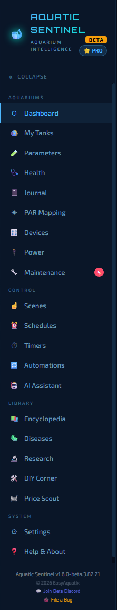
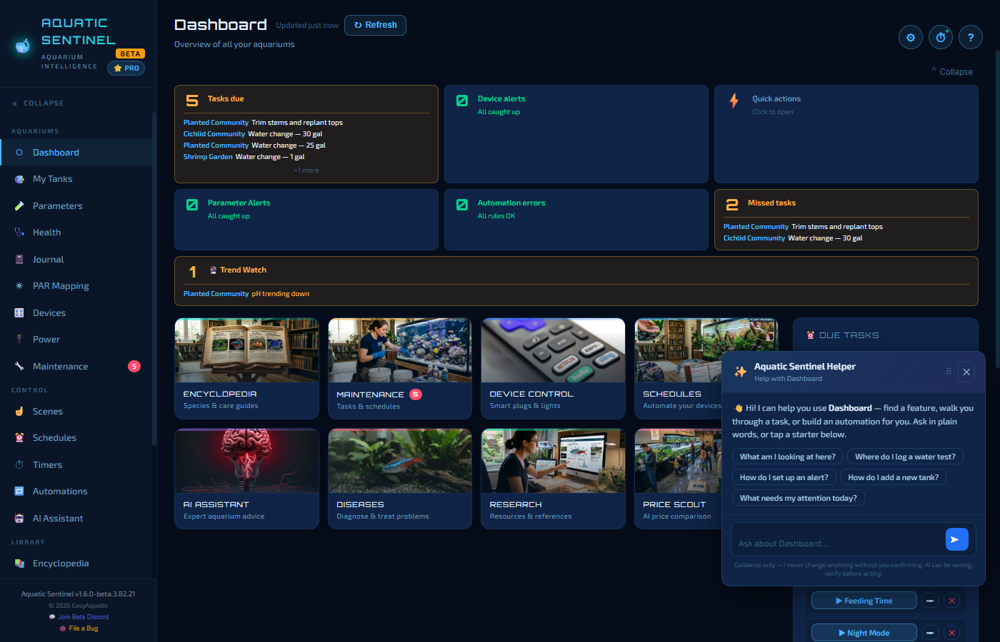
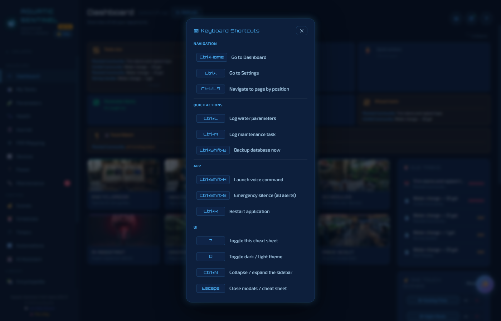

# 1. Getting started

This chapter takes you from download to your first tank, with a tour of the screen so you always know where you are.

**In this chapter:** [Install](#install-aquatic-sentinel) · [First launch](#first-launch) · [Finding your way around](#finding-your-way-around) · [Getting help](#getting-help-inside-the-app) · [Keyboard shortcuts](#keyboard-shortcuts)

---

## Install Aquatic Sentinel

Aquatic Sentinel runs on **Windows**, **Linux** and **Android**. Pick the one that suits the computer or phone you want to leave running — it is the one that does the work (schedules, alarms, device control). Everything else, including a Mac or an iPhone, can use it through a web browser.

All downloads are on the releases page: **<https://github.com/Aquaman-TSH/aquasentinel-releases/releases>**. The newest release is at the top.

> [!NOTE]
> Every Aquatic Sentinel release is published as a *prerelease* while we are in beta, so GitHub's "Latest release" badge is empty. Just use the newest entry on the list.

### Windows

1. Download **`AquaSentinel-Setup-<version>.exe`** from the newest release.
2. Run it. The first time, Windows SmartScreen may show **"Windows protected your PC"**. This appears because the installer isn't code-signed yet, not because of anything Windows found in the file. Click **More info**, then **Run anyway**.
3. Choose an install folder (the default is fine). The installer adds a desktop shortcut and a Start Menu entry.
4. Start **Aquatic Sentinel**.

Requirements: Windows 10 or 11 (64-bit), 4 GB of memory (8 GB recommended) and about 300 MB of disk space.

After the first install, **updates install themselves** — you will be asked to restart when one is ready, and your data is kept. **Help & About → Check for Updates** looks for one on demand.

### Linux

1. Download **`AquaSentinel-<version>-x86_64.AppImage`**.
2. Make it executable (right-click → **Properties** → **Allow executing file as program**, or `chmod +x` in a terminal) and double-click it.
3. Keep the file somewhere you own, such as `~/Applications` — the app updates itself by replacing that file.

It runs on 64-bit Intel/AMD systems with Ubuntu 22.04 or newer, and distributions built on it. Some desktops ask you to confirm the first run because the file isn't signed. See [Platform differences on Linux](18-settings.md#platform-notes) for what works differently (Wayland, keyrings, firewalls).

### Android

An old Android phone or tablet makes an excellent always-on tank controller. The whole app runs on the phone. See [chapter 17](17-android.md) for installation, setup and tips.

### Mac and iPhone

Aquatic Sentinel doesn't run as a server on these yet, but you can use it from a web browser on them while a Windows, Linux or Android copy is running — see [Remote access and your phone](16-remote-access.md).

---

## First launch

On the very first launch (when you have no tanks yet), a short **setup wizard** appears:

| Step | What you do |
|---|---|
| **Welcome** | Read what the app does. |
| **Your first tank** | Give it a name, choose a type (freshwater, saltwater, reef, planted or brackish) and enter its volume. |
| **Connect a device** | Optional. You can skip it — devices are added later from the **Devices** page. |
| **Quick tour** | A summary of the main pages. |
| **All done** | Shortcuts to your next steps, and a link to the short narrated video tour. |

After the wizard you will see a **beta welcome** message with the link to the Beta Discord.

> [!TIP]
> You can run the wizard again any time from **Settings → Subscription → Relaunch Setup Wizard**, and the video tour lives on the **Help & About** page ("New here? Watch the Getting Started tour").

### Everything is unlocked during the beta

The **BETA** and **PRO** badges at the top of the left menu mean exactly what they say: while Aquatic Sentinel is in beta, **all Pro features are unlocked for everyone**, free. That includes unlimited tanks and devices, automations, voice and the Power dashboard. The AI features are free on every plan — you bring your own key from a provider such as Google Gemini, which has a free tier ([chapter 13](13-ai.md)).

### Starts with your computer

An aquarium monitor only protects your tank while it is running, so by default Aquatic Sentinel **starts when you sign in** (Windows) and keeps going in the background. You can turn this off, or have it start minimised, in **Settings → System → Startup**.

### Where your data lives

Everything is stored **on your own computer** in a single database file — nothing is uploaded unless you switch on a service that needs the internet (the AI assistant, Tuya cloud control, weather, remote access). On Windows the file is `%APPDATA%\aquaticsentinel\aquaticsentinel.db`. See [Backup and your data](19-backup-and-data.md).

---

## Finding your way around

The **left menu** holds every page, in four groups:

| Group | Pages |
|---|---|
| **Aquariums** | Dashboard · My Tanks · Parameters · Health · Journal · PAR Mapping · Devices · Power · Maintenance |
| **Control** | Scenes · Schedules · Timers · Automations · AI Assistant |
| **Library** | Encyclopedia · Diseases · Research · DIY Corner · Price Scout |
| **System** | Settings · Help & About |

- A red number on **Maintenance** counts overdue tasks.
- **Collapse** (top of the menu, or **Ctrl+N**) shrinks the menu to an icon rail when you want the room.
- At the bottom you will find the version number, **Join Beta Discord**, and **File a Bug** ([chapter 20](20-troubleshooting.md#reporting-a-bug)).
- On a phone the menu is the **☰** button in the top-left corner.

The three round buttons at the top right of every page are:

| Button | What it does |
|---|---|
| ⚙ | Opens **Settings**. |
| ⏱ | Starts a **timer or alarm** quickly (**Ctrl+Shift+T**). |
| ? | Opens **help for the page you're on** — see below. |

If you are using the app through a phone or a remote link, a **🌐 REMOTE** badge appears there too, so you always know you are looking at the remote copy.

### Layout: Auto, Phone or Desktop

**Settings → Appearance → Layout** chooses between **Auto** (follows the size of the screen — the default), **Phone** and **Desktop**.

---

## Getting help inside the app

Aquatic Sentinel has four kinds of built-in help, from quickest to deepest:

1. **The ? button** on every page opens a side panel with tips written for that page.
2. **The ✨ Helper** is the glowing button in the corner of every page. Ask it in your own words — *"How do I log a water test?"*, *"Why is my device offline?"* — and it answers for the page you're on, points you to the right place, or drafts an automation for you to approve. Each page offers one-tap starter questions. It never changes anything without you confirming. You can drag it out of the way, and it remembers where you left it. (It uses your AI key — see [chapter 13](13-ai.md).)
3. **Help & About** (bottom of the left menu) describes every feature, answers common questions and lists known issues.
4. **The narrated video tour** — on the Help page and at the end of the setup wizard.

---

## Keyboard shortcuts

Press **?** anywhere (outside a text box) to see the cheat sheet.

| Shortcut | Action |
|---|---|
| **?** | Show or hide the cheat sheet |
| **D** | Switch between dark and light theme |
| **Ctrl+1 … Ctrl+9** | Go to a page by its position in the menu |
| **Ctrl+Home** | Dashboard |
| **Ctrl+,** | Settings |
| **Ctrl+L** | Log a water test |
| **Ctrl+M** | Add a maintenance task |
| **Ctrl+N** | Collapse or expand the left menu |
| **Ctrl+Shift+T** | New timer or alarm |
| **Ctrl+Shift+A** | Start a voice command |
| **Ctrl+Shift+S** | **Silence** all active alarms — works even when the app is minimised |
| **Ctrl+Shift+B** | Back up now |
| **Ctrl+R** | Restart the application |
| **Escape** | Close a dialog or panel |

> [!NOTE]
> Three shortcuts — **Ctrl+Shift+A**, **Ctrl+Shift+S** and **Ctrl+R** — are system-wide hotkeys, which some Linux desktops (those using *Wayland*) don't allow. Where that applies, the app hides them and shows an on-screen **Silence** button instead. All the others keep working.

---

← [Manual home](README.md) · **Next:** [2. The Dashboard](02-dashboard.md) →
