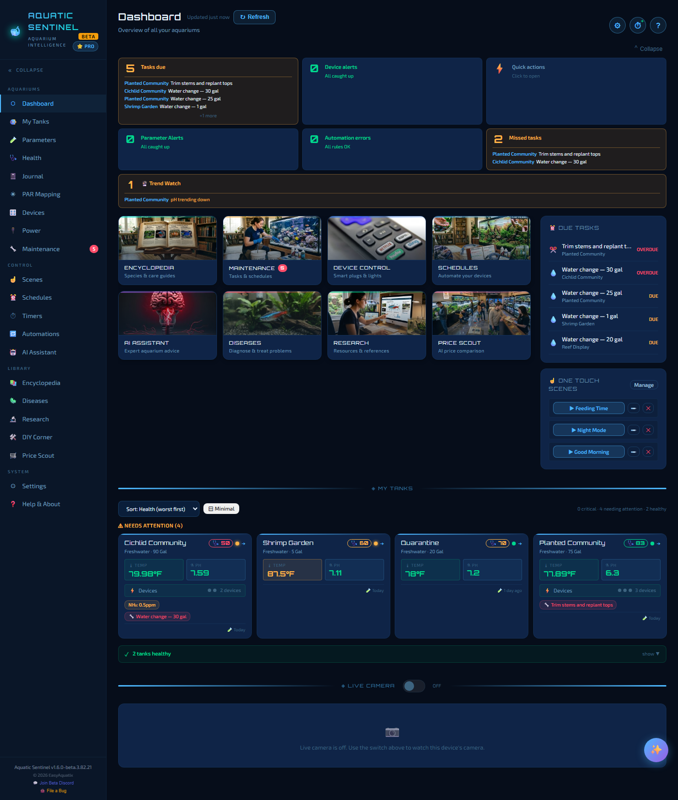
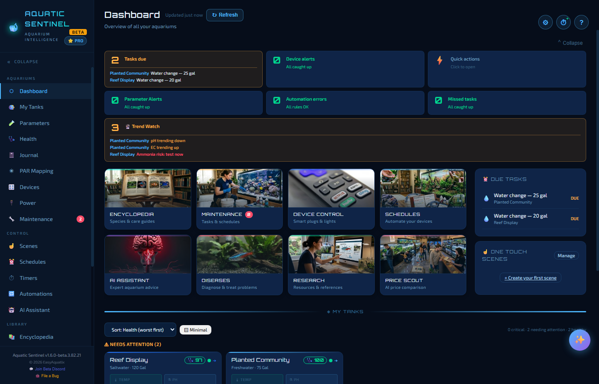

# 2. The Dashboard

The Dashboard is your home page: every tank, every alert and every task due, on one screen. Glance at it each morning and you will know whether anything needs you.

**In this chapter:** [The summary boxes](#the-summary-boxes) · [Trend Watch](#trend-watch) · [Due tasks and scenes](#due-tasks-and-one-touch-scenes) · [Tank cards](#tank-cards) · [Staying up to date](#staying-up-to-date) · [Live Camera](#live-camera)

---

## The summary boxes

Across the top is a row of boxes. Each one is calm and green when all is well and turns amber or red when something needs a look. Click a box to jump to the place that fixes it.

| Box | What it tells you |
|---|---|
| **Tasks due** | Maintenance tasks due now or soon, with the tank each belongs to. |
| **Device alerts** | Devices that have gone offline and sensors whose calibration is due. It turns amber when it is only calibration, red when something is offline. |
| **Quick actions** | A small menu of shortcuts: log water parameters, log maintenance, open the Encyclopedia, ask the AI, jump to My Tanks or Devices. |
| **Parameter alerts** | Any water reading currently outside its safe range. Click it to open the Parameters page. |
| **Automation errors** | Automation rules that failed the last time they ran. A rule that pauses because its sensor went quiet is named here too, so you know why it did nothing. |
| **Missed tasks** | Maintenance tasks past their due date. |
| **Trend Watch** | Early warnings drawn from the direction your readings are heading — see below. |

If a leak sensor detects water, a pulsing red banner appears across the top of the Dashboard and says what is alerting, and an on-screen **Silence** button appears on every page while an alarm is sounding. See [Devices → Leak sensors](09-devices.md#leak-sensors).

> [!TIP]
> Short on screen space? The **Collapse** link above the tiles tucks the summary boxes away; **Expand** brings them back.

---

## Trend Watch

Trend Watch is an early-warning box. It looks at the readings you and your sensors have logged and flags slow drifts that often come *before* a problem a test would show:

- **ORP falling** — the tank's oxidation level drifting downward.
- **pH sliding** — often alkalinity running out.
- **EC climbing** — often nitrate building up.
- **Ammonia risk** — a falling ORP compared with *that tank's own* normal over the past two months. See [Parameters → Ammonia risk](04-parameters.md#ammonia-risk-early-warning).

It is plain arithmetic on your own readings, so it needs no AI and no internet. Once it has warned you it offers to **ask the AI assistant** what to do next.

The same warnings appear on the **Parameters** page for the tank you're looking at.

---

## Due tasks and One Touch Scenes

On the right of the Dashboard:

- **Due Tasks** lists what is coming up or overdue — *OVERDUE* in red, *DUE* in amber — with the tank for each. Click a task to open the Maintenance page.
- **One Touch Scenes** has a button for each scene you've made. Press **▶ Feeding Time** and every device in that scene switches at once. Use **Manage** to add, edit or remove scenes — see [Scenes](11-scenes-schedules-timers.md#scenes).

Below the summary boxes there is also a grid of **shortcut tiles** — Encyclopedia, Maintenance (with its overdue badge), Device Control, Schedules, AI Assistant, Diseases, Research and Price Scout — as another way into those pages.

---

## Tank cards

Further down is **My Tanks**: one card per aquarium. Each card shows

- the tank's name and **health score** (a heart badge with a number from 0 to 100, coloured green, amber or red),
- the latest water readings,
- active alerts, which blink when something is out of range, and
- shortcuts into the tank.

Hover the health badge for a breakdown, and click a card to open the tank. How the score is worked out is explained in [My Tanks → Tank health](03-tanks.md#tank-health-score).

---

## Staying up to date

The Dashboard refreshes itself: tank cards (health, readings, alerts) every 30 seconds, and the automation and missed-task summary every minute. Battery sensors that sleep to save power can take up to five minutes to report a change — that is a deliberate choice so the app stays within the Tuya cloud's request limits, not a fault.

Don't want to wait? Press **Refresh** next to the page title. The label beside it says how long ago the page last updated.

---

## Live Camera

At the bottom of the Dashboard is a **Live Camera** card. Switch it on to see the camera of the device you are using — handy on a spare phone or tablet propped in front of the tank. It is **off until you turn it on**, and it remembers your choice on that device.

- A device with more than one camera shows a **Front / Rear** button on the video; the rear camera is used first.
- Out of the box the picture stays on your own screen — nothing is recorded or uploaded.
- Browsers only allow camera access on a secure connection. On the phone itself use `http://localhost:3480`, or use your remote-access `https://` link — not a plain `http://` address with an IP number.

### Share a phone's camera with remote viewers

On the phone that has the camera, switch on **Share with remote viewers** under the video. Anyone who opens that phone's Aquatic Sentinel through remote access then sees the picture under **Shared camera**. Choose **Fastest** (about 20 frames a second), **Balanced** or **Data saver**. The phone keeps its screen awake while it shares, so leave it on a charger. A red **Camera live** badge shows in every page while it is running. Turn the share switch off to stop it.

> [!IMPORTANT]
> Anyone who has your remote-access link can watch a shared camera while sharing is on. Share only when you need to, and keep the link private. Remote viewers can also start, stop and adjust the shared camera from their own phone — that is **off by default** and is switched on under **Settings → System → Camera** (see [Remote access](16-remote-access.md#the-tank-camera-over-remote-access)). Remote viewers only ever see the shared camera, never the camera of the computer they are connected to.

---

← [1. Getting started](01-getting-started.md) · [Manual home](README.md) · **Next:** [3. My Tanks](03-tanks.md) →
