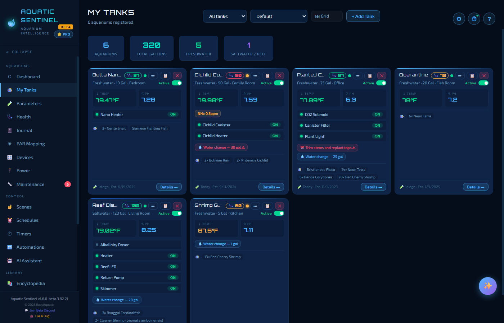
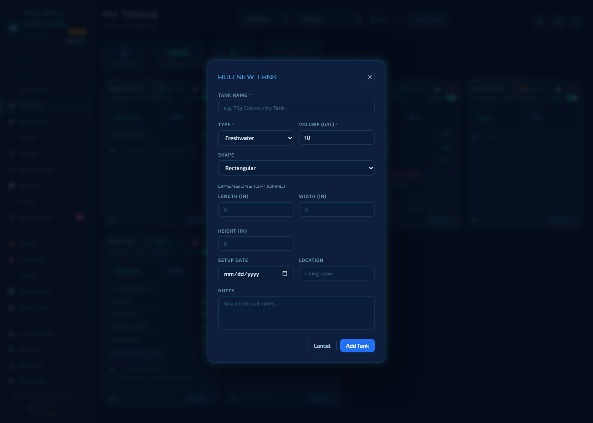
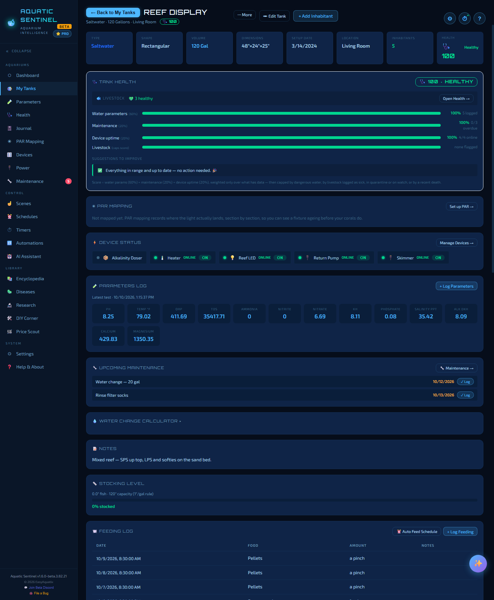
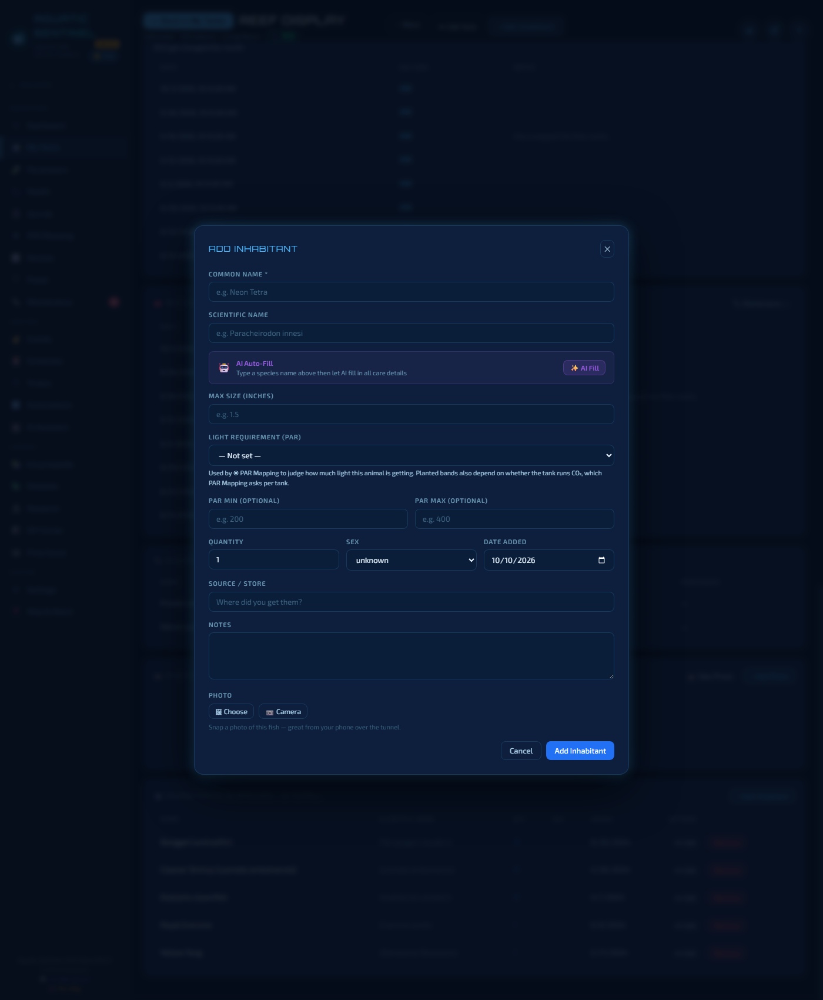
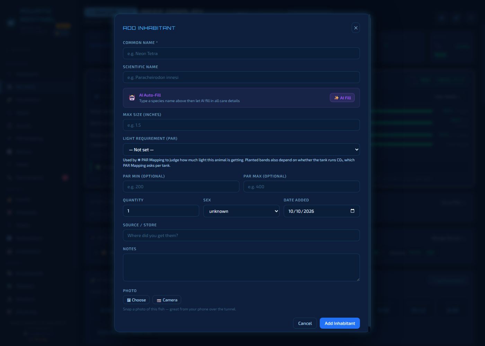

# 3. My Tanks

A **tank** is the heart of Aquatic Sentinel: your water tests, livestock, equipment, chores and devices all hang off it. You can keep as many tanks as you like — freshwater, saltwater, reef, planted or brackish — each with its own safe ranges.

**In this chapter:** [The tank list](#the-tank-list) · [Adding a tank](#adding-a-tank) · [The tank page](#the-tank-page) · [Tank health score](#tank-health-score) · [Inhabitants](#inhabitants) · [Calculators](#calculators) · [Export, duplicate and retire](#export-duplicate-and-retire-a-tank)

---

## The tank list

The **My Tanks** page shows a tile for each aquarium and a strip of totals at the top (number of tanks, total gallons, freshwater count, saltwater/reef count).

Each tank tile shows:

- the **name**, a **♥ health score**, and an *Active* switch,
- type, size and location, plus the latest temperature and pH,
- the tank's **devices** with their on/off state,
- the next **chores** (overdue ones in red), and
- a chip for each kind of inhabitant.

Use the controls along the top to **filter** (active or inactive tanks), **sort**, and switch between a **Grid** and a list. Click **Details →** on a tile to open the tank.

Tank types are tinted differently — freshwater, saltwater and brackish look different at a glance.

---

## Adding a tank

Click **+ Add Tank**.

| Field | Notes |
|---|---|
| **Tank name** *(required)* | Something descriptive, like *75g Reef Display*. |
| **Type** *(required)* | Freshwater, saltwater, reef, planted or brackish. The type decides the *safe ranges* the tank is judged against (see [Settings → Water](18-settings.md#water)). |
| **Volume (gal)** *(required)* | Unlocks the stocking and water-change calculators. |
| **Shape** | Rectangular and others. |
| **Dimensions** *(optional)* | Length, width, height in inches. PAR Mapping uses the footprint to lay out its grid. |
| **Setup date** | Lets the app work out how long the tank has been running. |
| **Location** | *Living room*, *Office*… |
| **Notes** | Anything you want to remember. |

> [!NOTE]
> A new tank starts with **alert rules** already in place, seeded from the safe ranges in **Settings → Water** — including any you have changed.

---

## The tank page

Click a tank to open its page — everything about one aquarium, top to bottom.

At the top are the **Back to My Tanks** button and the actions **⋯ More** (Export, Duplicate), **Edit Tank**, and **+ Add Inhabitant**. Under the title is a row of facts — type, shape, volume, dimensions, setup date, location, number of inhabitants — and the tank's health tile.

Scrolling down you will find these sections:

| Section | What it is for |
|---|---|
| **Tank Health** | The 0–100 score, how it is made up, and a list of suggestions. |
| **PAR Mapping** | A summary of your light map for this tank, with a button to open [PAR Mapping](08-par-mapping.md). |
| **Device Status** | Every device on the tank, online or offline, on or off. **Manage Devices →** opens the Devices page. |
| **Parameters Log** | The latest water test, and **+ Log Parameters** to add another. |
| **Active Alerts** | Readings out of range right now. **Click an alert** for what it means, what to do, and a button that opens the AI assistant with the question already typed in (it isn't sent until you send it). |
| **Upcoming Maintenance** | The next chores, each with a **✓ Log** button. |
| **Water Change Calculator** | Click the heading to open it (see below). |
| **Notes** | Your free-text notes for the tank. |
| **Stocking Level** | How full the tank is by the "1 inch of fish per gallon" rule. |
| **Feeding Log** | What and when you fed. **+ Log Feeding**, or **Auto Feed Schedule** to feed on a timetable. |
| **Medication Log** | Treatments you've added. **+ Log Medication**. |
| **Water Changes** | Volumes changed. **+ Log Change**. |
| **Recent Maintenance** | A history of finished chores. |
| **Equipment** | Filters, heaters, lights and so on, with name, type and brand. |
| **Inhabitants** | Everything living in the tank. |
| **Photo Gallery** | Pictures of the tank over time — add them from a file or straight from a camera, including a phone over remote access. |

---

## Tank health score

Every tank carries a single number from 0 to 100. It is **holistic**: a tank with perfect water can still score low because chores are overdue or a filter is offline.

| Part | Weight | What it measures |
|---|---|---|
| **Water parameters** | 60% | Your latest temperature, pH, ammonia, nitrite and nitrate against the tank's safe ranges. |
| **Maintenance** | 20% | How many tasks are overdue. |
| **Device uptime** | 20% | How many of the tank's devices are online. |
| **Dangerous readings** | caps the score | A reading far enough out of range to threaten the animals — ammonia or nitrite well above safe, or a temperature far off — puts a ceiling on the score however good everything else is. The worse the reading, the lower the ceiling. |
| **Livestock** | caps the score | A tank cannot score above a ceiling if livestock is logged as sick, in quarantine or on watch, or if there has been a death in the last 14 days. |

Parts with no data are skipped and the others carry the weight. Bands: **80+ Healthy** (green), **55–79 Watch** (amber), **under 55 Critical** (red).

The **Tank Health** section lists each part as a bar, and below the bars a **How to improve it** list tells you in plain words what is holding the score down — for example *"Ammonia is high at 0.5 ppm — do a partial water change now, check the biofilter, and cut back on feeding."* Work through the list and the score recovers.

> [!TIP]
> **Open Health →** jumps to the [Health page](05-health.md) for this tank, where the animals themselves are tracked.

---

## Inhabitants

Click **+ Add Inhabitant** to add fish, invertebrates, corals or plants.

- **Common name** is the only required field. Type a name and use **AI Auto-Fill** to have your AI provider fill in the scientific name, adult size and care details (needs an [AI key](13-ai.md)).
- **Link to the Encyclopedia.** Choosing a species from the built-in Encyclopedia fills in its care details and — importantly — lets the app judge your water against *that species'* ideal ranges on the [Health page](05-health.md).
- **Max size** feeds the stocking calculator.
- **Light requirement (PAR)** is a category, or an exact **PAR min / max**, that [PAR Mapping](08-par-mapping.md) uses to say whether a coral or plant is getting enough light. An exact range here overrides everything else.
- **Quantity, sex, date added, source / store and notes** keep the record complete.
- **Photo** — **Choose** a file or use the **Camera** (great from a phone over the tunnel).

Click an inhabitant to edit it or to open its health record.

---

## Calculators

**Stocking Level** shows how stocked the tank is against the old "1 inch of fish per gallon" rule: green is comfortable, amber means you are nearing the limit, red means overstocked. It uses each inhabitant's *max size*, so fill that in for a true picture.

**Water Change Calculator** uses dilution maths. Enter a current reading and the level you want, and it tells you what percentage of the tank to change. It works for nitrate, ammonia, nitrite and phosphate.

---

## Export, duplicate and retire a tank

- **⋯ More → ⬇ Export** saves the tank's data. Choose **CSV** (spreadsheet-friendly — one file per kind of record) or **JSON** (one file, best for backup), and a period: the last 7 days, 30 days or everything.
- **⋯ More → 📋 Duplicate** makes a copy with an automatic new name, ready to rename — handy for a second tank set up like the first.
- **Edit Tank** changes any detail. Switching a tank's **Active** switch off (on its tile, or in Edit Tank) **retires** it: it fades out of the main lists but stays reachable through the **Inactive only** filter, with all its history intact.

---

← [2. The Dashboard](02-dashboard.md) · [Manual home](README.md) · **Next:** [4. Water parameters](04-parameters.md) →
