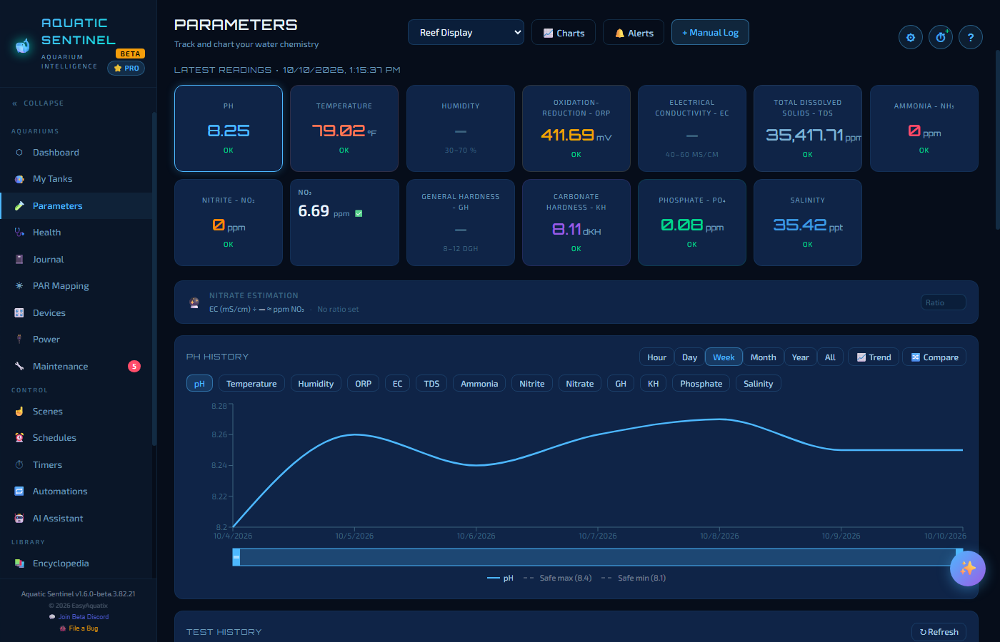
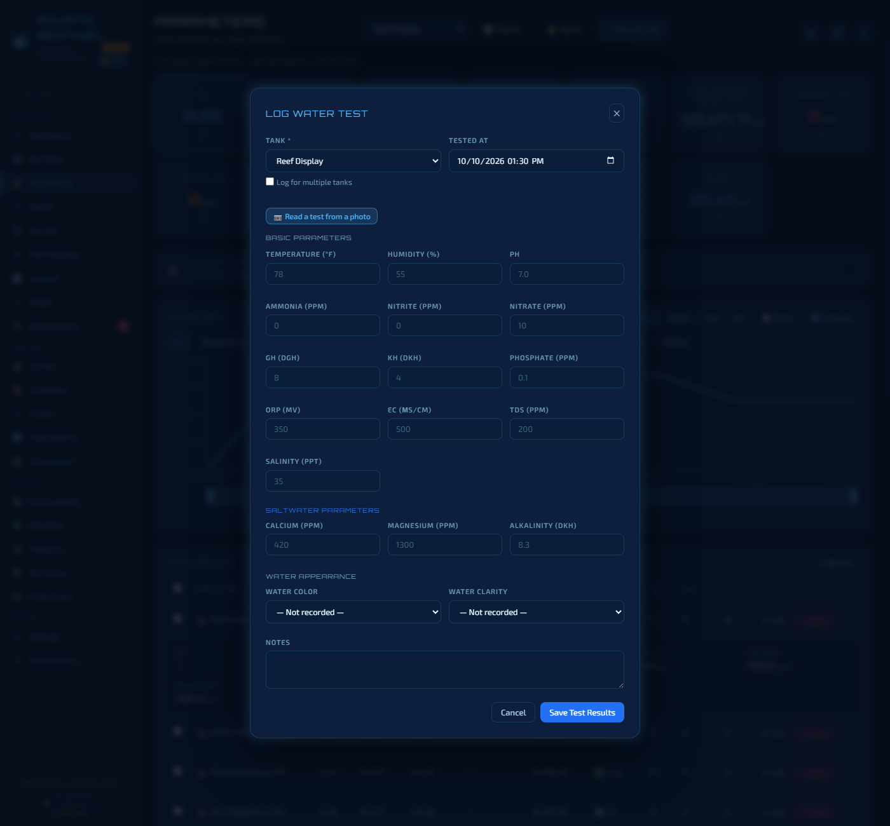
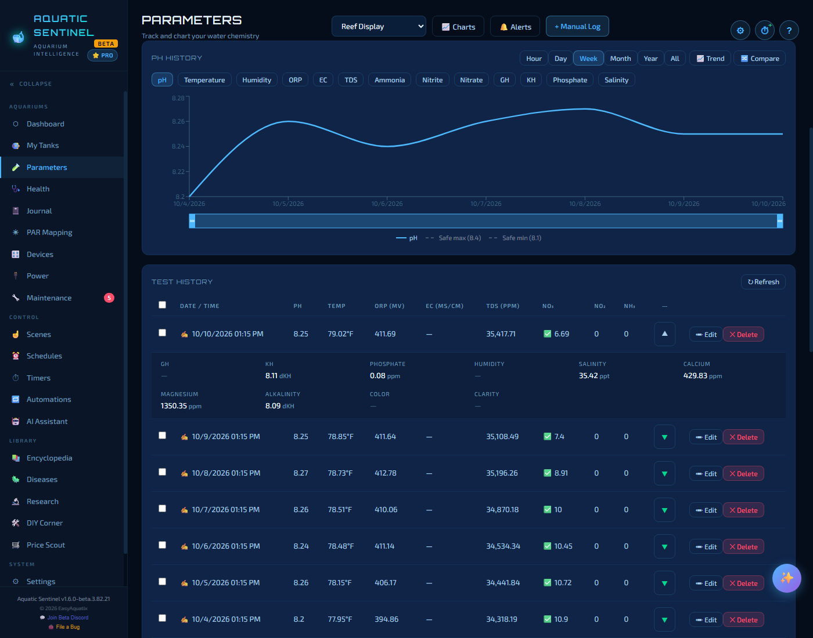
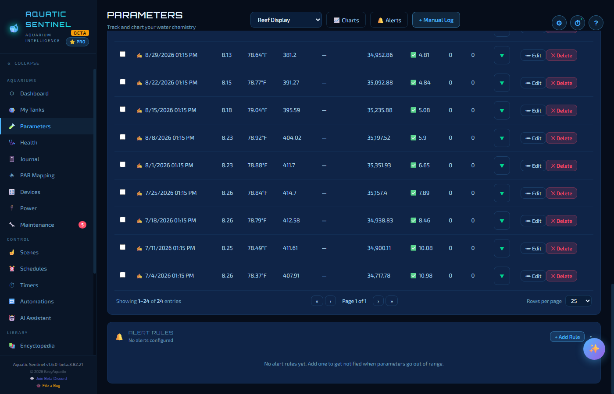
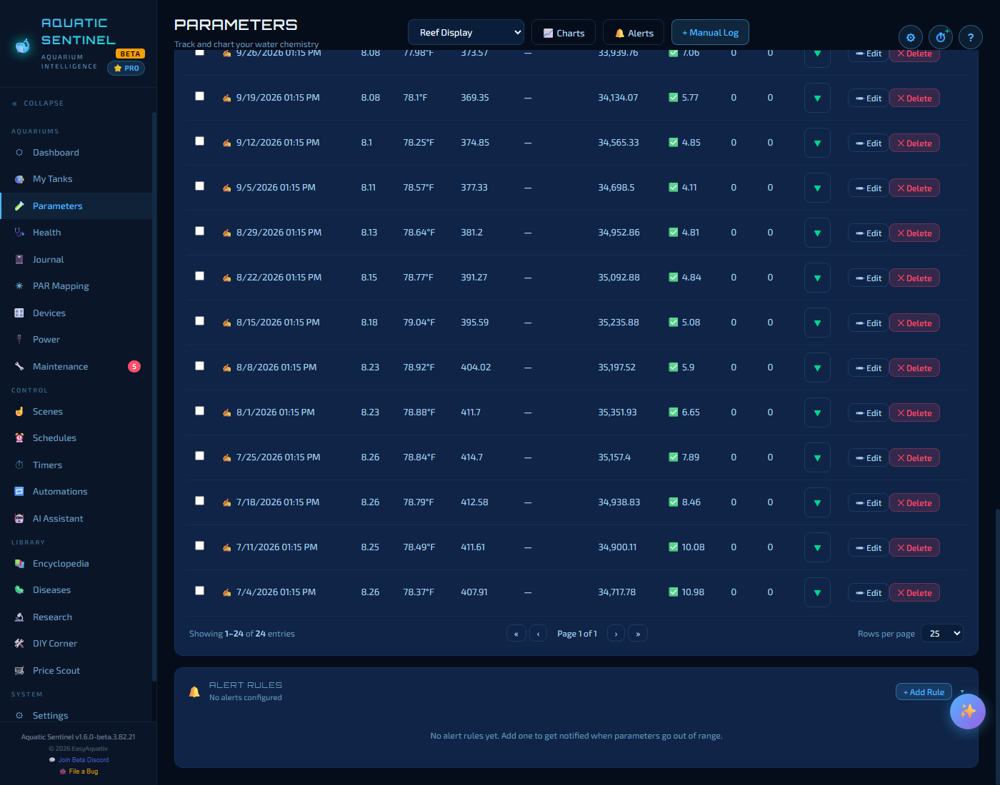
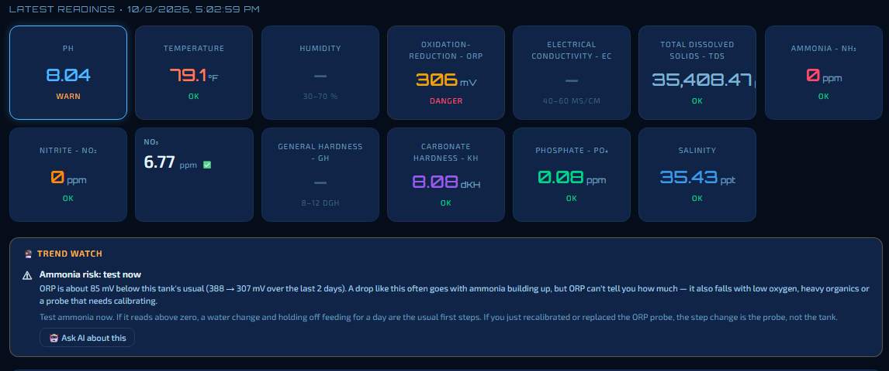

# 4. Water parameters

The Parameters page is where your tank's chemistry lives: log a test, see every reading at a glance, watch the trend over time, and set alerts for when something drifts out of range.

**In this chapter:** [The page at a glance](#the-page-at-a-glance) · [Logging a test](#logging-a-test) · [Reading the charts](#reading-the-charts) · [Test history](#test-history) · [Alert rules](#alert-rules) · [Nitrate estimate](#nitrate-estimate) · [Trend Watch](#trend-watch) · [Ammonia risk](#ammonia-risk-early-warning) · [Readings that log themselves](#readings-that-log-themselves)

---

## The page at a glance

Pick a tank from the menu at the top. Beside it are three buttons:

| Button | What it does |
|---|---|
| **Charts** | Scrolls to the history chart. |
| **Alerts** | Scrolls to the alert rules at the bottom of the page. |
| **+ Manual Log** | Opens the *Log water test* form. |

With **no tank selected** the page shows **Today's Latest Log per Tank** instead — each tank's most recent log from today, newest first — which answers *"which tank did I test last?"* when you're working through several with a liquid test kit.

### Latest readings

The tiles under the title show the most recent value of each parameter. Each is coloured by whether it sits in the safe range for the tank's type — green is in range, amber and red mean it needs attention — with an **OK** or warning word beneath. Tap a tile to chart that parameter.

If a monitor logged temperature, pH or EC *after* you tested ammonia by hand, the ammonia tile still shows **your** reading, with how long ago it was measured, rather than going blank. Every tile shows the latest known value of its own parameter.

---

## Logging a test

Click **+ Manual Log** (or press **Ctrl+L** anywhere in the app).

Fill in only what you tested — every parameter is optional, and a blank water test can't be saved by accident.

| Section | Parameters |
|---|---|
| **Basic parameters** | Temperature (°F), humidity, pH, ammonia, nitrite, nitrate, GH, KH, phosphate, ORP (mV), EC (mS/cm), TDS (ppm), salinity (ppt) |
| **Saltwater parameters** | Calcium, magnesium and alkalinity (dKH) — shown for saltwater, reef and brackish tanks |
| **Water appearance** | Water colour and clarity |
| **Notes** | Anything worth remembering |

Other things the form offers:

- **Tested at** defaults to now. Change it to backdate a test you forgot to log.
- **Log for multiple tanks** lets you enter one set of readings and save it to several tanks at once — ideal for a fish room.
- **Read a test from a photo** — photograph a liquid test vial (API or Salifert) and the AI reads the colour against the kit's chart. You confirm or edit the value before it is saved, and a thumbnail of the vial is kept with the reading. Drop-count titration kits (GH, KH, reef calcium, magnesium and alkalinity) can't be read from a photo, so those are flagged for manual entry and the photo is kept for the record. It works on the desktop and on your phone, and needs a [photo-capable AI](13-ai.md).
- **By voice:** *"Log pH 8.1, ammonia 0, nitrite 0 for the reef tank."* See [Voice](14-voice.md).

> [!TIP]
> Salinity can be logged on a freshwater tank too, and a note-only entry is fine — it won't blank the Dashboard card.

---

## Reading the charts

- **Pick a parameter** with the chips above the chart — pH, temperature, humidity, ORP, EC, TDS, ammonia, nitrite, nitrate, GH, KH, phosphate, salinity.
- **Pick how far back** with **Hour · Day · Week · Month · Year · All**. Year and All are averaged to one point per day so a long history stays readable.
- **Safe-range lines** are drawn on the chart (*Safe min* and *Safe max*), taken from your tank type's range.
- **Zoom** by dragging the handles on the strip under the chart — it works with a finger too. **⤢ Reset zoom** appears beside the title to go back.
- **Trend** switches on a trend line with a short forward projection (the tooltip calls it a *30-day* projection; on shorter views like Day or Week it looks ahead by a shorter span). It only draws the forward projection when the data show a clear direction, so a noisy chart doesn't produce a misleading arrow.
- **Compare** overlays the same parameter from several tanks on one chart.

---

## Test history

Under the chart, the **Test history** table lists every entry, newest first.

- Click the arrow at the end of a row to **expand** it and see the rest of that test (GH, KH, phosphate, salinity, calcium, water colour and so on).
- **Edit** fixes a typo or changes the time; **Delete** removes the entry. Tick the boxes to select several rows. Edited tests jump to the top of *Today's Latest Log per Tank*.
- The table pages through long histories (25 rows a page by default).

---

## Alert rules

At the bottom of the page, **Alert rules** are how Aquatic Sentinel tells you a reading has gone out of range.

Press **+ Add Rule** and choose:

- the **parameter**,
- whether the rule fires **above** or **below** a value, and the value,
- the **severity** — Warning or Critical, and
- which **tank** it applies to, or all of them.

When a reading breaks a rule the alert **blinks on that tank's card** on the Dashboard and My Tanks, appears in the **Parameter alerts** box on the Dashboard, and can speak or sound an alarm (see [Settings → Alerts](18-settings.md#alerts)).

**Click an alert** — on a tank page or in the Dashboard — to see *what the reading means, what to do about it*, and a button that opens the AI assistant with the question already filled in (it isn't sent until you send it).

> [!NOTE]
> A brand-new tank starts with alert rules already in place, seeded from the safe ranges in **Settings → Water**. Change the ranges there and every tank of that type follows. The default ranges are listed in the [Reference](21-reference.md#default-safe-ranges).

---

## Nitrate estimate

Nitrate is the reading most people test least often, and the one that creeps up. If you have an **EC (conductivity)** probe, Aquatic Sentinel can estimate nitrate between your tests from a ratio: *EC ÷ ratio ≈ nitrate*. It is marked clearly as an estimate.

- On a **freshwater** tank, press **Suggest** and the app works a ratio out from your own paired EC and nitrate tests.
- On a **saltwater** tank salt swamps the signal, so the app will not work a ratio out for you. Type a ratio of your own and the estimate switches on, marked as *yours*.
- If the ratio you've typed disagrees with your paired tests by a factor of two or more, you're told, and can press **Suggest** to use theirs or keep yours.

> [!IMPORTANT]
> The estimate is a rough cross-check, not a measurement. **Test nitrate directly** before you act on it.

---

## Trend Watch

On the Parameters page, **Trend Watch** appears for the tank you're viewing (and on the [Dashboard](02-dashboard.md#trend-watch) for all tanks). It spots slow drifts that tend to come before a problem:

- **ORP falling**
- **pH sliding** — often alkalinity running out
- **EC climbing** — often nitrate building

It is plain arithmetic on your own readings — no AI, no internet — and after it has warned you it offers to **ask the AI assistant** what to do next.

---

## Ammonia risk: early warning

Ammonia is the one thing you can't afford to find out about late. Most of us only learn it has risen when a test says so, or when a fish dies. Aquatic Sentinel now watches for it **between tests**.

**It has already caught a real one.** On one of our own tanks the warning came up, the ammonia had indeed risen, and the message told us exactly what to check without sending us anywhere to look it up.

**How it works.** It watches your **ORP probe**. A falling ORP often goes with ammonia building up, so the app compares ORP with *that tank's own* normal over the past two months — a reef sits around 350 mV and a planted tank nearer 200, so only a departure from *your* tank's usual means anything — with the effect of pH taken out. It stays quiet until it has a few days of ORP history to compare against.

**Two levels, in plain words.**

| Level | What it means | What to do |
|---|---|---|
| **Ammonia risk: watch** | A drop worth keeping an eye on. | Test ammonia today, and check for overfeeding, a dead or dying inhabitant, or an overdue water change. |
| **Ammonia risk: test now** | A large drop — or a modest drop backed up by a second sign: pH falling, EC rising, ORP sliding for several days, or a death logged in the last week. | Test ammonia **now**. If it reads above zero, a water change and holding off feeding for a day are the usual first steps. |

**It shows you how big the change is** — for example *"ORP is about 60 mV below this tank's usual"*, with the before and after readings — so you can judge it yourself.

**Getting the most from it:**

- **Test when it says test.** ORP can't measure ammonia — it also falls with low oxygen, heavy waste or a probe that needs calibrating — so the warning never gives you a number of ppm. It tells you to *test*, and your test kit gives you the answer.
- **Calibrate your probe, and say so.** If you just recalibrated or replaced the ORP probe, the step change is the probe, not the tank — and the message says that too.
- **Keep logging.** It works from a tank with an **ORP reading logged** to Aquatic Sentinel — from a water-quality monitor or a pen — and the more days of history it has, the better it knows your tank's normal. Log deaths in the [Health](05-health.md) page; a recent loss is one of the signs it looks for.
- **Keep your regular tests going.** ORP can stay flat through some spikes, so treat this as the tap on the shoulder, not a replacement for the test kit.

---

## Readings that log themselves

You don't have to type everything. Water-quality monitors, pens and probes — Tuya water-quality meters, the BLE-C600, a Zigbee probe, ESPHome sensors, a Hydros controller — **log their readings straight into a tank** of your choosing, in the background, even when the Devices page is closed. Pick which tank a device logs to on its card or in its detail panel. See [Devices](09-devices.md#sensors-and-probes).

---

← [3. My Tanks](03-tanks.md) · [Manual home](README.md) · **Next:** [5. Health](05-health.md) →
