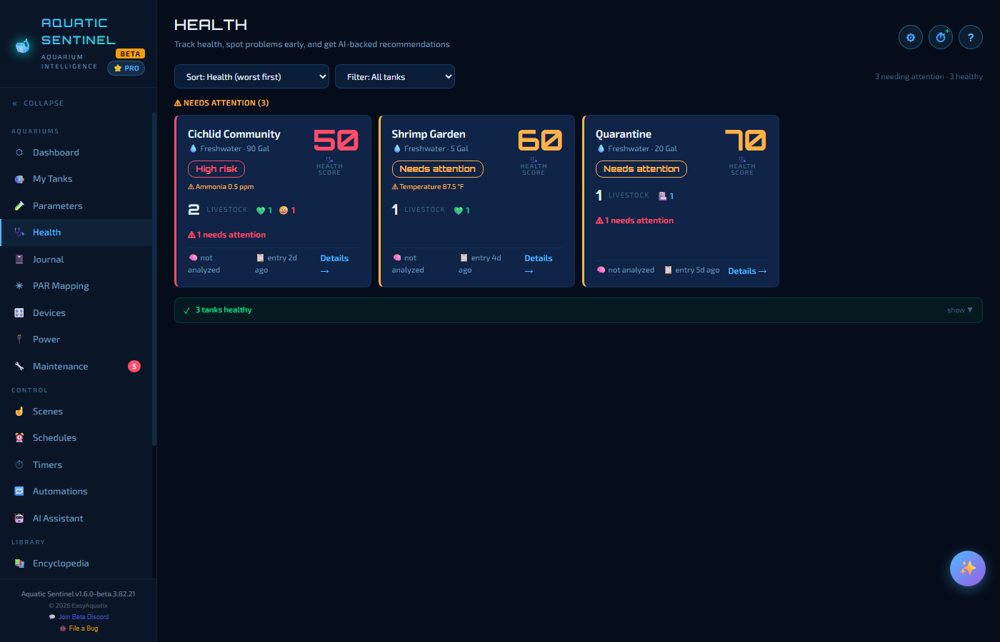
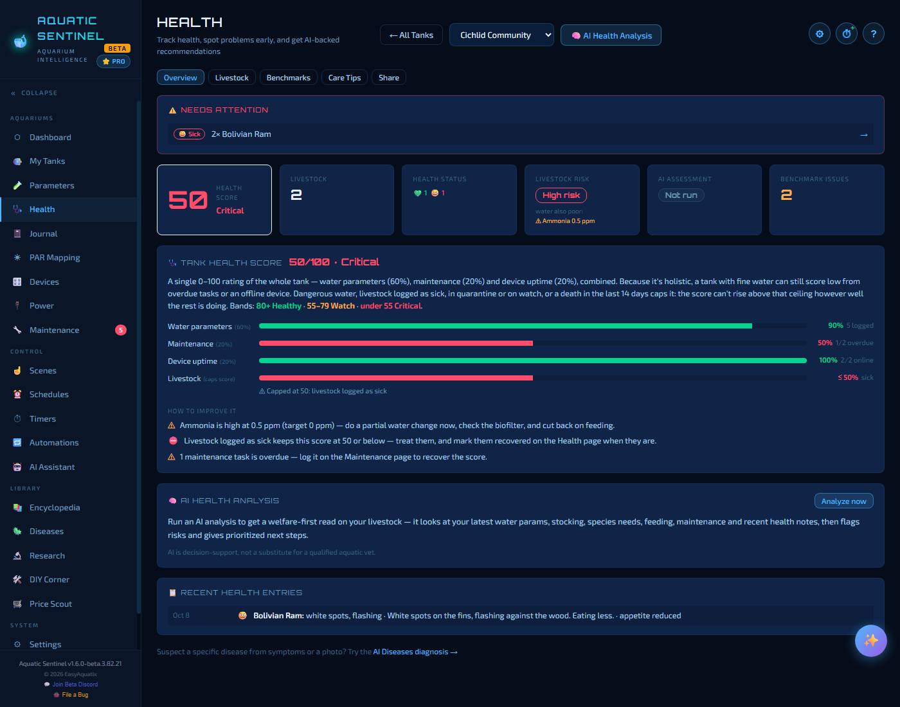
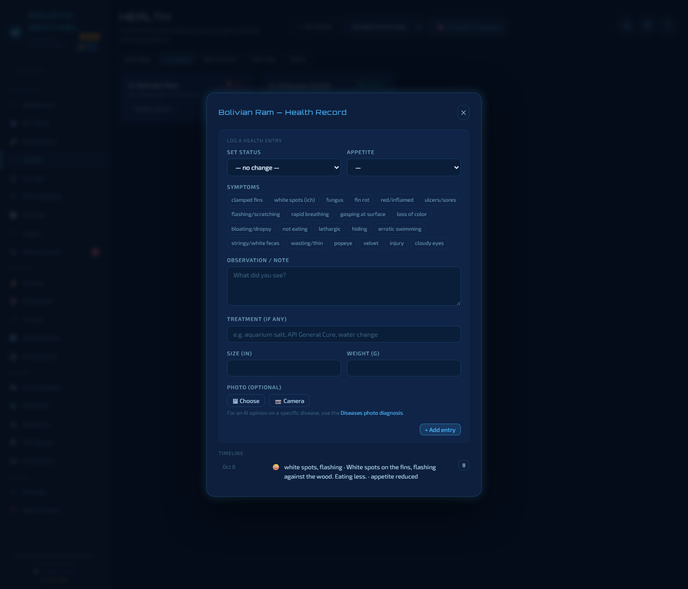
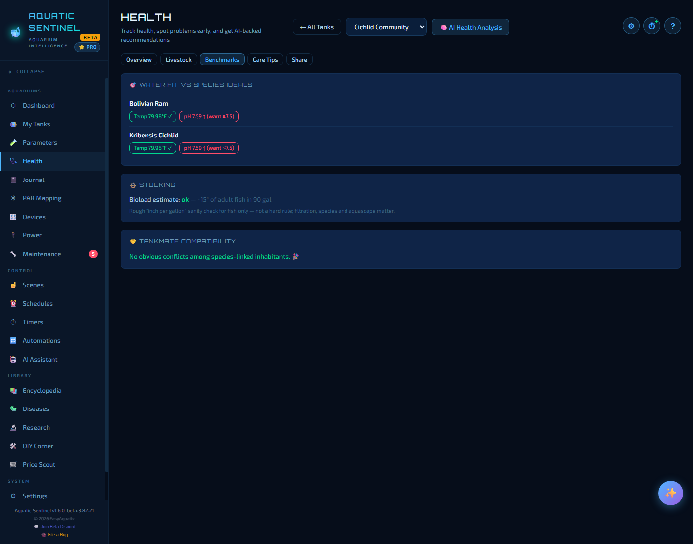
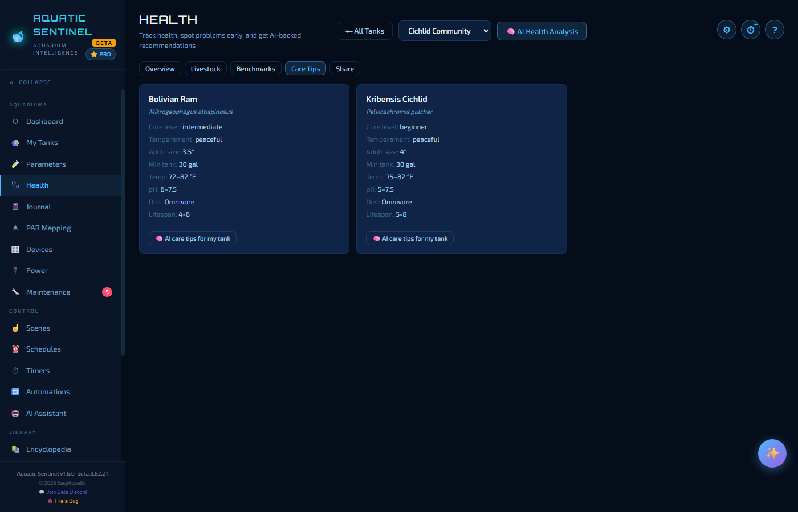
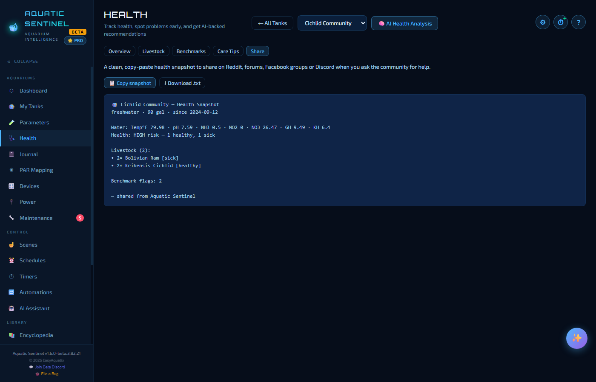

# 5. Health

Water chemistry tells you about the tank. The **Health** page is about the **animals in it**: a health record for every inhabitant, a rollup for each tank, and an AI second opinion when you want one.

**In this chapter:** [The tank grid](#the-tank-grid) · [A tank's health view](#a-tanks-health-view) · [Logging a health record](#logging-a-health-record) · [Benchmarks](#benchmarks) · [Care tips](#care-tips) · [Share](#share) · [AI health analysis](#ai-health-analysis) · [Three verdicts](#three-verdicts-kept-separate)

---

## The tank grid

The page opens on one tile per tank. Each tile shows:

- the tank's **health score** (0–100) and a **risk badge** — *High risk*, *Needs attention* or *Low risk*,
- the **livestock count** with a breakdown of statuses (healthy, sick, in quarantine…),
- the most pressing reading, if any (for example *Ammonia 0.5 ppm*), and
- how fresh your information is — *entry 2d ago*, or *not analyzed* if you've never run an AI analysis.

Tanks that need attention are grouped at the top, sorted worst first; healthy tanks are tucked into a collapsible *"N tanks healthy"* strip. Use **Sort** and **Filter** at the top to reorder, or to reach a retired tank through the *Inactive* filter. Click a tile (or **Details →**) to open that tank; **← All Tanks** brings you back.

---

## A tank's health view

Five tabs cover everything about one tank:

| Tab | What it's for |
|---|---|
| **Overview** | Who needs attention, the key numbers, the score breakdown and recent entries. |
| **Livestock** | A card for each inhabitant — open its health record. |
| **Benchmarks** | How the tank measures up to each species' needs. |
| **Care Tips** | A care sheet for every inhabitant. |
| **Share** | A text snapshot to paste when you ask for help. |

The **Overview** shows, from the top:

- **Needs attention** — any inhabitant logged as sick, in quarantine or on watch.
- **The key numbers** — the health score, how many animals, the status breakdown, **Livestock risk**, the **AI assessment** (or *Not run*), and the number of benchmark issues.
- **Tank health score** — the same 0–100 score as on the tank page, broken into water parameters, maintenance, device uptime and livestock, with a *How to improve it* list in plain words.
- **AI Health Analysis** — press **Analyze now** (see below).
- **Recent health entries** — the latest records, with a link to the **AI Diseases diagnosis** if you suspect a specific problem.

---

## Logging a health record

On the **Livestock** tab each inhabitant has a card with a status pill — *Healthy*, *Watch*, *Sick*, *Quarantine*, *Recovered* or *Deceased*. Press **Health record →**.

| Field | Use it to… |
|---|---|
| **Set status** | Change the animal's status. *— no change —* just adds a note. |
| **Appetite** | Record how well it is eating. |
| **Symptoms** | Tap tags for what you see — white spots, flashing or scratching, clamped fins, fin rot, gasping at the surface, not eating, lethargic, hiding, popeye, cloudy eyes and more. |
| **Observation / note** | Describe it in your own words. |
| **Treatment** | What you did — aquarium salt, a medication, a water change. |
| **Size and weight** | Track growth, or a slow decline. |
| **Photo** | Attach a picture (**Choose** a file or use the **Camera**). For an AI opinion on a specific disease, use the [Diseases](15-library.md#diseases) photo diagnosis. |

Press **Add entry** and it joins the **timeline** at the bottom of the same window. That timeline is what makes a problem that comes back weeks later easy to diagnose.

For a group — say 19 neon tetras — you can record that **only some are affected** ("3 of 19 are sick") rather than marking the whole group.

> [!TIP]
> When the problem is over, set the status to **Recovered** (or **Deceased**) so the tank score and risk badge reflect reality. A recent death lowers the tank score and raises its risk badge for the next two weeks, so a loss never slips by unnoticed.

---

## Benchmarks

**Benchmarks** compares your tank with what each species needs. For every inhabitant linked to a species in the [Encyclopedia](15-library.md#encyclopedia):

- **Water fit vs species ideals** — your latest temperature, pH and other readings against that species' ideal range, as green ticks and amber or red flags (for example *pH 7.59 ↑, want 6–7.5*).
- **Stocking** — a rough bioload estimate: *"about 15" of adult fish in 90 gal"*. It is an inch-per-gallon sanity check, not a substitute for good filtration.
- **Tankmate compatibility** — species that may not get along, if any.

> [!TIP]
> Benchmarks only work for inhabitants linked to a species. When you add an inhabitant, choose it from the Encyclopedia list (or, for an animal that isn't in the Encyclopedia, build a care guide with the AI button on the Care Tips tab and save it) and it will be benchmarked automatically.

---

## Care tips

**Care Tips** gives every inhabitant a care sheet: care level, temperament, adult size, minimum tank, temperature, pH, diet and lifespan. Species in your Encyclopedia use their own sheet. Anything that isn't in the Encyclopedia gets a button that builds a care sheet on the spot with the AI, and every sheet has an **AI care tips for my tank** button for advice specific to your setup — and you can save it to the Encyclopedia and link the inhabitant with one click, which also unlocks Benchmarks for it.

---

## Share

**Share** builds a clean text snapshot of the tank's health — water, livestock and any benchmark flags — to paste into a forum, a Facebook group, Reddit or Discord when you ask the community for help. **Copy snapshot** puts it on the clipboard; **Download .txt** saves it as a file.

---

## AI health analysis

The **AI Health Analysis** button runs a welfare-first review of the whole tank. It reads the tank's type and size, the latest parameters, the stocking and species needs, feeding, maintenance and your recent health notes, then returns an overall assessment with a risk level, environmental flags, notes for each species, a **prioritised action list** and things to watch for. The report is saved, so reopening the tank shows the last analysis without spending another AI call. It needs an [AI key](13-ai.md).

> [!NOTE]
> The AI is decision support, not a veterinarian. It flags risks and suggests actions — you stay in charge.

---

## Three verdicts, kept separate

You'll see three different "how is it doing?" answers. They are deliberately separate:

| Verdict | Judges | Based on |
|---|---|---|
| **Health score** | the **tank** | Water, maintenance and device uptime — capped when livestock is sick, in quarantine or on watch, or has died in the last 14 days. |
| **Livestock risk** | the **animals** | The health statuses you've logged, *plus* any water reading that is itself dangerous to them. |
| **AI assessment** | the **whole picture** | Your most recent AI analysis. |

Livestock risk turns red on bad water **even when every fish is still marked healthy**, and names the readings underneath — ammonia first, then nitrite. Fish don't wait to be logged as sick, so the water counts as a risk to them the moment you test it.

---

← [4. Water parameters](04-parameters.md) · [Manual home](README.md) · **Next:** [6. Journal](06-journal.md) →
