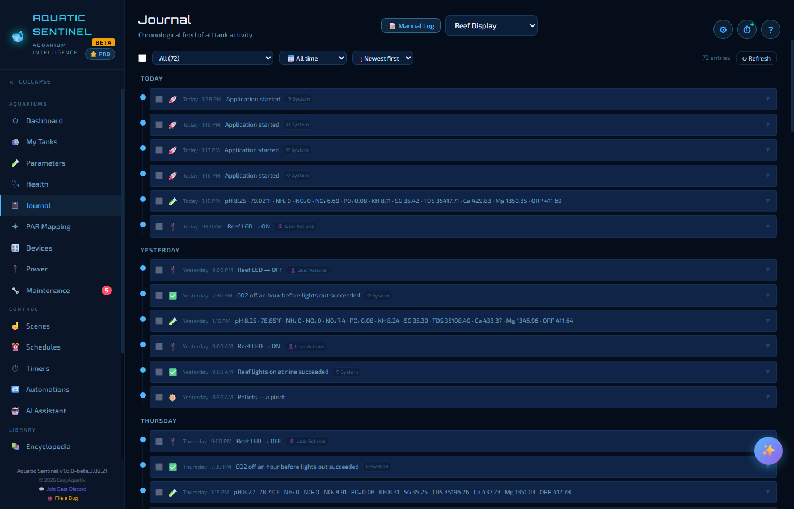
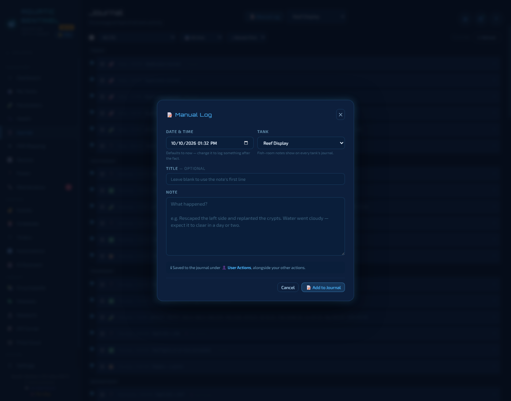

# 6. Journal

The Journal is your tank's diary, written for you. Every water test, chore, feeding, treatment and notable event lands in one timeline, newest first, grouped by day — so when something goes wrong you can scroll back and see exactly what changed.

**In this chapter:** [Reading the timeline](#reading-the-timeline) · [Filtering](#filtering) · [Adding a note](#adding-a-note) · [Editing and deleting](#editing-and-deleting)

---

## Reading the timeline

Pick a tank from the menu at the top. The timeline then merges, for that tank:

- **Water tests** — the readings you or a sensor logged
- **Maintenance** — chores you completed
- **Feeding** and **medication / treatment** entries
- **Events** — things the app recorded for you: devices switched on or off, automations that ran, scenes you ran, backups, and alerts

Each entry has an icon and a time; click it to expand the details. Events carry a small badge that says where they came from:

| Badge | Meaning |
|---|---|
| **⚙ System** | Things the app did — it started, a backup ran, an automation rule succeeded. |
| **👤 User Actions** | Things you did — switched a device, ran a scene, wrote a note. |
| **🚨 Alerts** | Things that need attention — a leak detected, a battery running low, a device that went offline, a network outage. |

**Alerts are shown in red** so they stand out when you scroll, and the entry that says the problem is over (*leak cleared*, *network recovered*) is shown in green. The pair sits together, so you can see how long it lasted.

Entries from power strips are recorded **per outlet**, and the app notes both **device offline** and **back online** in the timeline.

---

## Filtering

Three menus under the title narrow the list:

- **What** — everything, or only one kind: water tests, maintenance, feeding, treatment, or all events (and just System, User Actions or Alerts). The number beside each choice is how many entries it holds.
- **When** — *All time*, or a recent period.
- **Order** — newest first, or oldest first.

**Refresh** reloads the list.

---

## Adding a note

Press **Manual Log** to add your own entry — *"Rescaped the left side and replanted the crypts; water went cloudy"*.

You choose the **date and time** (it defaults to now, and you can change it to log something after the fact), the **tank**, an optional **title**, and your **note**. It is saved to the journal under **User Actions**, alongside everything else. You can also add notes from a tank's own page.

---

## Editing and deleting

Move the pointer over an entry to reveal **Edit** and **Delete**:

- **Edit** opens the entry with every field filled in — including its date and time — for water tests, maintenance, feeding and treatment entries. Events the app recorded for you are read-only.
- **Delete** asks you to confirm — it can't be undone.
- Tick the boxes at the left of several entries and press **Delete** to remove them together.

---

← [5. Health](05-health.md) · [Manual home](README.md) · **Next:** [7. Maintenance](07-maintenance.md) →
