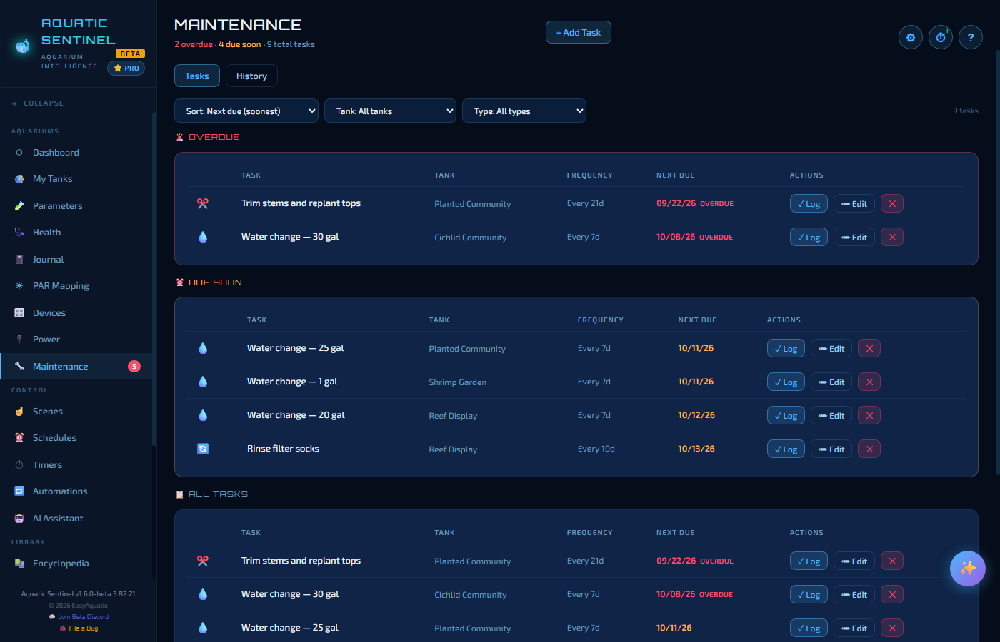
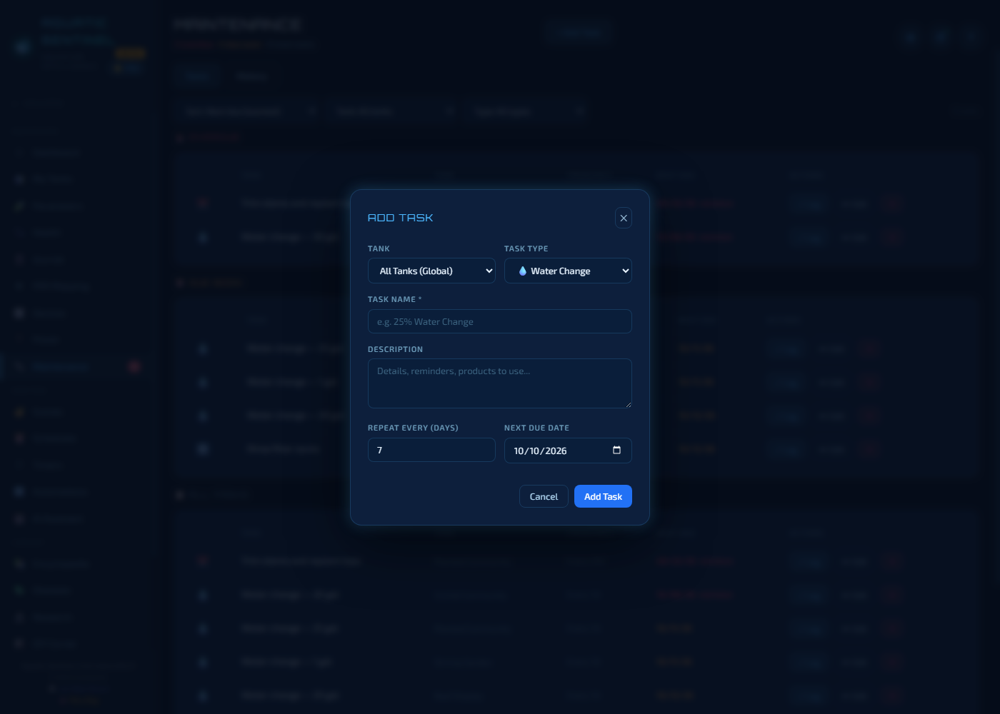
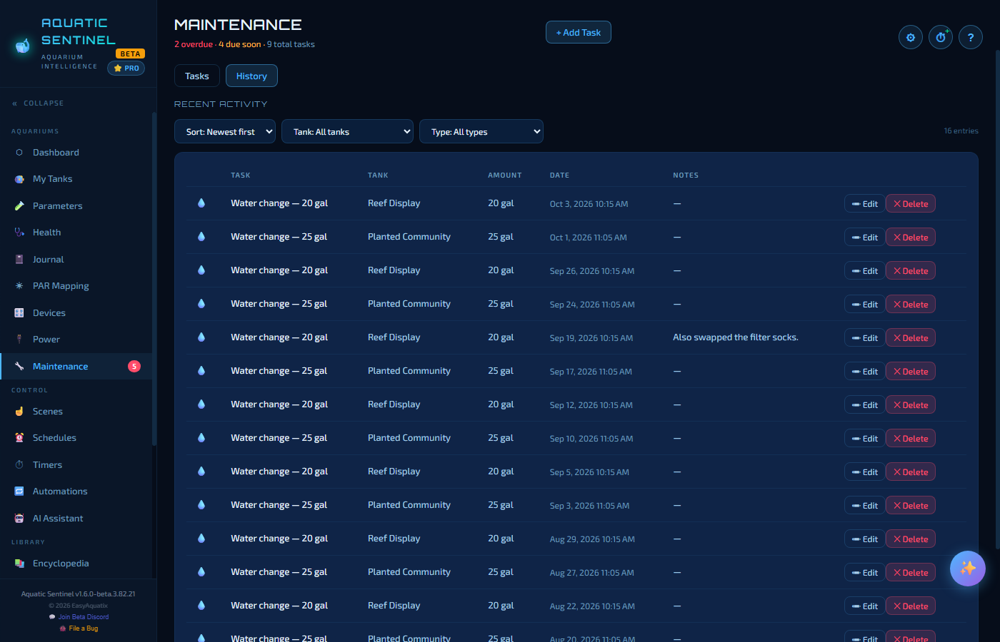

# 7. Maintenance

The Maintenance page keeps the chores that keep a tank healthy — water changes, filter cleans, trimming, dosing — from slipping. Set each task up once with how often it repeats, and Aquatic Sentinel counts down to the next one for you.

**In this chapter:** [Reading the page](#reading-the-page) · [Adding a task](#adding-a-task) · [Logging a task as done](#logging-a-task-as-done) · [History](#history) · [Where tasks show up](#where-tasks-show-up)

---

## Reading the page

Tasks are grouped by urgency, most urgent first:

- **Overdue** — past their due date (red).
- **Due soon** — due today or within the next 3 days (amber).
- **All tasks** — everything, including tasks not due yet.

Each row shows the task, its tank, how often it repeats, the next due date, and three buttons: **✓ Log** (done!), **Edit**, and **✕** (delete).

The strip under the title counts them: *"5 overdue · 3 due soon · 9 total tasks"*. Use the three menus above the list to **sort** (soonest first by default), narrow to one **tank**, or one **type** of task.

The **Maintenance** entry in the left menu wears a red number while anything is overdue, so you notice from any page.

---

## Adding a task

Click **+ Add Task**.

| Field | What to enter |
|---|---|
| **Tank** | The tank this chore belongs to, or **All Tanks (Global)** for a chore that isn't tied to one tank. |
| **Task type** | Pick from the list below — it sets the icon and, for some types, a unit. |
| **Task name** *(required)* | A label you'll recognise, such as *Water change — 25 gal*. |
| **Description** | Optional notes. |
| **Repeat every (days)** | How many days between each time. |
| **Next due date** | When it is next due. |

| Task type | Use it for |
|---|---|
| **Water Change** | Records the gallons changed each time you log it. |
| **Filter Clean** | Mechanical filter maintenance. |
| **Change Filter Media** | Replacing biological or chemical media. |
| **Gravel Vacuum** | Cleaning the substrate. |
| **Trim Plants** | Pruning. |
| **Fertilize** | Liquid or root fertiliser. |
| **Clean Algae / Glass** | Scraping and wiping. |
| **Dosing** | Supplements and additives (unit: ml). |
| **Treatment** | Medication or disease treatment. |
| **Feeding** | Scheduled feeding reminders. |
| **Other** | Anything else. |

> [!TIP]
> Edit a task and you get every type in the list — the same list is used everywhere in the app.

---

## Logging a task as done

When you've done the chore, press **✓ Log** on its row. A small form asks for the **date and time** (now, by default), an **amount and unit** where it applies — gallons for a water change — and optional **notes** such as the brand of filter media.

Logging records the work in the history *and* moves the **next due date** forward by the task's repeat interval, so the task drops back out of the overdue list.

You can also mark a chore done by voice — say *"log water change for reef tank"* (see [Voice](14-voice.md)) — or tap **✓ Log** beside a task on the tank's page.

---

## History

Switch to the **History** tab to see everything you've logged, newest first, so you can tell at a glance whether you've been keeping up. The columns show the task, tank, amount, date and notes, and you can sort, or filter by tank or type. **Edit** or **Delete** fixes an entry that was logged wrongly. Every entry also appears in the tank's [Journal](06-journal.md).

---

## Where tasks show up

| Place | What you see |
|---|---|
| **Dashboard** | *Tasks due* and *Missed tasks* boxes, and the **Due Tasks** list. |
| **Tank page** | **Upcoming Maintenance**, with **✓ Log** buttons. |
| **Tank health score** | Overdue tasks lower the *Maintenance* part of the score. |
| **Journal** | Every completed task, in the timeline. |

---

← [6. Journal](06-journal.md) · [Manual home](README.md) · **Next:** [8. PAR Mapping](08-par-mapping.md) →
