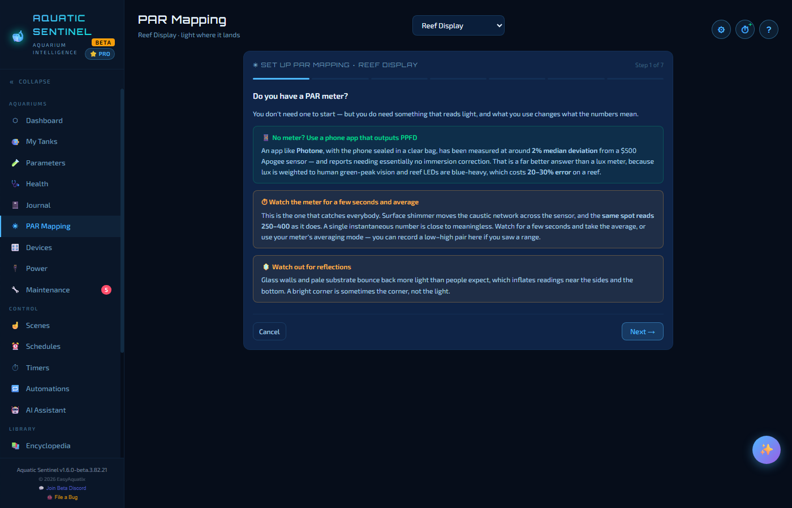

# 8. PAR mapping

**PAR** is the light your corals and plants can actually use. PAR Mapping records **where the light lands in your tank, section by section**, so you can see a fixture ageing — or a coral sitting in the wrong spot — *before* the animals show it.

**In this chapter:** [What you need](#what-you-need) · [Setting up a tank](#setting-up-a-tank) · [Taking a sweep](#taking-a-sweep) · [Reading the map](#reading-the-map) · [Why it keeps asking how you measured](#why-it-keeps-asking-how-you-measured) · [Targets](#targets)

---

## What you need

A PAR meter is ideal. If you don't have one, a **phone app that outputs PPFD** (Photone, with the phone sealed in a clear bag, is the one the app mentions) has been measured at around 2% deviation from a $500 sensor — a far better answer than a lux meter. Choose the PAR page's **Do you have a PAR meter?** step for the details.

Three habits give you good numbers:

- **Average over a few seconds.** Surface shimmer swings the same spot between, say, 250 and 400, so a single instantaneous reading is close to meaningless. You can record a **low and a high** for each spot.
- **Measure at the animal, not above it.** Hold the sensor at the coral, or at the plant's leaves. A reading taken six inches too high is a different measurement.
- **Watch for reflections.** Glass walls and a pale substrate bounce light back and inflate readings near the sides and bottom. A bright corner is sometimes the corner, not the light.

---

## Setting up a tank

Open **PAR Mapping** from the left menu, choose a tank at the top, and follow the setup. It takes a few short steps:

1. **Do you have a PAR meter?** — and what to use if you don't.
2. **Take a top-down photo** of the tank.
3. **How big is the tank?** — its length and width.
4. **Confirm the grid** — the tank is divided into **sections about a foot across**.
5. **Fit the grid to the tank** — drag the grid so it lines up with the picture. The grid follows the tank's footprint, not the photo.
6. **Measure at the creature, not above it.**
7. **How will you measure?** — your meter or app, its units, and how you correct for being under water. For a planted tank it also asks **Do you inject CO₂?**

> [!TIP]
> Entering the tank's dimensions when you add it ([chapter 3](03-tanks.md#adding-a-tank)) saves a step here. You can come back and **⚙ Redo setup** at any time.

---

## Taking a sweep

A **sweep** is one pass over the tank taking readings. Press **+ Start a sweep** and the app walks you from section to section:

- Take a reading (or a low and a high) in each section and enter it. **Drag a reading** on the map to exactly where you took it.
- **Next section →** moves on.
- **⏸ Done for now** parks the sweep — it stays open and **resumable**. A sweep doesn't have to cover the whole tank; stop after two sections and finish the rest tomorrow.
- **✓ Finish sweep** closes it.

---

## Reading the map

After setup the page shows your tank as a grid. The map **shades each section by how long it has been since you last measured it**, so stale areas stand out. The *colour of a reading* says which sweep a number came from, not how bright it is — select two sweeps (flow on and flow off, say) to see them stacked in each section.

Below the map:

- **📈 Trend by section** shows each section over months, so you can see one section dimming rather than guess — plus a **rollup for the whole tank**.
- **🗓 Sweeps** lists every sweep you have taken.

The tank page ([chapter 3](03-tanks.md#the-tank-page)) has a **PAR Mapping** summary with a shortcut here.

---

## Why it keeps asking how you measured

Units, immersion correction and depth method are recorded **with every sweep and never converted**. Storing a converted number would bake in an error you could never undo. Comparing two sweeps that were measured differently raises a **warning** — otherwise you could read a measurement artefact as a dying fixture and buy bulbs you didn't need.

Lux readings (from a lux meter) are compared with each other, **never against a PAR target**, because the lux-to-PAR factor swings widely on a reef's blue-heavy spectrum.

---

## Targets

A reading only gets a verdict if there is something to judge it against, and the app is deliberately cautious here:

- **The animal's own light requirement.** Open an animal on its tank and set its **Light requirement** — a category, or an exact PAR min and max. An exact range **overrides everything else**.
- **Its Encyclopedia species.** If you've linked the animal to a species, that species' requirement is used.
- With neither, the number is shown on its own, rather than judged against a range that was never established.
- **Planted tanks depend on CO₂.** The same PAR that grows carpet plants in an injected tank grows algae in a low-tech one. If the tank's CO₂ state is unknown, no planted target is given at all.

The bands are deliberately wide, because a wrong band is worse than none — someone moves a coral because of it. When the band is wide, the useful signal is **rank**: which section is the dimmest in your tank.

---

← [7. Maintenance](07-maintenance.md) · [Manual home](README.md) · **Next:** [9. Devices](09-devices.md) →
