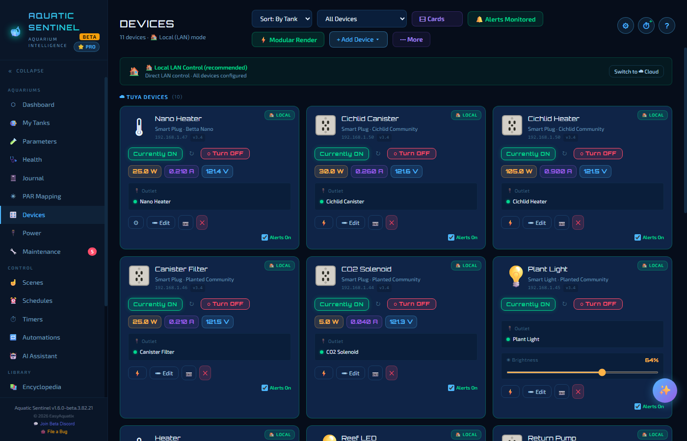
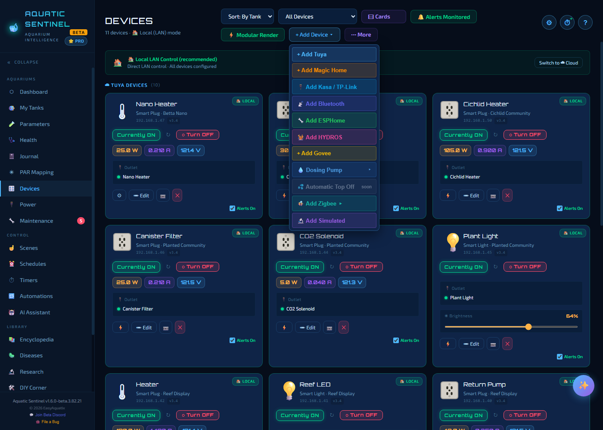
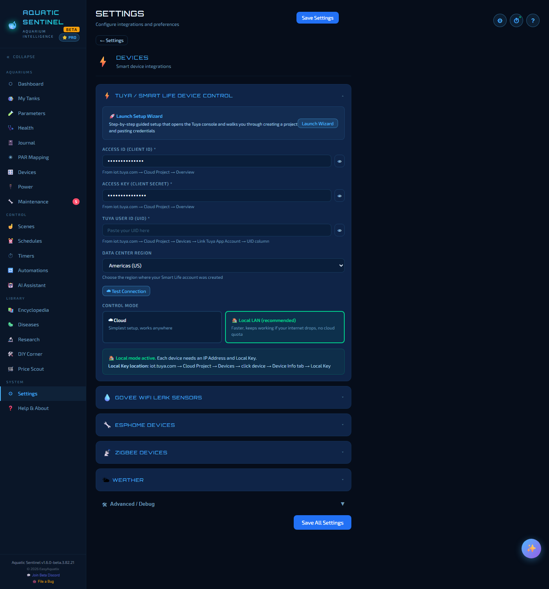
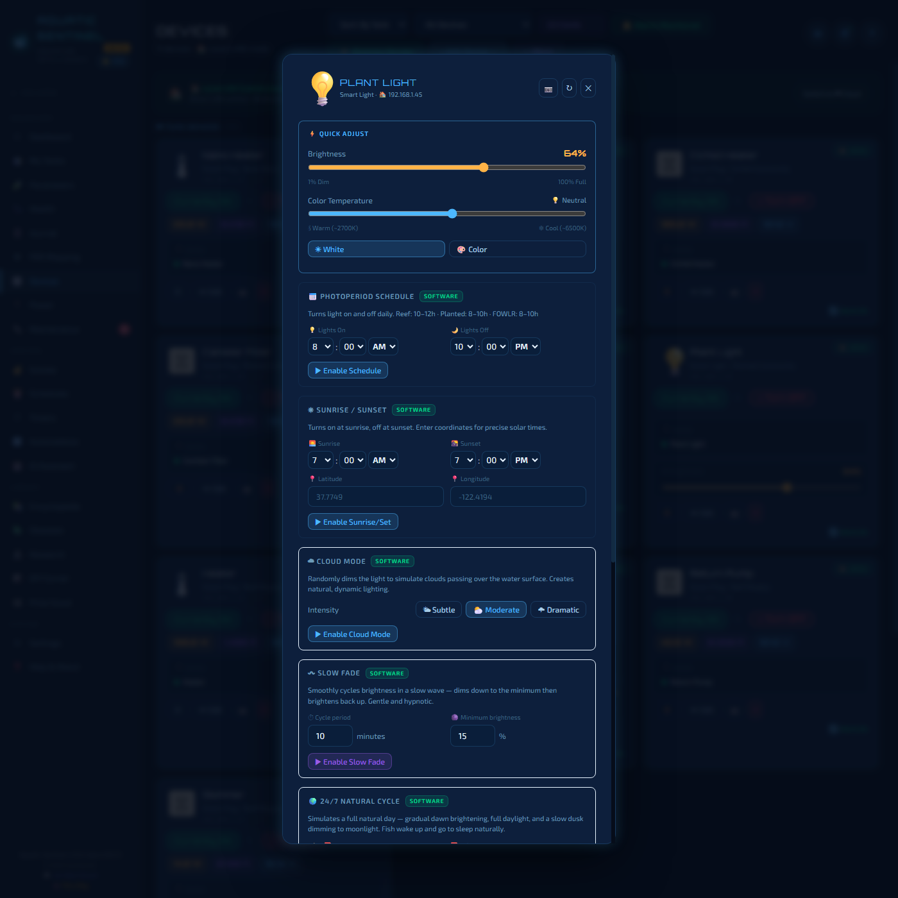
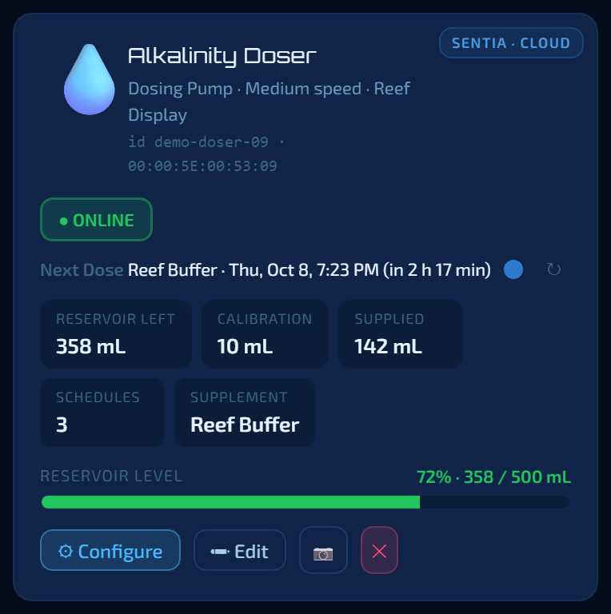
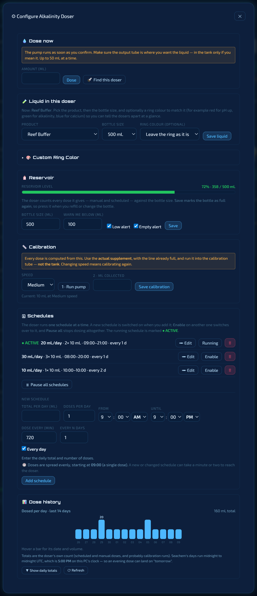

# 9. Devices

Aquatic Sentinel is **hardware-agnostic**: it works with smart plugs, lights, sensors and doser pumps you can buy off the shelf, from many different makers, all on one page. Plug in a heater with a $12 smart plug and it becomes something you can schedule, automate, lock, and watch for failures.

**In this chapter:** [The Devices page](#the-devices-page) · [Adding a device](#adding-a-device) · [Connecting Tuya](#connecting-tuya) · [Local or cloud?](#local-or-cloud) · [Plugs and power strips](#plugs-and-power-strips) · [Lights](#lights) · [Sensors and probes](#sensors-and-probes) · [Leak sensors](#leak-sensors) · [Other device families](#other-device-families) · [Dosers, valves and controllers](#dosers-valves-and-controllers)

---

## The Devices page

Every device is a **card**: a name, its tank, whether it is online, and the controls that make sense for it — an on/off button for a plug, a brightness slider for a light, readings for a sensor.

Along the top:

| Control | What it does |
|---|---|
| **Sort** and **filter** menus | Order cards (by tank, for example) or show only one kind of device. |
| **Cards** | Switches between full cards and a compact list. |
| **⚡ Modular Render** | Switches between the current card design (*Modular*) and the older one (*Legacy*). Leave it on Modular; the older layout is kept only for comparison. |
| **🔔 Alerts Monitored** | Shows that device alarms are active, and lets you snooze them for a while. |
| **+ Add Device** | The menu of device types (next section). |
| **⋯ More** | **Export all devices** to a JSON file, or **Import devices** from one — a quick way to move to a new computer. |

A banner under the title says how devices are being controlled — for example **Local LAN Control (recommended)** — with a button to switch to cloud control ([see below](#local-or-cloud)). If several devices drop off at once, a red **Network issue detected** banner points you at your router, since that is far more likely than every device failing together.

Each card carries:

- a **status pill** — *Currently ON*, *OFF*, *OFFLINE* — and a button to flip it,
- for plugs that measure power, **watts, amps and volts**,
- a **LOCAL** or **CLOUD** badge, and the device's address,
- **⚡** (or **⚙**, or **🚨** for leak sensors) to open its **detail panel**, **Edit**, a **photo** button, and **✕** to delete,
- an **Alerts On** tick box: when ticked, you're warned if the device goes offline.

> [!TIP]
> Put a photo on a card — the manufacturer's picture, or one you take — so the card looks like the thing it controls. Give each device a clear name like *Sump Return Pump*; the same name is what voice commands and automations use.

---

## Adding a device

Press **+ Add Device** and choose the family:

| Menu entry | For |
|---|---|
| **Add Tuya** | Smart Life / Tuya plugs, strips, lights, thermostats, sensors, valves and more. |
| **Add Magic Home** | Magic Home / Zengge LED controllers. |
| **Add Kasa / TP-Link** | Kasa smart plugs and strips. |
| **Add Bluetooth** | The BLE-C600 meter and single-colour BLE lights (desktop only). |
| **Add ESPHome** | DIY ESP32 / ESP8266 sensors. |
| **Add HYDROS** | CoralVue Hydros controllers (preview). |
| **Add Govee** | Govee WiFi leak sensors. |
| **Dosing Pump ▸** | Opens a short list in place; today it holds **Sentia (AquaVitro / Seachem)**. |
| **Automatic Top Off** | Greyed out — *coming soon*. |
| **Add Zigbee ▸** | Hands you over to the Zigbee setup in Settings. |
| **Add Simulated** | A pretend device for trying things out safely. |

**Simulated devices** behave like real ones for schedules and automations but talk to no hardware — a safe way to build and test a rule before pointing it at your heater.

---

## Connecting Tuya

Most smart plugs and lights are Tuya-based (sold under the Smart Life and many other brand names). They need a free Tuya developer account so Aquatic Sentinel can read your device list.

1. Open **Settings → Devices → Tuya / Smart Life Device Control** and press **Launch Setup Wizard** — it opens the Tuya console and walks you through creating a project and pasting the credentials. Or do it by hand:
   - Create a free account at **iot.tuya.com** and a **Cloud Project**; pick the *data center* nearest you.
   - Copy the project's **Access ID (Client ID)** and **Access Key (Client Secret)**.
   - In the project, open **Devices → Link Tuya App Account** and link your Smart Life account. Your **UID** appears there — it is *not* your Smart Life username.
2. Enter the Access ID, Access Key, UID and **Data Center Region**, then press **Test Connection**.
3. Choose a **Control mode** (below) and press **Save**.
4. On the Devices page, **+ Add Device → Add Tuya**, pick a device from your account, and press **Fetch Details**. In local mode the app then **searches your network for the device automatically** and fills in its address; press **✕** on the purple banner if the search takes long and enter the address yourself.

If nothing turns up, the usual cause is that the Smart Life account isn't linked to the Cloud Project, or the UID is the wrong one. The [troubleshooting chapter](20-troubleshooting.md#devices) lists the fixes.

**Three buttons in the device form save a lot of time:**

- **🔍 Diagnose** (under *Advanced*) tries every protocol version (3.1, 3.3, 3.4, 3.5) against the device and shows what each returned; the version that returns the most real data is selected. If a device "connects but doesn't work", this is the button to press. (Many devices are version 3.3 even though the form defaults to 3.4.)
- **📡 Smart Network Scan** sweeps your network for Tuya devices. Ones you've already added are greyed out with an *Already in use* badge so you can't add them twice.
- **🔍 Identify** makes the physical device flash — a plug clicks its relay, a water-quality monitor flashes its backlight — until you press Stop, so you know which one is which.

---

## Local or cloud?

Aquatic Sentinel can talk to a device two ways:

| | **Local LAN** *(recommended)* | **Cloud** |
|---|---|---|
| How | Directly to the device on your network | Through the manufacturer's service |
| Speed | Fast | Slower |
| Internet down? | Keeps working | Stops |
| Setup | Each device needs its **IP address** and **Local Key** (the app can fetch the key from Tuya) | Simplest — just the credentials |
| Uses your Tuya quota? | No | Yes |

A fresh install starts on **Local LAN (recommended)**; an upgrade keeps whatever you had. Switch with the button on the Devices page banner or in **Settings → Devices**.

Good to know:

- **Local control is really local** — on/off in local mode is sent over your network, not the cloud.
- **A device that stops answering locally falls back to the cloud automatically** instead of showing offline. (This fixed lights that went "offline" while still powered.)
- **If your router gives a device a new IP address, the card finds it again** by itself, and a device's protocol version repairs itself from its own broadcast.
- **Some devices can never do local control.** Battery sensors that sleep — most leak sensors and water-quality testers — only wake now and then and report through the cloud, so a few minutes' delay is normal and local mode doesn't apply to them. They are checked about every five minutes, to stay within Tuya's request limits.
- Device state is kept fresh in the background from a moment after launch, even if you never open the Devices page.

---

## Plugs and power strips

A plug card has the on/off button, live power readings if the plug measures them, and **⚡** for the detail panel. A power strip shows a row for **each outlet**; give each a name (*Heater*, *Skimmer*, *Return pump*) and switch them independently.

### Locking an outlet in place

The most useful safety feature for a tank. A **🔒 lock button** sits beside each outlet's on/off button. A **locked outlet cannot be switched by accident** — by a stray tap, a voice command, a scene gone wrong, a schedule or an automation. Everything simply skips it. Lock the return pump and the heater; unlock them when you really want to switch them.

### The detail panel

Open **⚡** for more:

- **Power monitoring** — live watts, volts and amps with a rolling graph and average and peak.
- **Overcurrent protection** — a watt limit; if the device goes over it you get an alert, and optionally it is switched off automatically. Good for catching a failing pump or heater.
- **Power-on behaviour** — what the relay does when power returns: *Always off*, *Always on* or *Last state*.
- **Master power** on a strip — *Turn on all* and a deliberately slow *Turn off all* that needs three clicks.

> [!NOTE]
> A few extras in the panel — **Daily Schedule, Random Mode, Inching** — are timers that run **inside the open panel**, so they stop when you close it, and each is marked with an amber note saying so. For anything that must keep running, use the [Schedules](11-scenes-schedules-timers.md#schedules) page: schedules are saved and keep firing in the background with the window closed.

### Power use

Many plugs report power. Those readings feed the [Power](10-power.md) page automatically.

---

## Lights

A light card has on/off and a brightness slider. Open the detail panel for the full set:

- **Quick adjust** — brightness, colour temperature (warm to cool), and **White** or **Colour** mode with a colour picker.
- **Photoperiod schedule** — a lights-on and lights-off time, which creates matching schedules for you (shown as *Auto* rows on the Schedules page).
- **Sunrise / sunset** — a gradual ramp up and down rather than a hard switch.
- **Cloud mode** — randomly dims the light the way passing clouds would (*Subtle*, *Moderate* or *Dramatic*).
- **Slow fade** — a gentle slow-wave dimming cycle.
- **24/7 natural cycle** — a whole day: gradual brightening, full daylight, a slow dusk and a moonlight phase, so fish wake up and go to sleep gently.

These effects are produced by Aquatic Sentinel itself ("software" modes), so the app needs to be running for them to play. You can dim a light by voice too — *"slowly dim the reef light to 20% over 30 minutes"* — see [Voice](14-voice.md).

---

## Sensors and probes

Water-quality monitors, pens and probes give you readings you never have to type. Aquatic Sentinel supports Tuya water-quality monitors (including the **PH-W218** 8-in-1 meter), the **BLE-C600** (a 7-in-1 pen: pH, TDS, EC, ORP, temperature, salinity and specific gravity), the **ZG-109TDS** Zigbee probe, ESPHome sensors and Hydros probes. A reading logs to a tank of your choosing — pick it on the card — in the background, even when the Devices page is closed, and appears in [Parameters](04-parameters.md).

- **Calibrate first.** The first time a probe logs, you're prompted to calibrate so your history doesn't begin with uncalibrated readings. Each sensor can carry a **calibration reminder** (every 14 days by default), a **Mark calibrated today** button, and **Calibrating now**, which pauses fault alerts for 15 minutes while the probe sits in its buffer solution. The BLE-C600 also has per-parameter offsets you can enter.
- **Impossible readings are held back.** Every reading passes a quality check. A value or a jump that can't be real — a temperature leaping from 78 to 153 °F — is quarantined: the last good value stays, **automations never act on the bad one**, and you're alerted only if the fault persists (about ten minutes). A reading that *could* be a real emergency alerts you immediately.
- **A ⚖ Drift? badge** appears when your manual test-kit results keep disagreeing with the probe in the same direction (a pH probe reading 0.3 high across several checks), suggesting a clean and recalibration.
- **°F or °C** — temperature devices have a toggle in their panel.

> [!NOTE]
> The **ZG-109TDS** is a freshwater instrument: it saturates around 20,000 µS/cm and cannot read full saltwater. Reef tanks should keep a dedicated salinity probe.

---

## Leak sensors

Leak sensors watch for water. When a **Tuya** leak sensor detects a leak, Aquatic Sentinel does everything at once:

- the **Dashboard** shows a red banner naming the sensor, and the tank card flashes,
- the **alarm** sounds and a **spoken "RED ALERT"** repeats until you deal with it (alarms duck, never mute, under speech),
- a **push notification** goes to your phone ([chapter 16](16-remote-access.md#using-it-on-a-phone)), and
- the Journal records the leak, and again when it clears.

The sensor card has **Test Leak Alert** and **Cancel Alarm** buttons, always visible — cancel silences the alarm at once rather than waiting for the next poll. Battery warnings and offline alerts are recorded too.

Battery leak sensors sleep, so they report through the cloud; the app also listens for them on your network, so a leak is heard as soon as the sensor wakes.

**Govee** WiFi leak sensors can be added too. They need a Govee API key — in the Govee Home app choose *Profile → Settings → Apply for API Key*, then paste it in **Settings → Devices → Govee WiFi Leak Sensors**. Some Govee models send their leak events only to the Govee app, which Aquatic Sentinel can't read, so **test yours with a few drops of water before relying on it**; a Tuya leak sensor is the dependable choice for protection.

---

## Other device families

### Kasa / TP-Link
Older plugs answer again, newer ones can use your Kasa account, and plugs on firmware 1.1.1 need **Me → Settings → Third-Party Compatibility** switched on in the Kasa app (it takes a few minutes to apply). TP-Link warns this reopens older weaknesses, so anything on your home network can then switch that plug.

### Magic Home / Zengge
LED controllers over Wi-Fi. Add one with its IP address; the card gives you on/off, colour and brightness.

### Bluetooth
Bluetooth devices — the BLE-C600 and single-colour LED controllers — are reached by the computer that runs Aquatic Sentinel, so **it needs a Bluetooth radio** (and the desktop app); from a phone over remote access you can still take a reading. **Add Bluetooth → 👁 Find Device** scans, and you pick yours from the list; the app recognises the device type from its Bluetooth fingerprint. An unknown Bluetooth device can be configured by hand.

### ESPHome
DIY sensors on ESP32 or ESP8266 boards running ESPHome with the `web_server` component. Enter its address, press **Test Connection** to discover its sensors and switches, and choose which to show.

### Zigbee
Plug a supported **USB Zigbee coordinator** into the computer and pair devices from **Settings → Devices → Zigbee Devices**. The coordinator is the radio; Aquatic Sentinel drives it itself, so there is **no vendor hub and no extra program to keep running**. You get a setup panel, a pairing wizard and per-device diagnostics. If the coordinator is unplugged or stops answering you're told, and the app recovers by itself when it returns. Settings such as the reporting interval and the probe's freshwater/seawater mode are written back over the radio and applied the next time the sleeping device wakes. Zigbee is a desktop feature, not available on Android.

---

## Dosers, valves and controllers

### Seachem / AquaVitro Sentia doser

See the **reservoir level**, the **next dose** and a **14-day dose history**. In **Configure** you can set the schedule, change the ring-light colour with Seachem's presets, or **dose now**.

*Dose now* stays off until the doser is calibrated, and you're warned before dosing from an empty bottle. Reservoir alerts and every dose, change and alert go to the tank Journal. Set it up and configure it on the computer, or on the phone that hosts the app; over remote access you get the read-only card and the dose history. It talks to the Sentia through Seachem's cloud — there is no local connection.

> [!NOTE]
> **Known issue:** the doser's weekday schedule may land a day off. If a dose doesn't run on the day you picked, check which day it actually ran and tell us.

### Sprinkler timers and water valves
Run a Tuya valve for a set time and watch it count down; a manual *off* always wins over a running timer. A metering valve records how much water went through, keeps a history, and writes it to the Journal — in litres, as the valve reports them.

### "Other" Tuya devices
A Tuya device Aquatic Sentinel doesn't recognise can still be added, controlled and scheduled — it is added as **Other** rather than being a dead end.

### CoralVue Hydros (preview)
Sign in with your Hydros cloud account, choose your controller, and its probes and outlets appear as devices, with power monitoring, calibration, auto-logging and offline alerts. Support is a **preview**: built and checked against a simulator, not yet on real Hydros hardware — treat it as experimental and tell us what you find.

---

← [8. PAR mapping](08-par-mapping.md) · [Manual home](README.md) · **Next:** [10. Power](10-power.md) →
