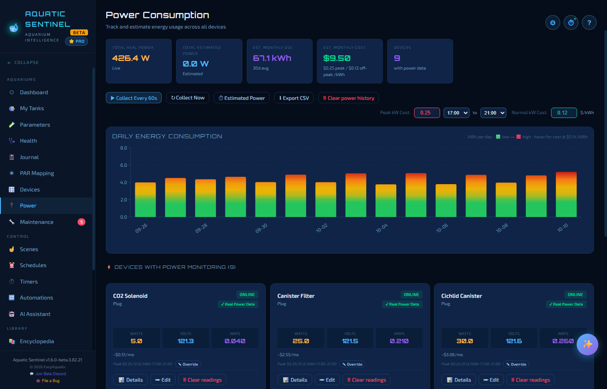

# 10. Power

The Power page shows how much electricity your tank equipment uses and what it costs — live, by the day, and by the month — and helps you spot a heater that is working too hard or a pump that has gone quiet.

**In this chapter:** [The totals](#the-totals) · [Setting your electricity rates](#setting-your-electricity-rates) · [The daily chart](#the-daily-chart) · [Devices with power monitoring](#devices-with-power-monitoring) · [Devices without monitoring](#devices-without-monitoring) · [Keeping the history tidy](#keeping-the-history-tidy)

---

## The totals

The tiles across the top show:

- **Total real power** — the live combined wattage of every device that reports its own power use.
- **Total estimated power** — devices without monitoring, using the figures you gave them (see below).
- **Est. monthly usage** — kilowatt-hours over a month, based on the last 30 days.
- **Est. monthly cost** — that usage priced at your rates.
- **Devices** — how many have power data.

Buttons beside them:

| Button | What it does |
|---|---|
| **Collect every 60s** | Switches the automatic once-a-minute collection on or off. |
| **Collect now** | Takes a reading this moment. |
| **Estimated power** | Opens the estimates for devices that can't measure themselves. |
| **Export CSV** | Saves the history to a spreadsheet file. |
| **Clear power history** | Wipes the stored readings — see [below](#keeping-the-history-tidy). |

---

## Setting your electricity rates

Set your rates **on this page** (not in Settings). Enter your **normal** cost per kWh, and — if your supplier charges more at busy times — a **peak** rate with the hours it applies (for example 5 PM to 9 PM). The cost estimates use both. A single device can have its own rate: press **Override** on its card.

---

## The daily chart

**Daily energy consumption** shows kWh for each day. Each bar is a heat gradient — green for low-use days climbing to deep red on your highest-use days — so heavy days stand out. Hover a bar to see that day's cost.

---

## Devices with power monitoring

Many smart plugs report watts, volts and amps. Those appear automatically as cards showing the live reading, a rolling graph of the last 60 samples, and the estimated cost for the month. Each card has:

- **Details** — a closer look at the device,
- **Edit**, and
- **Clear readings** — remove just this device's history.

> [!NOTE]
> Power monitoring is not universal — many plugs and power strips simply don't have the hardware. If a device's card has no watts, volts or amps, it doesn't report them.

**Overcurrent protection** is set up **per device on the Devices page**, not here. Give a plug or an outlet a watt limit and it is switched off automatically if it goes over — useful for catching failing equipment. See [Devices → Plugs and power strips](09-devices.md#plugs-and-power-strips).

---

## Devices without monitoring

A device with no power monitoring can still be included. Press **Estimated power** and tell the app how many **watts the device draws when it's on** and **roughly how many hours a day it runs**; it is then counted in the totals and the cost.

If you change your mind, **Remove estimate** (it asks first) takes it back out.

---

## Keeping the history tidy

Power readings are collected every minute and can add up. **Clear power history** shows how many readings it will remove, keeps your devices, settings and estimates, and shrinks the database file straight away. The per-device **Clear readings** button does the same for one device.

---

← [9. Devices](09-devices.md) · [Manual home](README.md) · **Next:** [11. Scenes, schedules and timers](11-scenes-schedules-timers.md) →
