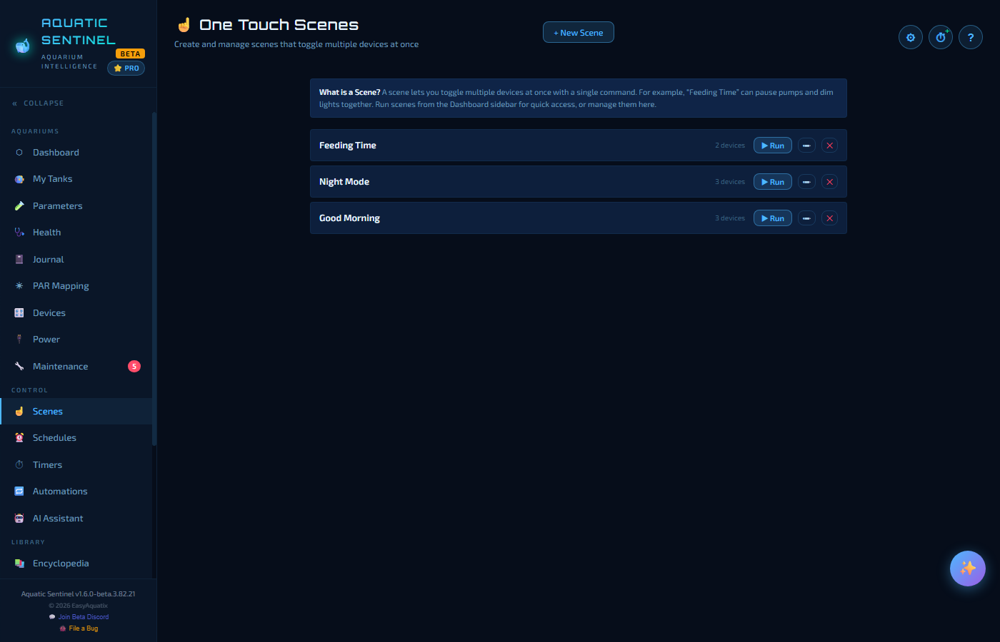
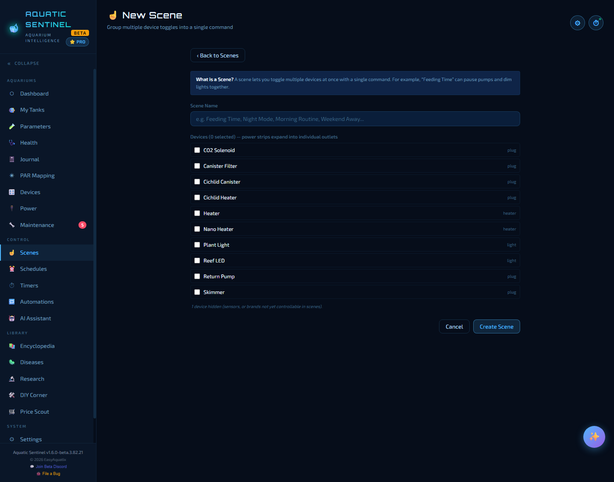
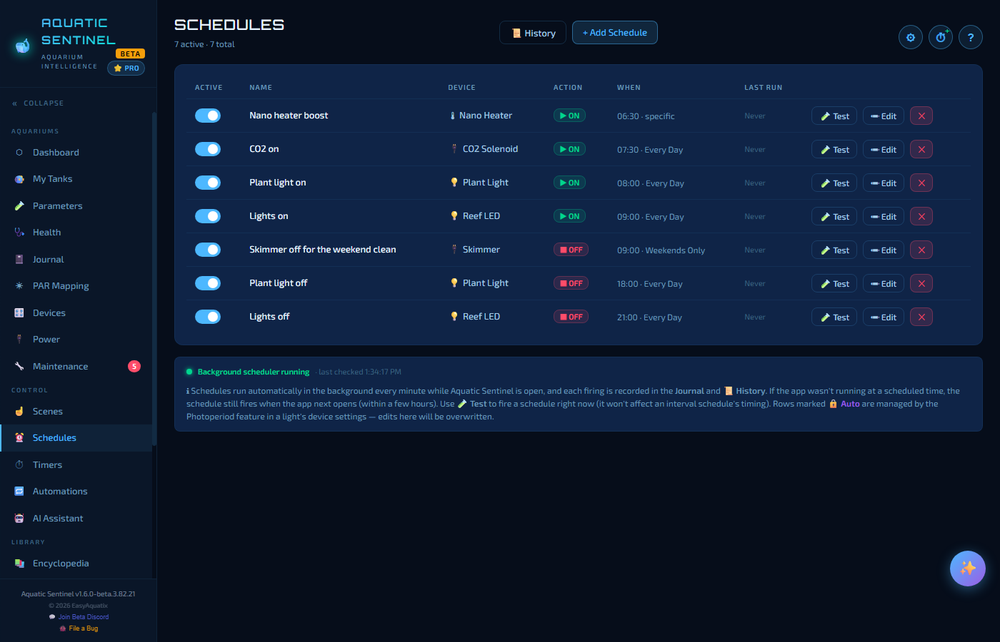
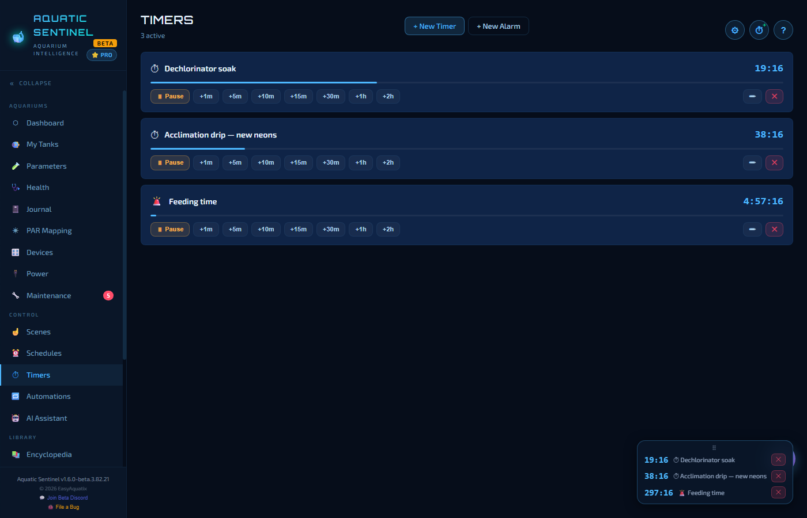
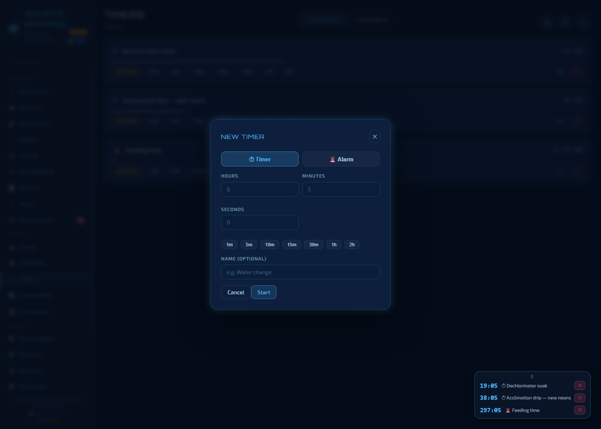

# 11. Scenes, schedules and timers

Three simple tools take the repetitive work out of tank keeping — each one is a single page in the **Control** group of the left menu.

| Tool | Use it when you want… |
|---|---|
| **[Scenes](#scenes)** | Many devices to change **at once**, on demand ("Feeding Time"). |
| **[Schedules](#schedules)** | A device to switch **at the same time every day**. |
| **[Timers and alarms](#timers-and-alarms)** | A **countdown** or a **clock alarm** that tells you when to do something. |

For rules that react to your water or your devices ("if the temperature goes above 82 °F, turn the heater off"), see [Automations](12-automations.md).

---

## Scenes

A **scene** is a named group of device actions that run together with one tap — *Feeding Time* switches the return pump and the skimmer off; *Night Mode* switches the lights off; *Good Morning* switches them back on.

Each scene appears in a list with the number of devices it controls and a **▶ Run** button. Scenes also appear on the **Dashboard** under *One Touch Scenes*, so you can run them from your home page.

### Making a scene

1. Press **+ New Scene** and give it a name.
2. Add the devices you want. **Power strips expand into their individual outlets**, so a scene can switch just the return pump without touching the rest of the strip.
3. Set each one to **on** or **off** (and a brightness for lights).
4. Save.

Every device is sent to the right brand automatically — Tuya, Kasa, Magic Home or ESPHome — so one scene can mix them.

### Running a scene

Press **▶ Run** on the Scenes page or the Dashboard, say *"activate feeding time"* ([Voice](14-voice.md)), or run it from an [automation](12-automations.md). Each run is recorded in the **Journal**.

> [!NOTE]
> A **locked outlet** ([Devices → Locking an outlet](09-devices.md#locking-an-outlet-in-place)) is **skipped**, not failed. A scene that touches six outlets and finds one locked still does the other five, and the Journal says *"1 locked"* so you can see it happened.

---

## Schedules

A **schedule** switches a device on or off at a set time — lights at 9 AM and off at 9 PM, CO₂ on half an hour before the lights.

The page lists every schedule with an **Active** switch, its **name**, **device**, **action** (ON or OFF), **when** it runs, and when it **last ran**. The buttons at the end of each row are **Test**, **Edit** and **✕**.

### Adding a schedule

Press **+ Add Schedule**.

| Field | Notes |
|---|---|
| **Schedule name** | For example *Plant light on*. |
| **Device** | The plug, outlet or light to control. For a power strip, choose the outlet. |
| **Action** | **Turn ON** or **Turn OFF**. |
| **Repeat** | **Every Day**, **Weekdays Only**, **Weekends Only**, **Specific Days** (choose any combination), or **Repeat Every X Minutes** (anywhere from 1 to 1,440 minutes). |
| **Time** | Hour, minute and AM/PM. |
| **Active** | Untick to keep it without running it. |

### Good to know

- **They run in the background** — every minute, on any page, as long as Aquatic Sentinel is running (which is why the app starts with your computer by default). A line at the bottom of the page — *"Background scheduler running · last checked 1:34 PM"* — answers *"are my schedules being checked?"*
- **Missed schedules catch up.** If the computer was asleep or the app was closed at a scheduled time, the schedule still fires when the app next runs, within a few hours. An 8 AM schedule never fires late at night.
- **Test** fires a schedule's command right now, regardless of its time or whether it is active, without disturbing its timing. Use it to prove the whole chain works before trusting the clock.
- **History** (button at the top) lists every firing, labelled **⏰ Scheduled**, **⏱ Catch-up** or **🧪 Test**, with timestamps.
- **Rows marked *Auto*** are created and managed by a light's *Photoperiod* feature. Don't edit them here — they will be overwritten.
- A device can have as many schedules as you like — a light that turns on at 8 AM, dims in the evening and goes off at 10 PM.
- **Sunrise/sunset ramps are not set up here.** Open the light on the Devices page and use **Sunrise / Sunset** or **24/7 Natural Cycle** in its panel ([Devices → Lights](09-devices.md#lights)).

---

## Timers and alarms

A **timer** counts down — for a dechlorinator soak, a dosing wait, or an acclimation drip. An **alarm** rings at a time of day — for feeding time, a lights-out check or a medication dose.

### Creating one

Press **+ New Timer** or **+ New Alarm** on the Timers page, or tap the **⏱** button at the top of any page (or press **Ctrl+Shift+T**).

Choose **Timer** or **Alarm**, enter the **hours, minutes and seconds** (or pick a preset — 1 minute up to 2 hours), and give it a **name** so the announcement tells you what finished. Press **Start**.

You can also say *"Set a timer for 20 minutes"* or *"Set a timer called water change for 15 minutes"* ([Voice](14-voice.md)).

### While it runs

Each timer is a card with a progress bar and a countdown. From the card you can:

- **Pause** and resume it,
- **extend** it with **+1m, +5m, +10m, +15m, +30m, +1h, +2h**,
- **edit** it, or cancel it with **✕**.

Timers keep running whichever page you're on — a small floating panel in the corner shows them. They survive restarting the app, too: a timer still running comes back, and one that ran out while the app was closed doesn't surprise you with an alarm on launch.

### When one goes off

Aquatic Sentinel plays a chime (or the alarm sound) and **speaks the name** of what finished, repeating until you deal with it. From the alert you can:

- **😴 Snooze** — pick 1, 5, 10, 15, 30, 60 or 120 minutes; it comes back as a live countdown.
- **✓ Dismiss** it, or dismiss them all.
- Open the **Timers page**, which silences the repeating sound but keeps the alert in the *Expired* list for you to snooze or dismiss there.

Recently used timers stay in a reusable list, so yesterday's 15-minute drip timer restarts with one click.

---

← [10. Power](10-power.md) · [Manual home](README.md) · **Next:** [12. Automations](12-automations.md) →
