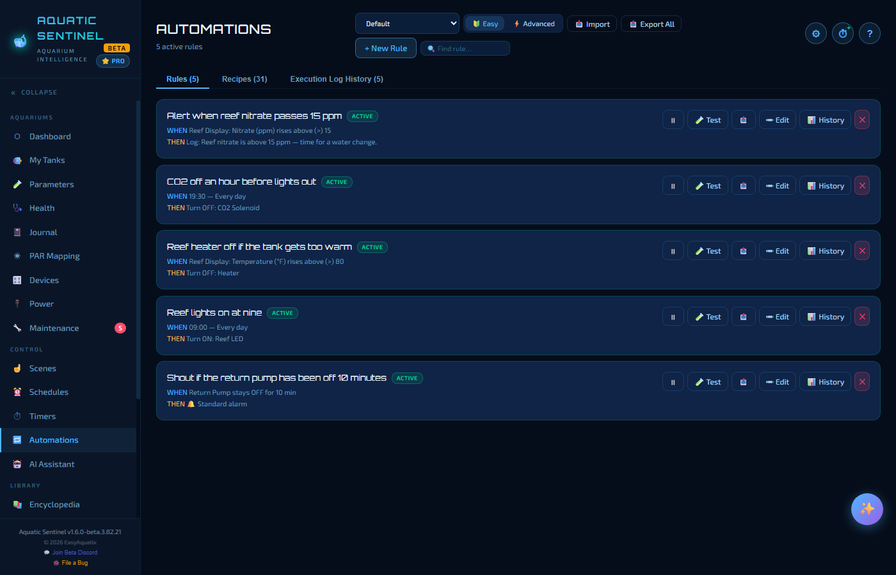
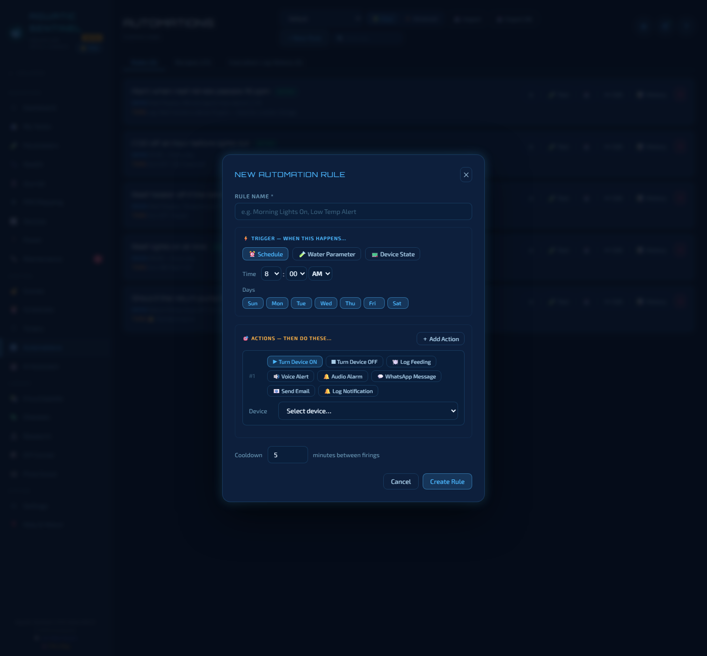
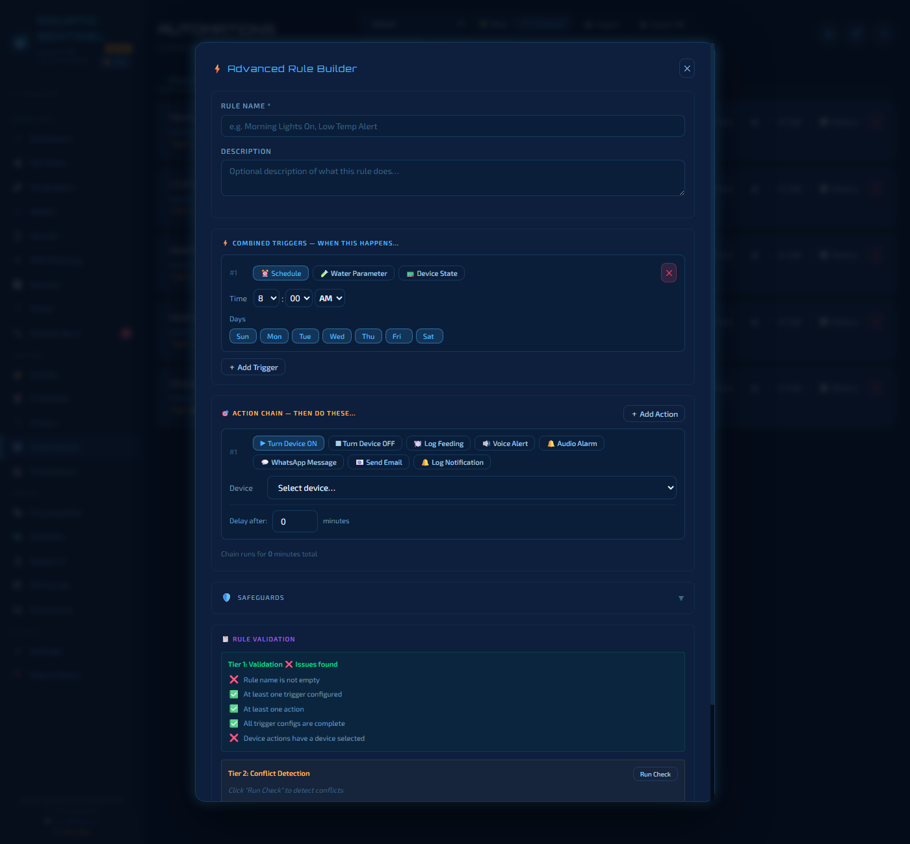
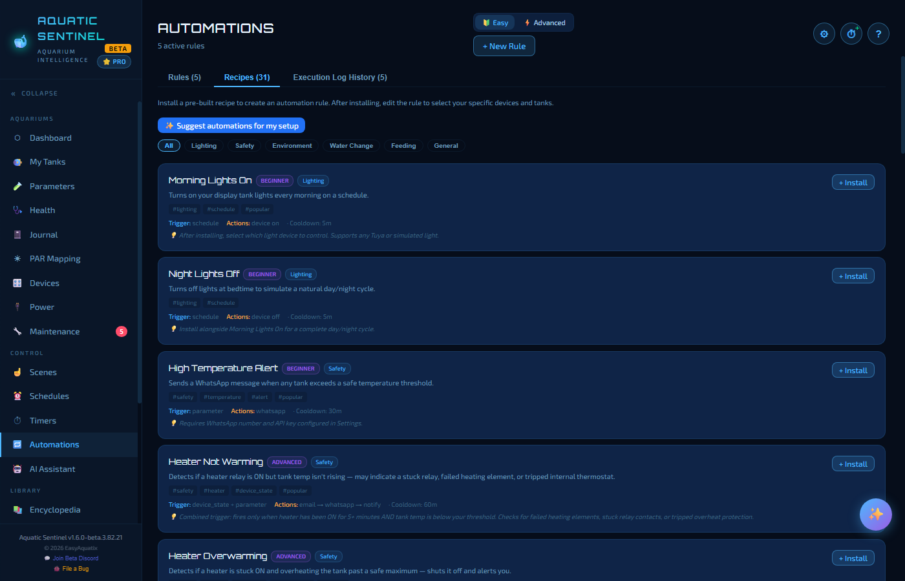

# 12. Automations

Schedules switch things at a set time. **Automations react.** *When the temperature goes above 82 °F, turn the heater off and warn me. When the return pump has been off for ten minutes, sound the alarm. Turn the CO₂ off an hour before the lights go out.* Build a rule once and it watches your tank around the clock.

**In this chapter:** [Reading the page](#reading-the-page) · [Easy mode](#easy-mode) · [Advanced mode](#advanced-mode) · [Recipes and AI suggestions](#recipes-and-ai-suggestions) · [Messages](#messages-and-placeholders) · [The execution log](#the-execution-log) · [Safety and good habits](#safety-and-good-habits)

---

## Reading the page

The page has three tabs — **Rules**, **Recipes** and **Execution Log History** — with the number in each beside its name.

Each rule on the **Rules** tab is a card with its name, an *ACTIVE* badge, and two plain-language lines: **WHEN** it happens and **THEN** what it does. For example:

> **Reef heater off if the tank gets too warm** — WHEN Reef Display: Temperature (°F) rises above (>) 80 · THEN Turn OFF: Heater

The buttons on a card: **⏸** pauses or resumes it, **Test** tries it, **Edit**, **History** (everything this rule has done), and **✕** deletes it.

At the top: an **Easy / Advanced** switch (next section), **Import** and **Export All** (rules travel as JSON files, so you can share them or move to another computer), **+ New Rule**, and a **Find rule…** box.

A **master switch** — **Settings → Automation → Enable Automation Engine** — turns the whole engine on or off. Use it to pause everything while you do maintenance.

---

## Easy mode

**Easy** is the default: one trigger, one or more actions, a form you fill in. Press **+ New Rule**.

**Trigger — when this happens**

| Trigger | Use it for |
|---|---|
| **Schedule** | A time of day, on the days you choose. |
| **Water Parameter** | A reading going above or below a value — pick the tank, the parameter, *above* or *below*, and the threshold. |
| **Device State** | A device going on or off, or staying in a state for a time — *"the return pump has been off for 10 minutes"*. |

**Actions — then do these.** Add as many as you like with **+ Add Action**:

| Action | What it does |
|---|---|
| **Turn Device ON** / **OFF** | Switches a plug, an outlet or a light. |
| **Log Feeding** | Writes a feeding entry to the tank's journal. |
| **Voice Alert** | Speaks a message. |
| **Audio Alarm** | Sounds the alarm. |
| **WhatsApp Message** | Sends a message (needs WhatsApp set up in **Settings → Alerts**). |
| **Send Email** | Sends an email (needs email set up in **Settings → Alerts**). |
| **Log Notification** | Records a note in the log. |

**Cooldown** sets the minutes that must pass between firings, so a reading hovering around the threshold doesn't fire the rule over and over.

---

## Advanced mode

Flip the switch to **Advanced** and **+ New Rule** opens a full builder for rules that need more.

- **Combined triggers** — add several triggers and join them with **AND** or **OR**. *"Heater has been ON for five minutes **and** the tank is still below its threshold"* catches a stuck relay or failed heating element.
- **Action chains** — each action has a **Delay after** in minutes, so one rule can say *turn the pump off, wait 15 minutes, turn it back on*.
- **Safeguards** — an expandable section with **Cooldown**, **Max firings per day**, **Skip if the target is already in that state** and **Only when the tank is active**.
- **Three tiers of checking**, shown beside the form as you build:
  1. **Validation** — a checklist of what's missing (a name, a trigger, an action, a device).
  2. **Conflict detection** — press **Run Check** to look for overlapping schedules, opposite actions on the same device, and rules that can never fire.
  3. **Engine simulation** — a test run against your tank's current state that tells you whether the rule *would* fire right now, and why.

A rule you built in either mode opens in the matching editor when you press **Edit**.

---

## Recipes and AI suggestions

Don't want to start from a blank page? The **Recipes** tab holds **31 ready-made rules** — Morning Lights On, Night Lights Off, High Temperature Alert, Heater Not Warming, Heater Overwarming, Auto Top-Off Reminder, Feeding Mode Pause, Low pH Emergency Alert and many more.

Filter by category — **Lighting, Safety, Environment, Water Change, Feeding, General** — and each card shows its difficulty (*Beginner*, *Intermediate*, *Advanced*), what triggers it, what it does, its cooldown, and any prerequisite. Press **+ Install** and it becomes a rule; then **Edit** it to choose *your* devices and tanks.

**✨ Suggest automations for my setup** asks your [AI](13-ai.md) to look at your actual tanks and devices and propose rules to suit. Every suggestion installs **switched off**: you review it, pick the device and tank, and turn it on yourself. You can also just ask the Assistant or the Helper — *"Alert me if the temperature goes above 82°F"* — and it drafts one for you to approve.

---

## Messages and placeholders

Messages in voice, WhatsApp and email actions can include placeholders that fill in when the rule fires:

`{tank_name}` · `{value}` · `{param}` · `{threshold}` · `{rule_name}` · `{device_name}`

Capitalisation and spacing don't matter — `{Tank}`, `{tank name}` and `{TANK_NAME}` all work. So *"{param} in {tank_name} is {value}, over the limit of {threshold}"* becomes a sentence with the real numbers in it.

---

## The execution log

The **Execution Log History** tab is a record of everything your rules have done — *Turned CO₂ Solenoid off — success* — which you can filter by type and by status. **Clear Log** empties it. A single rule's own **History** button shows just that rule.

Automations also leave entries in the tank [Journal](06-journal.md), so a heater that switched off at 2 AM is explained in the morning.

---

## Safety and good habits

- **Rules act only on fresh readings.** If a sensor has gone quiet, a rule that depends on it pauses rather than acting on stale data — and the Dashboard's **Automation errors** box says so.
- **Bad readings never trigger anything.** A reading the quality check has held back as impossible ([Sensors and probes](09-devices.md#sensors-and-probes)) can't fire a rule.
- **Locked outlets are skipped** by every rule ([Locking an outlet](09-devices.md#locking-an-outlet-in-place)).
- **Test before you trust.** Use **Test**, or the simulation in Advanced mode, to see what a rule would do. A **simulated device** ([Devices](09-devices.md#adding-a-device)) lets you build and rehearse a rule without touching real equipment.
- **Pair a safety net with every convenience.** A rule that turns a heater off should usually be accompanied by one that warns you.

---

← [11. Scenes, schedules and timers](11-scenes-schedules-timers.md) · [Manual home](README.md) · **Next:** [13. AI](13-ai.md) →
