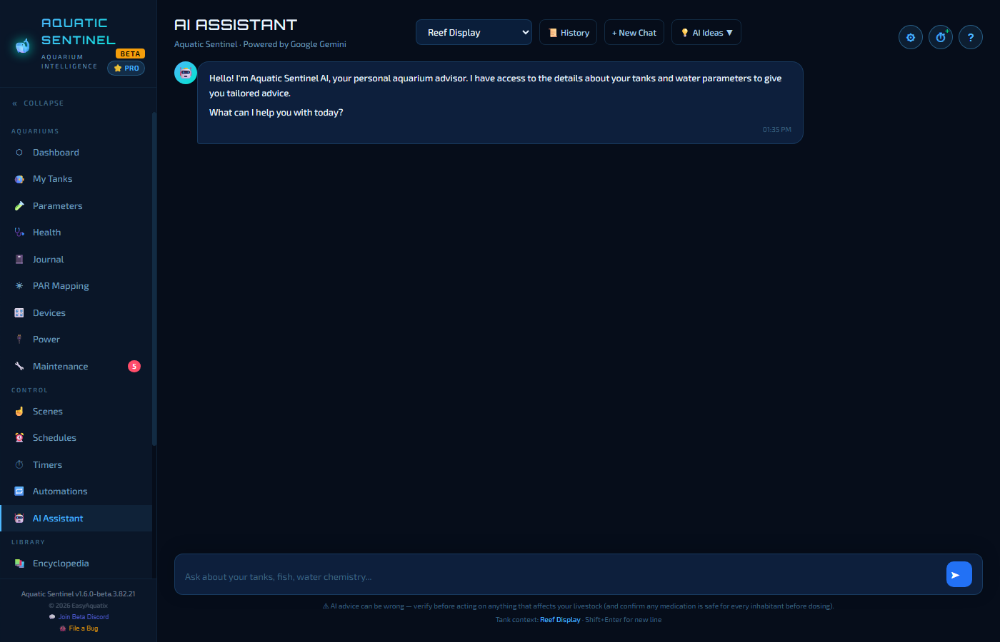
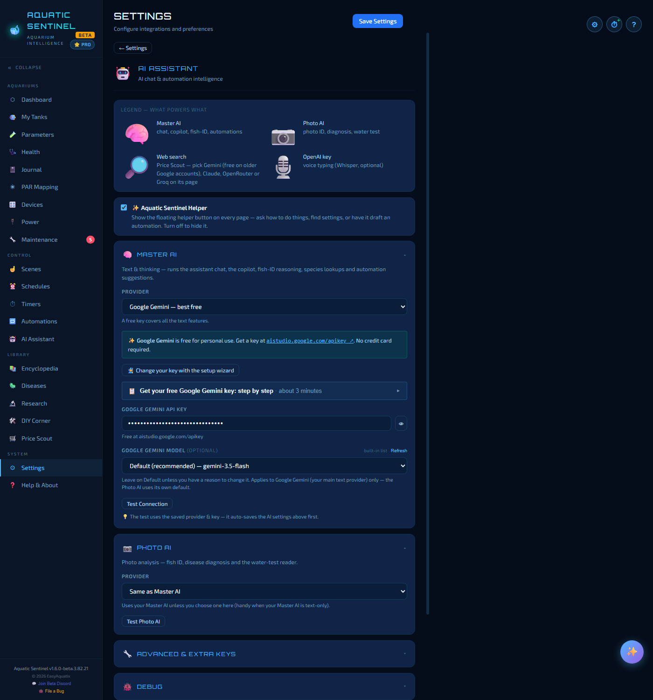

# 13. AI features

Aquatic Sentinel has an aquarium advisor built in: ask it a question, show it a photo of a sick fish, have it read a test vial, or let it draft an automation. **Every AI feature is free on every plan.** You bring your own key from an AI provider — and several of them give you a free one.

**In this chapter:** [Set up your AI](#set-up-your-ai) · [The AI Assistant page](#the-ai-assistant-page) · [The ✨ Helper](#the-helper) · [Everything the AI can do](#everything-the-ai-can-do) · [Keeping it reliable](#keeping-it-reliable) · [The AI suggests, you decide](#the-ai-suggests-you-decide)

---

## Set up your AI

A new install starts on **Google Gemini**, which has a free tier and needs no credit card. To set it up:

1. Open **Settings → AI Assistant**.
2. Press **Set up your AI key with the wizard** (or *Change your key with the setup wizard* if you already have one). It walks you through choosing a provider, getting a key on the provider's own site and pasting it back — the page also has a *"Get your free Google Gemini key: step by step"* guide that takes about three minutes.
3. The key is **tested before anything is saved**, so a wrong key can't break a setup that was working, and pasting the wrong provider's key is recognised and explained.

### The pieces

Settings → AI Assistant is organised so you can see what powers what:

| Setting | What it runs |
|---|---|
| **Master AI** | The assistant chat, the ✨ Helper, species look-ups, care guides, fish ID and automation suggestions. |
| **Photo AI** | Everything that reads a picture: disease diagnosis, fish ID and the water-test reader. It is **Same as Master AI** unless you choose another — handy if your main provider only handles text. |
| **Web search** | **Price Scout** is the one feature that has to read live web pages, so it needs a provider that can search (see below). |
| **OpenAI key** | *Optional* — only for the Whisper voice-typing engine ([Voice](14-voice.md)). |

For each, choose a **provider**, paste the **key**, optionally pick a **model** (the default is recommended, and the list is fetched live from the provider so it is always current), and press **Test Connection** — or **Test Photo AI**. Beneath the Master AI there are **Advanced & extra keys** and a **Debug** section that shows what's being used and a log of recent AI calls: the first place to look when an AI feature misbehaves.

### Providers

| Provider | Notes |
|---|---|
| **Google Gemini** | Free for personal use, no credit card. Also reads photos, so one Gemini key covers every AI feature. |
| **Groq** | Fast, with a free tier. |
| **OpenRouter** | A single account that reaches many models. |
| **Claude (Anthropic)** | Paid. |
| **OpenAI** | Paid. |
| **Custom** | Any OpenAI-compatible endpoint. |

> [!NOTE]
> **Price Scout and web search.** Searching the web is only free with Gemini on an *older* Google account — a newly made Google key needs billing turned on before Google will let it search. Claude and OpenRouter charge for every search, and Groq's free tier is too small to run one. Leave the *Searching with* box on Price Scout alone and it picks the best provider you have a key for.

---

## The AI Assistant page

Open **AI Assistant** from the left menu. Choose a **tank** at the top and the AI knows its inhabitants and its latest water parameters, so its advice is about *your* tank rather than tanks in general. Type a question — *"Why is my pH dropping?"*, *"Is a clownfish compatible with a royal gramma?"* — and press **Enter** (**Shift+Enter** for a new line).

- **💡 AI Ideas** opens a row of starter questions — analyse my water parameters, stocking advice, sick-fish symptoms, a water-change schedule, plant care tips, a cycling guide. Tap one to send it.
- **History** lists your past chats, which are saved on your computer. You can **rename**, **sort** and **group** them, and a chat is named for what you asked. Open one to carry on.
- **+ New Chat** starts fresh.
- **Narrate AI responses** (Settings → Voice) makes it read its replies aloud.

Things to ask:

- *"Analyze my latest water test."*
- *"What fish can I add to a 75-gallon community tank with angels and tetras?"*
- *"My fish has white spots and is scratching — what could it be?"*
- *"Alert me if the temperature goes above 82°F"* — it can draft an automation for you to review and switch on ([Automations](12-automations.md)).

---

## The Helper

The **✨ button** floating at the corner of every page opens the **Aquatic Sentinel Helper**, a quick guide for the page you're on: it answers *"how do I…"* questions, points you to the right place, or drafts an automation. Each page offers one-tap starter questions. You can drag it out of the way and it remembers where you left it, and you can hide it entirely with **Settings → AI Assistant → Aquatic Sentinel Helper**. It never changes anything without your confirmation.

---

## Everything the AI can do

| Feature | Where | What it does |
|---|---|---|
| **Chat advice** | AI Assistant | Water chemistry, stocking, compatibility, disease questions — with your tank as context. |
| **Photo diagnosis** | [Diseases](15-library.md#diseases) | Photograph a sick fish; get likely conditions, the signs it can see, how urgent it is, and treatments — optionally grounded in a tank's species and latest water test. |
| **Water-test reader** | [Parameters → Manual Log](04-parameters.md#logging-a-test) | Photograph a liquid test vial; the AI reads the colour against the kit's chart. You confirm before it's saved. |
| **Health analysis** | [Health](05-health.md#ai-health-analysis) | A welfare-first review of a whole tank with prioritised actions. |
| **Care guides and species fill** | Health, [Encyclopedia](15-library.md#encyclopedia) | **AI Auto-Fill** and **AI Bulk Import** fill in a species' care details. |
| **Suggested automations** | [Automations](12-automations.md#recipes-and-ai-suggestions) | Proposes rules tailored to your tanks and devices — installed switched **off** for your review. |
| **Price Scout** | [Price Scout](15-library.md#price-scout) | Searches the web for current prices on your wishlist. |
| **Voice understanding** | [Voice](14-voice.md#anything-else--the-ai-fallback) | Rephrases a spoken sentence the built-in parser didn't recognise. |

---

## Keeping it reliable

The app is built so a provider hiccup doesn't leave you stuck:

- **A retired model repairs itself.** Before sending a request, Aquatic Sentinel checks your model against the provider's live list and substitutes a working one if yours is gone.
- **A busy Gemini model falls back by itself** — when Google answers *overloaded*, the app retries once on another Gemini model. If a provider keeps failing, it pauses requests to it briefly and tells you to pick another; switching takes effect immediately.
- **Requests time out after two minutes** rather than hanging.
- **Plain-English errors.** An empty balance, a bad key or an overloaded model each get a sentence, not *"API error 400"*.
- **Just the answer.** Some free models return their private reasoning alongside the answer; you see only the answer.

---

## The AI suggests, you decide

The AI is **decision support**, not a veterinarian and not an infallible one. It says so under its text box: *"AI advice can be wrong — verify before acting on anything that affects your livestock (and confirm any medication is safe for every inhabitant before dosing)."* It never changes a device, a tank or a rule without you pressing the button, and every automation it drafts installs switched off.

Using it means sending your question — along with the tank context you select — to the provider you chose. Nothing is sent to an AI provider unless you use an AI feature.

---

← [12. Automations](12-automations.md) · [Manual home](README.md) · **Next:** [14. Voice](14-voice.md) →
