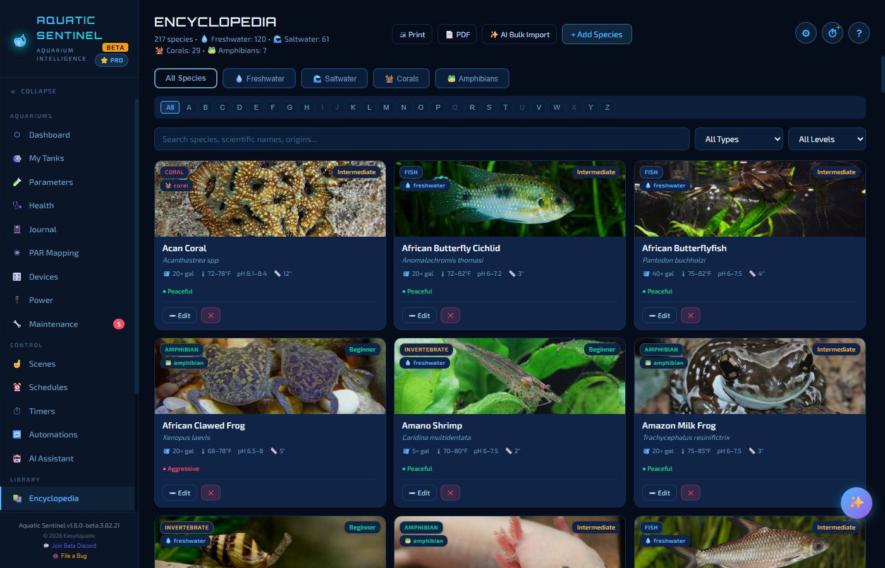
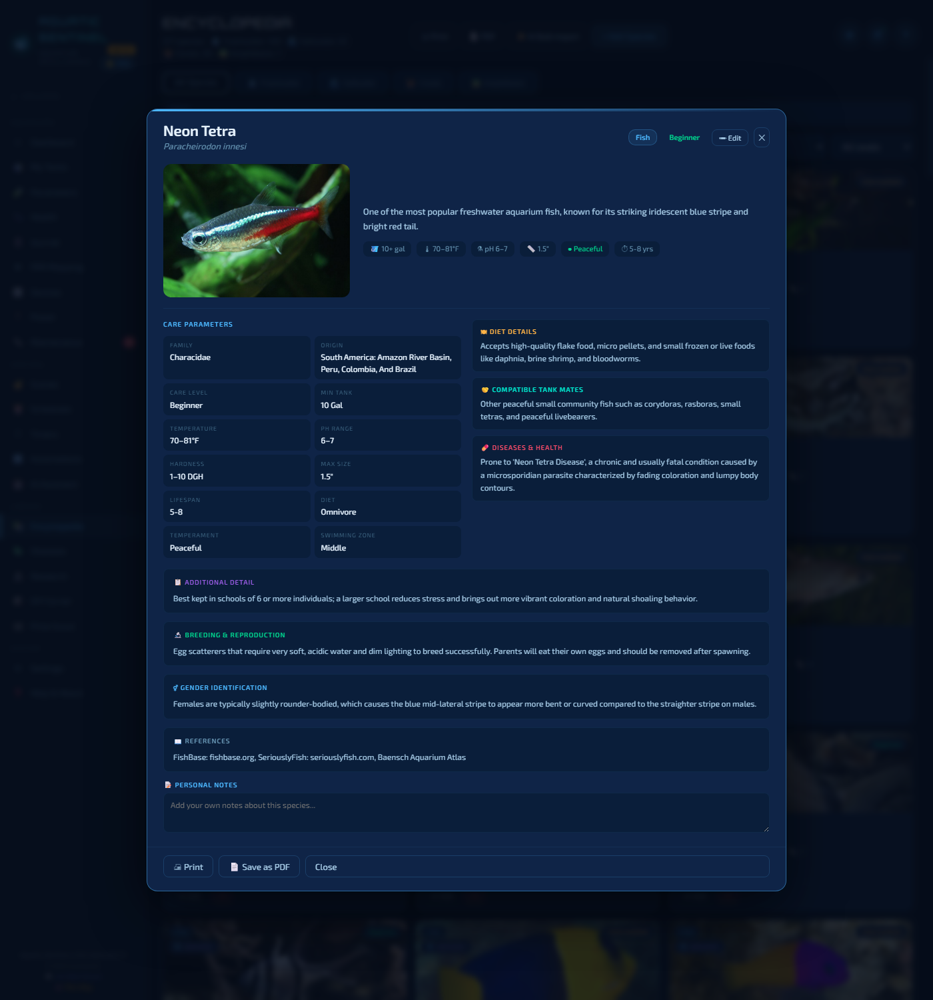
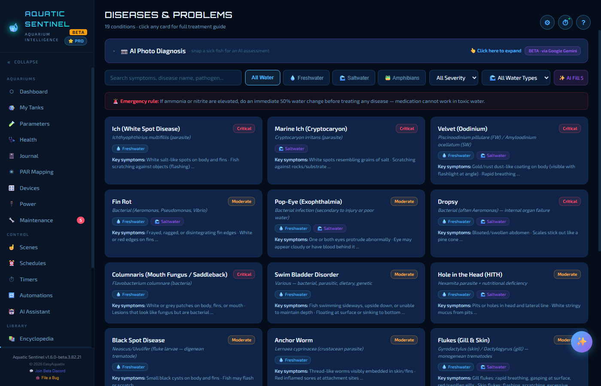
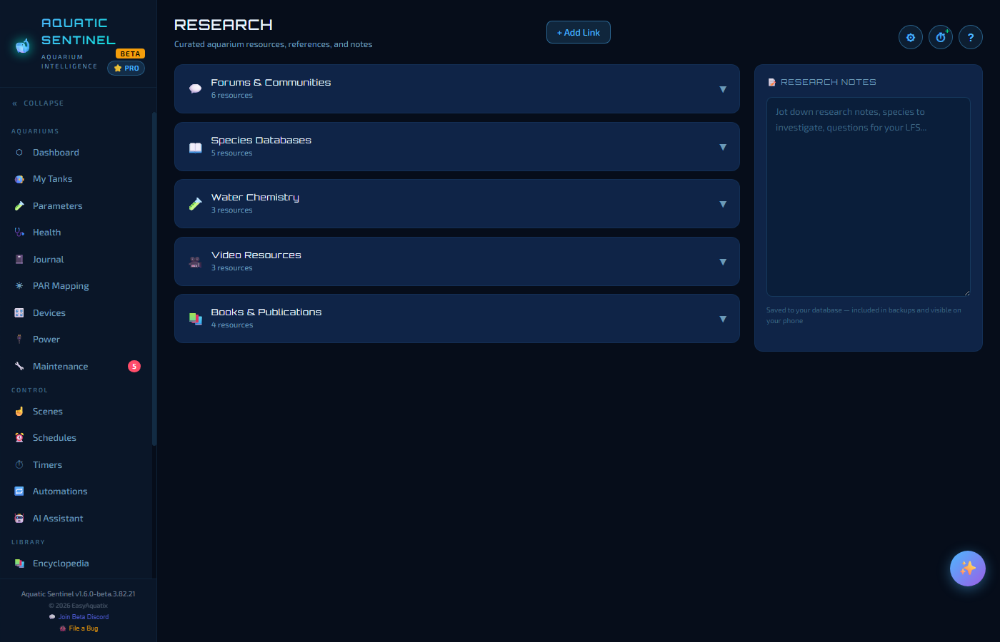
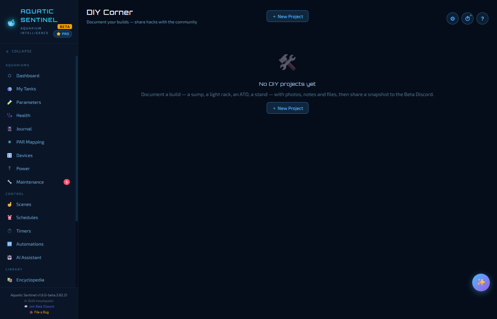
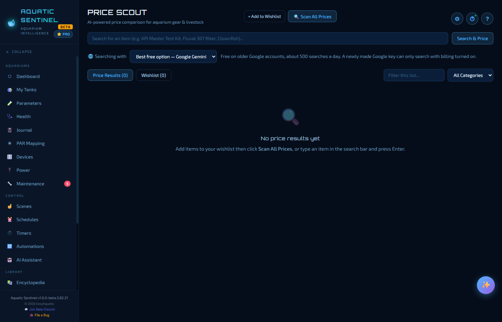

# 15. The Library

The **Library** group of the left menu is your reference shelf: a species encyclopedia, a disease guide, a research notebook, a place to document your builds, and a price-comparison tool.

**In this chapter:** [Encyclopedia](#encyclopedia) · [Diseases](#diseases) · [Research](#research) · [DIY Corner](#diy-corner) · [Price Scout](#price-scout)

---

## Encyclopedia

A searchable database of **217 species** — freshwater and saltwater fish, corals, invertebrates, plants and amphibians — that comes with the app. There is nothing to download and no account. **Every species has a photo and a full care card.**

### Finding a species

- Use the **category** buttons — All Species, Freshwater, Saltwater, Corals, Amphibians — and the **A–Z strip** to jump to a letter.
- **Search** by common name, scientific name or origin, and narrow by **type** or **care level** with the two menus.
- Each card shows a photo, the care level (*Beginner*, *Intermediate*, *Expert*), tank size, temperature and pH ranges, adult size and temperament.

### The care card

Click a species to open its card.

It lists the **care parameters** — family, origin, care level, minimum tank, temperature, pH range, hardness, maximum size, lifespan, diet, temperament and swimming zone — then **diet details**, **compatible tankmates**, **diseases and health**, **breeding and reproduction**, **how to tell males from females**, and references. There is also a box for **your own notes** — handy for recording breeding observations. **Print** and **Save as PDF** make a formatted care sheet.

### Why link your livestock to it

When you add an inhabitant to a tank, **link it to a species**. Its care card then drives the [Health](05-health.md) benchmarks — how your latest water compares with that species' ideal range, minimum tank size, bioload and tankmate conflicts. Species keep a stable identity, so renaming one in your own copy doesn't break the links.

### Adding your own

Press **+ Add Species**. A common name is all you need; fill in whatever else you know.

- **AI Auto-Fill** completes the care details from the name and corrects misspellings (needs an [AI key](13-ai.md)).
- **AI Bulk Import** generates a whole category of species at once.
- AI Fill **deliberately doesn't fill in photo links** — a broken link is worse than none. Use the Wikimedia Commons or Google Images links that appear to find a real photo, then paste its web address into the *Photo URL* field.
- To add an amphibian, choose the **Amphibians** filter first, then **+ Add Species** — the type defaults to amphibian.

---

## Diseases

A reference for **19 common aquarium diseases and problems** — ich, marine ich, velvet, fin rot, dropsy, columnaris, swim-bladder disorder, hole-in-the-head, anchor worm, flukes, fungal infections, popeye, chytrid fungus, red-leg, bloat, black beard algae, cyanobacteria, ammonia poisoning and more.

Search by symptom or disease name, or filter by water type (freshwater, saltwater, amphibian) and severity. Each card shows the severity (*Critical* or *Moderate*) and the key symptoms; **click one** for the full guide — symptoms, causes, treatment and prevention.

> [!IMPORTANT]
> Read the red line at the top of the page: **if ammonia or nitrite are elevated, do an immediate 50% water change before treating any disease** — medication cannot work in toxic water.

### AI photo diagnosis

Open the **AI Photo Diagnosis** panel at the top, and photograph a sick fish — or an invertebrate, coral or plant — with your webcam, a phone over [remote access](16-remote-access.md), or pick a file. A vision-capable AI returns:

- the **most likely conditions**, with how confident it is,
- the **signs it can see** in the picture,
- how **urgent** it is, and
- **treatments** that are safe for the other animals.

Attach a tank and it also weighs that tank's species and latest water test. Tap the photo to zoom in on the affected area. It needs a [photo-capable AI](13-ai.md) (Google Gemini's free tier works).

> [!NOTE]
> It is advisory. Check against the disease entry — and make sure any medication is safe for every inhabitant — before you dose. Afterwards, log the outcome on the [Health](05-health.md) page so the timeline stays complete.

---

## Research

A personal notebook for the hobby.

- **Curated links** are grouped by topic — forums and communities, species databases, water chemistry, video, and books and publications. Click a heading to open it; links open in your browser.
- **+ Add Link** adds your own articles, videos and forums alongside the built-in ones.
- **Research notes** is a notepad for observations, recipes or dosing sums. Your notes and links are saved in your database, so they are included in backups and available on your phone.

---

## DIY Corner

A place to document your own builds — a sump, a light rack, an auto top-off, a stand.

- **+ New Project** creates a project with a **category**, a **status** and notes.
- Attach **photos**, **documents or blueprints** (PDF or image, up to 5 MB) and **links** to video or reference material.
- **Share to Discord** writes a text summary you can paste into the Beta Discord's *#diy* channel. Your photos stay on your computer.

Everything is stored locally — no accounts and no cloud sync.

---

## Price Scout

Build a wishlist of equipment and livestock, and let the AI search the web for current prices.

1. Type an item into the search box — be specific (*Eheim 2217 canister filter* rather than *filter*) — and press **Search & Price**, or press **+ Add to Wishlist** to save it with an optional maximum budget.
2. Press **Scan All Prices**, or scan a single item. Prices only update when you scan — nothing runs in the background.
3. Each result has a button that goes straight to a search for it on that store.

The **Searching with** box picks which AI does the searching — see the note on web search in [AI features](13-ai.md#providers). Your wishlist is saved in your database (so it is in your backups and on your phone); scan results are kept only on the device you scanned from.

---

← [14. Voice](14-voice.md) · [Manual home](README.md) · **Next:** [16. Remote access](16-remote-access.md) →
