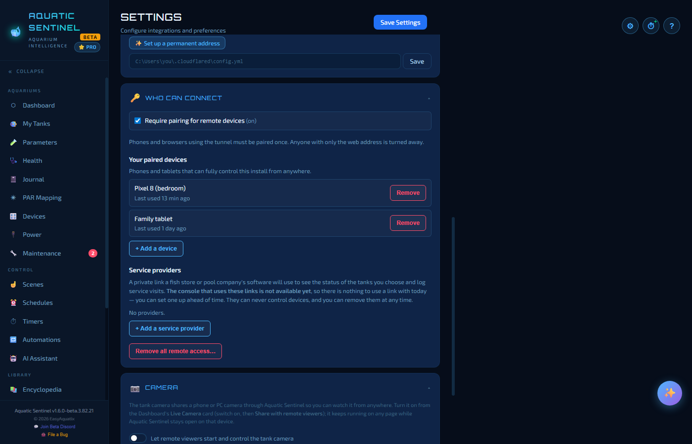
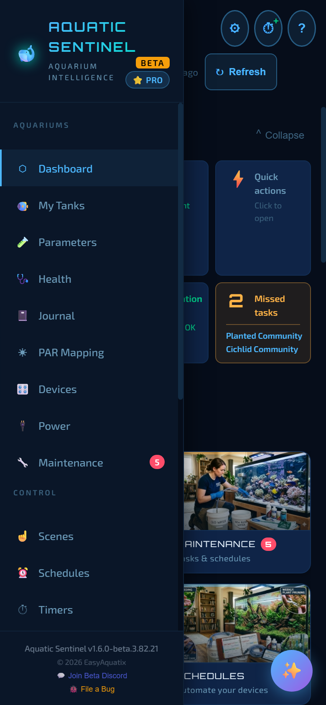
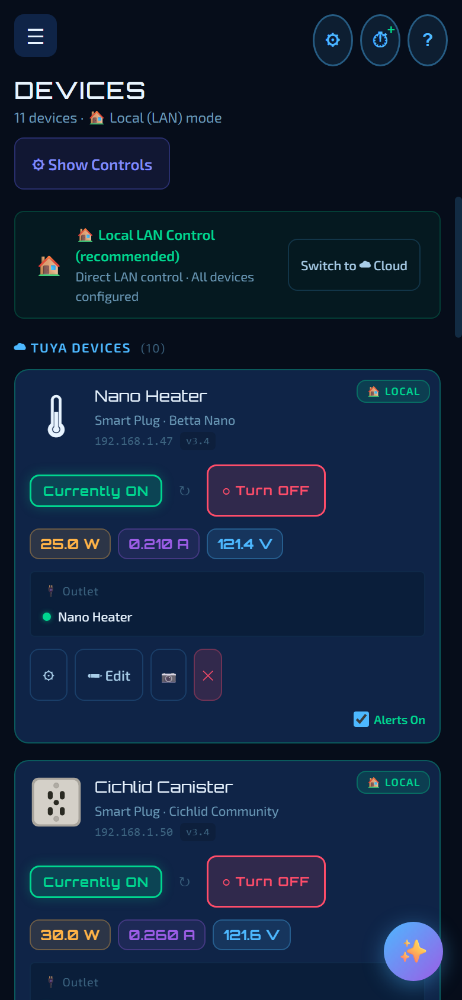
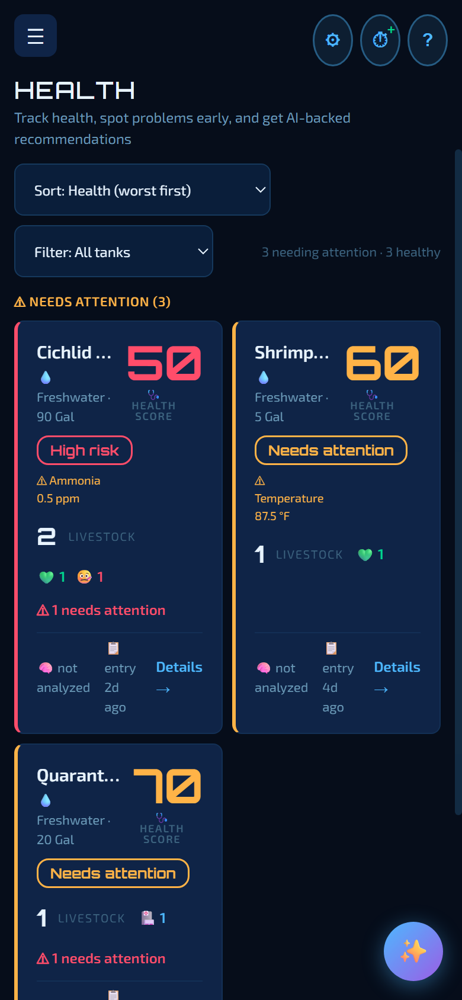
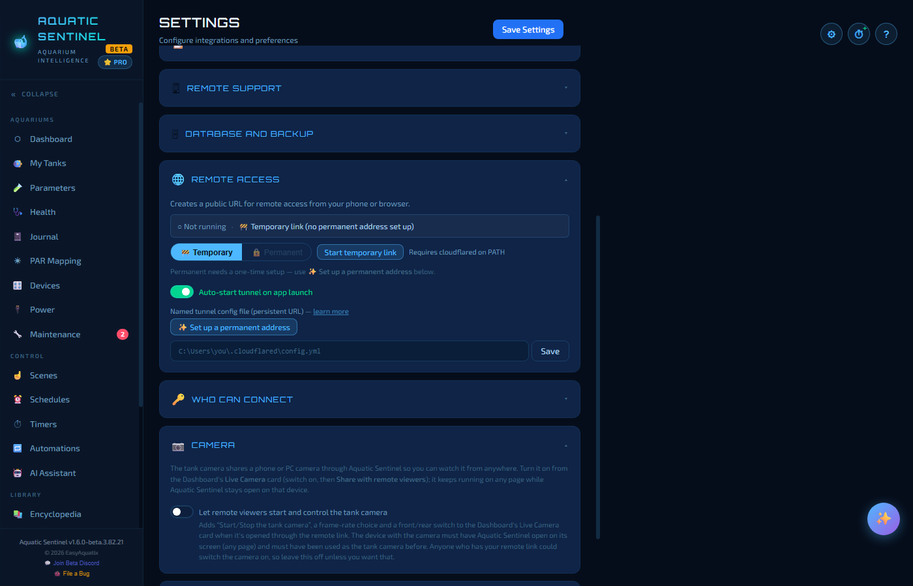

# 16. Remote access and your phone

Aquatic Sentinel is more than a window on one computer. The computer (or Android phone) that runs it also serves the app to **any web browser** — so you can check on your tanks from the sofa, or from the other side of the world.

**In this chapter:** [On your home network](#on-your-home-network) · [From anywhere (remote access)](#from-anywhere-remote-access) · [Permanent or temporary?](#permanent-or-temporary) · [Pairing: choosing who can connect](#pairing-choosing-who-can-connect) · [Using it on a phone](#using-it-on-a-phone) · [The tank camera over remote access](#the-tank-camera-over-remote-access) · [What works remotely](#what-works-remotely)

---

## On your home network

While Aquatic Sentinel is running, it serves the full app on **port 3480** of that computer. From a phone, tablet or another computer on the same Wi-Fi, open a browser and go to:

```
http://<the-computer's-address>:3480
```

For example `http://192.168.1.20:3480`. You can look up the address in your router's device list. Anything that can run a modern web browser will do — including a Mac or an iPhone.

> [!TIP]
> If the page won't load, the computer's firewall is the usual cause. Allow Aquatic Sentinel on your *private* network (Windows Firewall; *ufw* or *firewalld* on Linux).

---

## From anywhere (remote access)

To reach your tanks while you're away, Aquatic Sentinel can publish a secure web address for your computer using **Cloudflare Tunnel**. No port forwarding and no router changes are needed — the connection starts from your computer and goes *out*.

Everything you control is still controlled **by your computer at home**: when you tap a switch on your phone, the phone asks your home computer, and the computer talks to the device over your own network. That is why local-network devices keep working remotely.

### Turning it on

1. Go to **Settings → System → Remote Access**.
2. The tool that makes the tunnel, **cloudflared**, must be installed. The page tells you the command for your system — on Windows `winget install cloudflare.cloudflared`, on Linux `sudo apt install cloudflared` (or `sudo snap install cloudflared`) — or you can enter the path to the program.
3. Press **Start temporary link**. The address appears on the page, with a copy button. Open it on your phone.
4. Press **Stop Tunnel** to stop it. Tick **Auto-start tunnel on app launch** to bring it up every time the app starts.

The page always says what is running — *Temporary link* or *Permanent address* — and what the address is.

---

## Permanent or temporary?

| | **🚧 Temporary link** | **🔒 Permanent address** |
|---|---|---|
| Address | A new random address each time you start it | The same address every time, even after a restart |
| Needs | Just cloudflared | cloudflared **and a domain name you own**, added to a free Cloudflare account (a domain costs roughly $10–15 a year) |
| Best for | A quick check, or trying it out | Everyday use — bookmark it on your phone and forget about it |

A switch on the page chooses between the two (the choice is remembered, and also drives *auto-start*).

### The permanent address wizard

Press **✨ Set up a permanent address** and the wizard walks you through it:

1. **Domain** — it asks whether you own a domain on Cloudflare, and tells you at the start (not at the end) if you don't.
2. **cloudflared** — checks it is installed.
3. **Sign in** — you authorise against your own Cloudflare account.
4. **Tunnel** — creates the tunnel.
5. **Address** — chooses the web address (for example `tanks.yourdomain.com`), adds the DNS record and writes the configuration file.
6. **Done**.

> [!NOTE]
> Without a domain you can't have a permanent address — that is a Cloudflare rule, not an Aquatic Sentinel one. Temporary links work fine in the meantime.

---

## Pairing: choosing who can connect

A remote address is a door into your house, so you decide who may use it. Open **Settings → System → Who Can Connect**.



1. Turn on **Require pairing for remote devices**. From then on, phones and browsers using the tunnel must be **paired once** — anyone who only has the web address is turned away. This computer is not affected.
2. Under **Your paired devices**, choose **Add a device**. A **QR code** appears.
3. Scan it with the phone's camera, then tap **Pair this device**. Done — that phone now works from anywhere.
4. Remove any phone from the list at any time, and it stops working immediately. **Reset all remote access** removes every paired device in one go.

> [!TIP]
> Pair your own phones first, *then* switch pairing on. While it is off, anyone who has your address can open the app.

The same section also has a **service providers** area for sharing read-only tank status with a fish store or pool company. The program that would use those links is not available yet, so there is nothing to use one with today.

---

## Using it on a phone

- **Install it like an app.** In Chrome (Android) tap the menu → **Add to Home Screen**; in Safari (iPhone) tap **Share → Add to Home Screen**. It then opens full-screen with its own icon and keeps the most recent pages for fast starts.
- **The menu is the ☰ button** in the top-left corner. There's no bottom tab bar, so nothing covers the Save buttons in dialogs.
- **It catches up the moment you pick it up.** Waking your phone re-syncs it with the computer instead of showing you what was true an hour ago.
- **If your computer is off** (asleep, or the app is closed), the phone shows an Aquatic Sentinel page that says what happened and what to check, tries again by itself and loads the app as soon as the computer answers.
- **Pick the layout.** **Settings → Appearance → Layout** is **Auto** by default — it follows the screen size — or force **Phone** or **Desktop**.
- **Quiet by default.** *Sound alarms on phone / remote* (Settings → Alerts) is off, so an offline alert appears on screen without a siren in your pocket.
- **Push notifications.** In **Settings → Alerts → Push Notifications** you can enable notifications on that phone, so a leak alert reaches you even with the app closed. On an iPhone, add the page to your Home Screen first, then enable them. On Android Chrome, when asked, choose **Allow**.

While you are using the remote copy, the page header shows a **🌐 REMOTE** badge so you always know which one you're looking at.

<p>  </p>

---

## The tank camera over remote access

Remote viewers can watch a phone's shared camera ([Dashboard → Live Camera](02-dashboard.md#live-camera)). To also let a remote viewer **start, stop and adjust** that camera (frame rate, front/rear), switch on **Settings → System → Camera → Let remote viewers start and control the tank camera**.



This is **off by default**, because anyone who has your remote link could then switch the camera on. The device with the camera must have Aquatic Sentinel open on its screen (any page) and must have been used as the tank camera before.

---

## What works remotely

Almost everything: viewing and logging tanks, parameters, journal, the Health page, devices on/off, scenes, schedules, automations, the AI assistant, the Encyclopedia and your photos. Your automations and schedules keep running on the computer at home whether or not anyone is connected.

A few things need you at the computer itself, or on its network:

- **Finding new devices on your network** (the network scan, Diagnose and the Kasa and Magic Home searches). From a browser on the *same computer* they work; over the remote address they are blocked on purpose, so a remote link can't be used to probe your home network.
- **Pairing and removing remote devices** (the *Who Can Connect* settings).
- **Changing the backup folder**, and anything that needs a native file or folder dialog.
- **Bluetooth devices** are read by the computer that has the Bluetooth radio.
- **Configuring a Sentia doser** is done on the computer or the phone that hosts the app; remotely you get the read-only card and dose history.

---

← [15. The Library](15-library.md) · [Manual home](README.md) · **Next:** [17. Android](17-android.md) →
