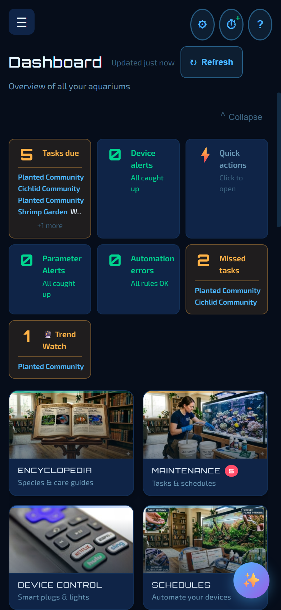

# 17. Aquatic Sentinel on Android

An old Android phone or tablet — or a new one — can be a complete, always-on tank controller. The whole app runs **on the phone**: your schedules, automations, alerts and device control keep going with the screen off, with no computer left switched on. And because phones have cameras, you can watch your livestock with the [live tank camera](02-dashboard.md#live-camera).

**In this chapter:** [Installing](#installing) · [How it works](#how-it-works) · [Setup tips](#setup-tips-keep-it-alive-overnight) · [Updates](#updates) · [Your data](#protecting-your-data) · [What's different on Android](#whats-different-on-android)

---

## Installing

You need Android **9 or newer** and about 130 MB of space. There are two ways to install:

**With Obtainium (recommended).** [Obtainium](https://obtainium.imranr.dev/) is a free app that installs apps from GitHub and keeps them up to date. Install it once, then add Aquatic Sentinel using the **Install with Obtainium** link at the top of the newest release page. From then on, Obtainium offers each new version, and on Android 12 or newer it can install updates in the background.

**From the APK.** Download **`AquaSentinel-android-<version>.apk`** from the newest release on the [releases page](https://github.com/Aquaman-TSH/aquasentinel-releases/releases) and open it. Android will ask you to allow **install unknown apps** for your browser or file manager — that's expected, because the app isn't in an app store.

Every release is signed with the same key, so an update installs over the top of the previous version and keeps your data.

---

## How it works

1. Open **Aquatic Sentinel** on the phone and tap **START SERVER**.
2. Tap **Open Graphical Application**. The full app opens in the phone's browser.
3. From any other phone or computer on your Wi-Fi, open `http://<the phone's Wi-Fi address>:3480` in a browser (the phone's address is in its Wi-Fi network details) — or turn on [remote access](16-remote-access.md) from the phone and reach it from anywhere.

The start screen is a live status panel: it shows whether the server is running, plus CPU, memory and uptime.

- **It runs unattended.** It keeps working with the screen locked and starts itself again after the phone reboots. After an app update it is built to restart on its own; if the notification hasn't come back within a minute, just open the app once.
- **It controls your devices over your own network.** Add Tuya devices straight from the phone — it can find them on your Wi-Fi. Scenes, schedules, automations, alerts and the Journal all work.
- **Everything is unlocked** during the beta, the same as on the desktop, and the **Encyclopedia** has the same 217 species.

---

## Setup tips: keep it alive overnight

Phones are designed to put apps to sleep to save battery. Three settings keep Aquatic Sentinel running:

1. **Tap Allow** when it asks to *ignore battery optimisation*. That is what keeps it alive overnight.
2. **Leave the phone plugged in.**
3. **On a Samsung phone**, also open **Settings → Battery and device care → Battery → Background usage limits** and make sure *Put unused apps to sleep* does **not** include Aquatic Sentinel. If schedules stop firing while the screen is locked, this is the first place to look.

> [!IMPORTANT]
> The phone *is* the server. Don't force-stop the app. A reboot or an update restarts it by itself.

---

## Updates

- **With Obtainium**: updates are offered automatically. On Android 12 or newer, with the app installed *through* Obtainium, they can run in the background. On older phones Android asks you to tap **Install**.
- **From a downloaded APK**: Android asks you to confirm each update.

---

## Protecting your data

Your data is stored on the phone, and the safest habit is to keep a copy elsewhere:

- **Share a copy…** (**Settings → System → Database and Backup**) sends a fresh copy of your data to Google Drive, email or any app you choose — or saves it to the phone's **Downloads**. Do this after any big change (new tanks, a restore, a long stretch of readings).
- **Backups** are also saved automatically to a folder on the phone. Plug the phone into a computer with a USB cable and copy the newest file out of it.
- **Restore** works with a backup made on any computer: **Upload a backup** from another computer through your remote address, or copy the file into the backup folder with its name unchanged.

> [!NOTE]
> Android's own automatic Google backup doesn't work for this app yet (Google's backup service declines it), so the phone's data is only as safe as the copies you take. We're looking for a proper automatic solution for a future release. Uninstalling the app deletes its backup folder, so copy off any backup you want to keep first. More in [Backup and your data](19-backup-and-data.md).

---

## What's different on Android

- **Zigbee** and the Windows-only **Bluetooth bridge** aren't available on the phone.
- **Voice commands and the wake word** are desktop features and haven't been tried on Android.
- A **Sentia doser** can be set up and configured from the phone's own browser tab; over remote access you get the read-only card and dose history.
- Camera pages need a secure connection — on the phone itself use `http://localhost:3480`.

---

← [16. Remote access](16-remote-access.md) · [Manual home](README.md) · **Next:** [18. Settings](18-settings.md) →
