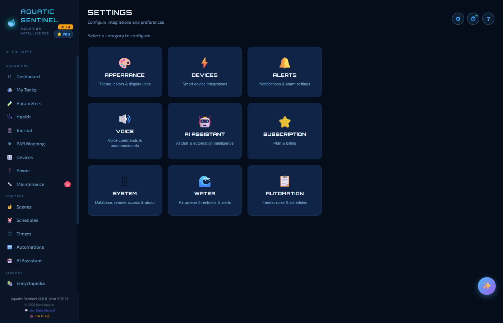
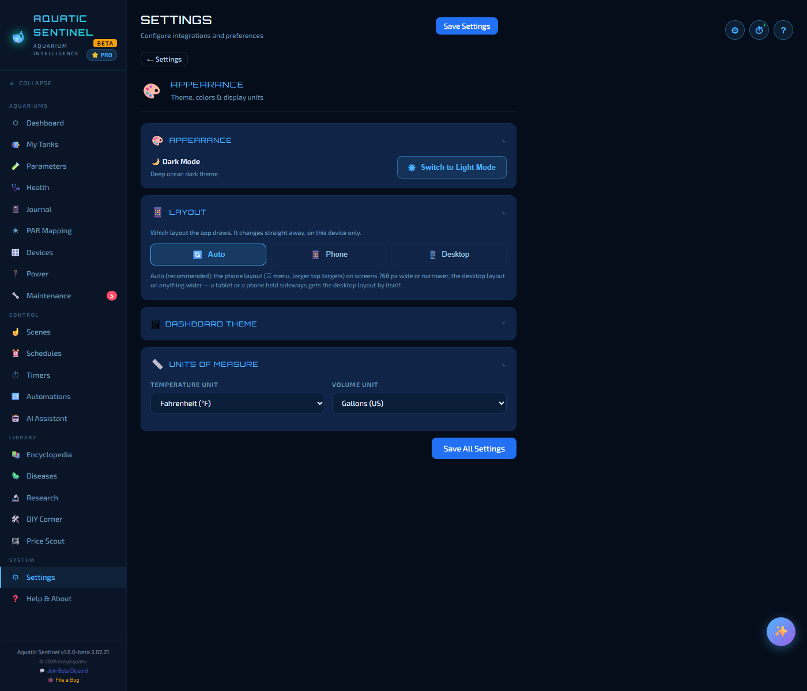
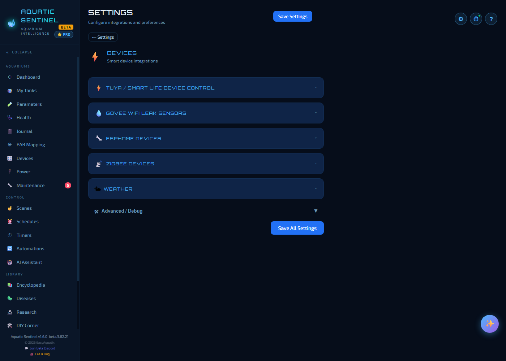
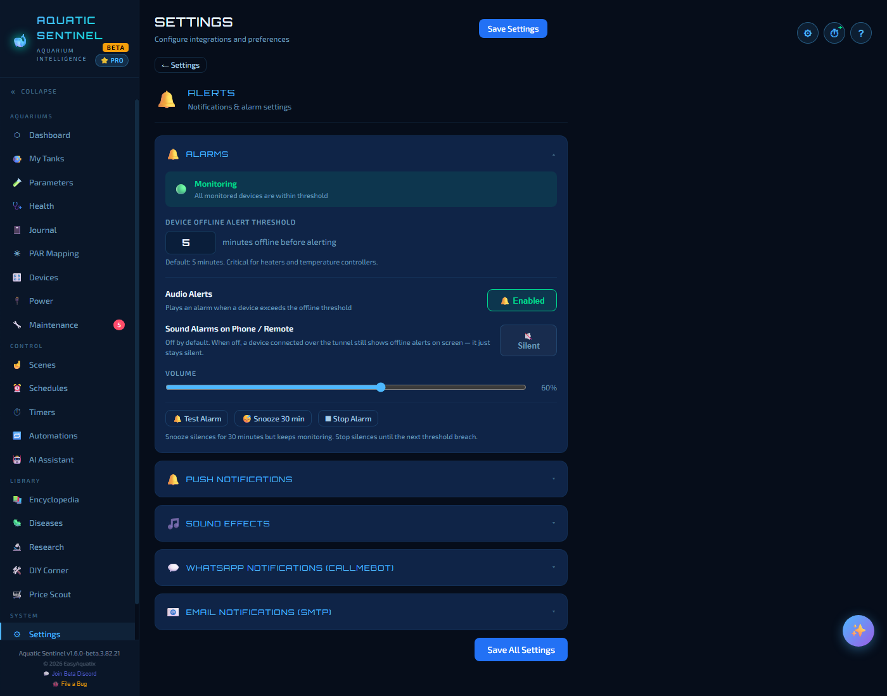
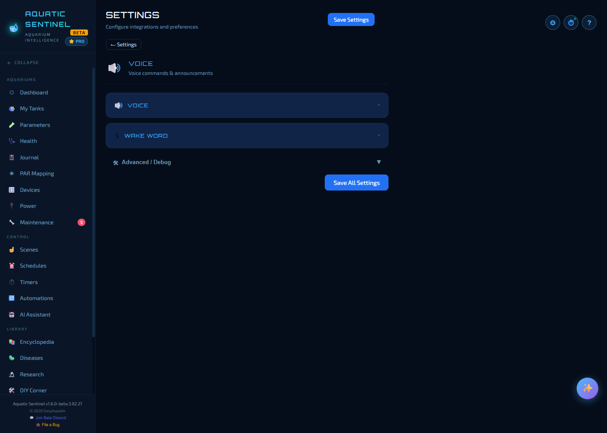
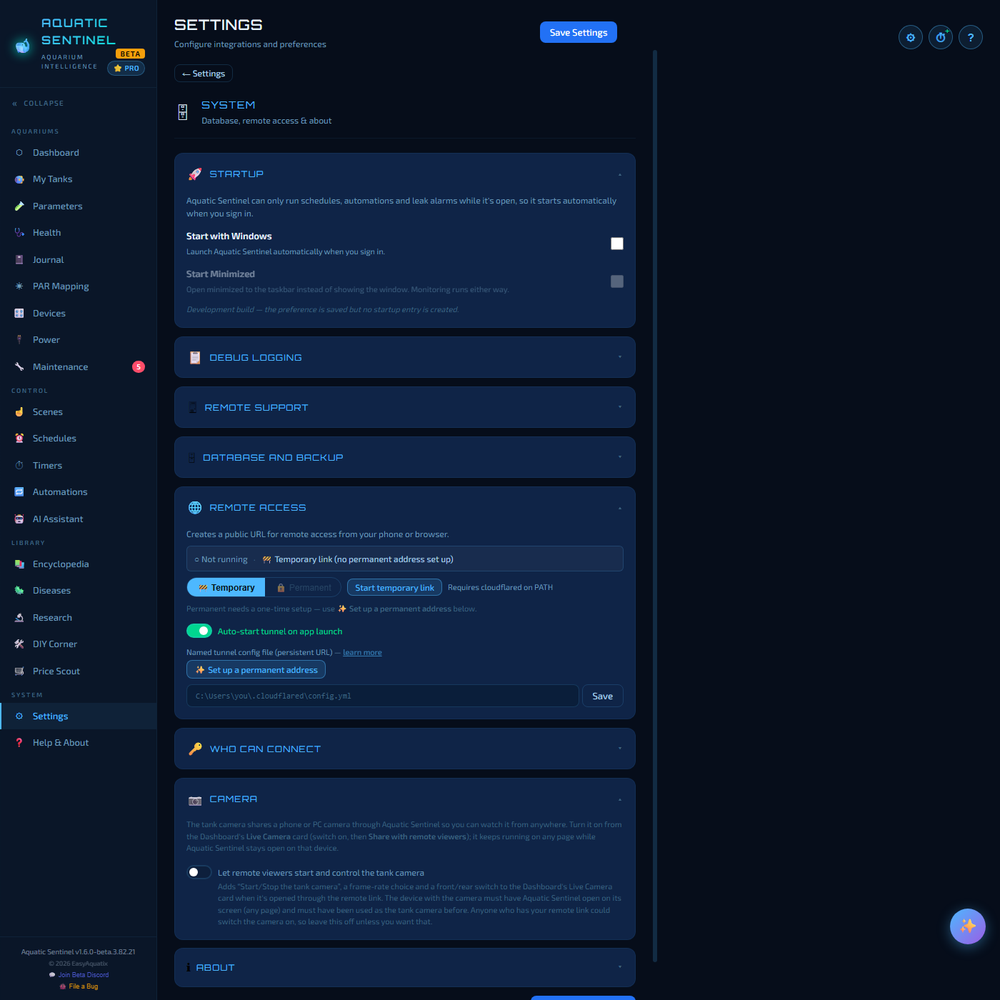
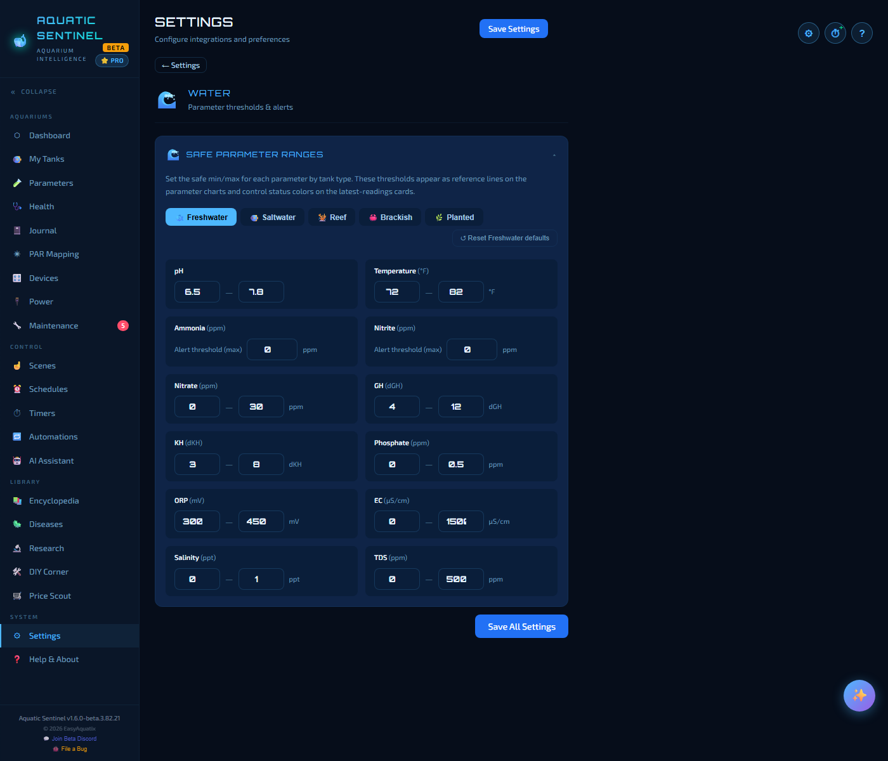
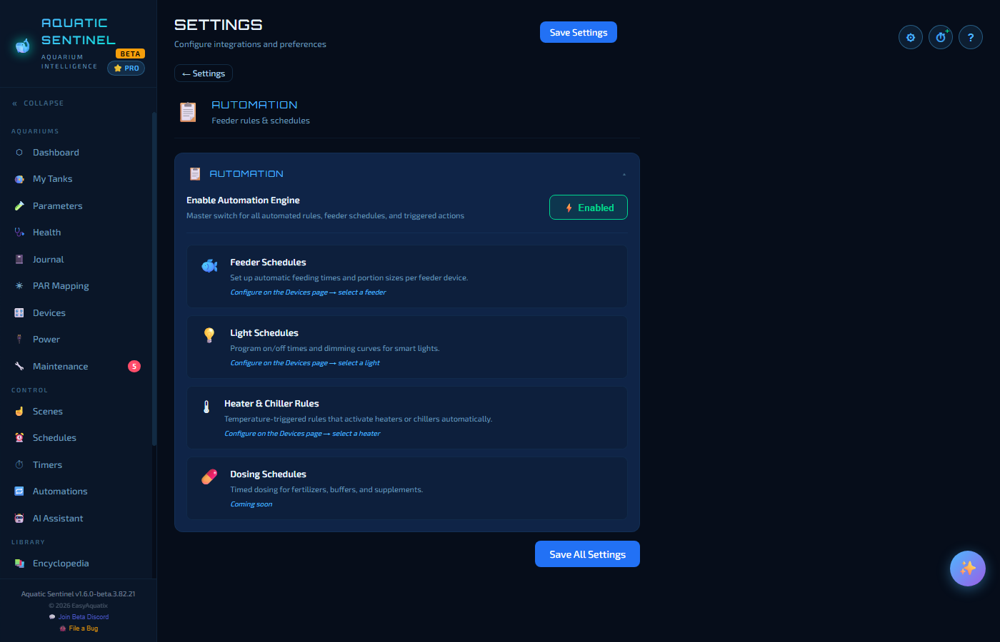

# 18. Settings

Settings is where you connect services, tune alerts and decide how the app looks. Open it with the **⚙** button at the top of any page, **Ctrl+,**, or **Settings** in the left menu.

The hub shows nine tiles. Click one to open its page; **← Settings** at the top brings you back. Within a page, each group is a collapsible section — click its heading to open or close it. Changes **save automatically** (a *Saving… / Saved* note appears near the title); **Save Settings** simply makes sure.

**In this chapter:** [Appearance](#appearance) · [Devices](#devices) · [Alerts](#alerts) · [Voice](#voice) · [AI Assistant](#ai-assistant) · [Subscription](#subscription) · [System](#system) · [Water](#water) · [Automation](#automation)

---

## Appearance

| Section | What it does |
|---|---|
| **Appearance** | **Dark mode** (the default) or **Light mode**. Press **D** anywhere to flip it. |
| **Layout** | **Auto**, **Phone** or **Desktop**. *Auto* (recommended) uses the phone layout — the ☰ menu and larger tap targets — on screens 768 px wide or narrower, and the desktop layout on anything wider, so a tablet or a phone held sideways gets the desktop layout by itself. The change is immediate and applies to **this device only**. |
| **Dashboard Theme** | The pictures on the Dashboard's shortcut tiles: **Modern** (clean, photographic), **Cartoon** (illustrated) or **Custom** (your own images). |
| **Units of measure** | **Temperature** in °F or °C, and **volume** in US gallons or litres. |

---

## Devices

| Section | What it does |
|---|---|
| **Tuya / Smart Life Device Control** | Your Tuya Cloud credentials, the **Test Connection** button, the **Launch Setup Wizard**, and the **Control mode** — *Cloud* or *Local LAN (recommended)*. See [Connecting Tuya](09-devices.md#connecting-tuya). |
| **Govee WiFi Leak Sensors** | Your Govee API key. |
| **ESPHome Devices** | ESPHome options, including the polling interval. |
| **Zigbee Devices** | The coordinator, the pairing wizard and per-device diagnostics. The **📖 How Zigbee works** button opens the full guide on the Help page. |
| **Weather** | An **OpenWeatherMap API key**, your **location** (a city name or zip code) and **units** (imperial or metric). It powers the *"what's the weather"* and forecast voice commands. |
| **Advanced / Debug** | Tuya API usage, to see how many cloud calls you're making. |

---

## Alerts

| Section | What it does |
|---|---|
| **Alarms** | The state of the alarm system (*Monitoring*, *Alarm active*, *Snoozed*). **Device offline alert threshold** — how many minutes a device must be offline before you're alerted (5 by default; it matters most for heaters and temperature controllers). **Audio alerts** on or off. **Sound alarms on phone / remote** — off by default, so a phone on remote access shows an offline alert on screen without making noise in your pocket. A **volume** slider, and **Test Alarm**, **Snooze 30 min** and **Stop Alarm** buttons. *Snooze* silences alarms for 30 minutes but keeps monitoring; *Stop* silences until the next breach. |
| **Push notifications** | Enable notifications on the device you're using, so a leak or alarm reaches you even with the app closed ([chapter 16](16-remote-access.md#using-it-on-a-phone)). |
| **Sound effects** | The chimes and sounds the app plays. |
| **WhatsApp notifications (CallMeBot)** | Add contacts to receive automation messages on WhatsApp. |
| **Email notifications (SMTP)** | Your outgoing mail server, so automations can send email. |

**Ctrl+Shift+S** (or the on-screen **Silence** button) silences every active alarm at once.

---

## Voice

| Section | What it does |
|---|---|
| **Voice** | **Voice output** (the voice, speed, pitch and volume), **Narrate AI assistant replies**, **Speak device alerts**, and how long a timer waits before re-announcing (**Timer alert snooze duration**). Your OpenAI key for the Whisper recogniser goes here too. |
| **Wake word** | Turn "Hey Sentinel" on (it's **off** by default) and set its sensitivity. |
| **Advanced / Debug** | **Voice vocabulary**, **voice macros** and **voice debug** — see [Voice](14-voice.md). |

---

## AI Assistant

Pick your provider and key, set a Photo AI, show or hide the ✨ Helper, and test the connection. Everything is explained in [AI features](13-ai.md#set-up-your-ai).

---

## Subscription

Shows your plan — **Aquatic Sentinel Pro**, unlocked free during the beta — and has **Relaunch Setup Wizard**.

---

## System

| Section | What it does |
|---|---|
| **Startup** | **Start with Windows** (or *Start with Linux*) — on by default, because schedules, automations and leak alarms only run while the app is open. **Start minimised** opens it to the taskbar instead of showing the window; monitoring runs either way. Switching it off in Windows' own Startup list is respected, and uninstalling removes the entry. |
| **Platform notes** | Appears only when something works differently on your system — see below. |
| **Debug logging** | **Write debug log to file** saves the app's diagnostic output (secrets masked) so you can read it or send it to us. |
| **Remote support** | **Launch Quick Assist** (Windows) lets someone from support see your screen; a code appears for you to share. |
| **Database and backup** | See [Backup and your data](19-backup-and-data.md). |
| **Remote access** | The tunnel: temporary or permanent, auto-start and the setup wizard — [chapter 16](16-remote-access.md). |
| **Who can connect** | Pairing for remote devices — [chapter 16](16-remote-access.md#pairing-choosing-who-can-connect). |
| **Camera** | Whether remote viewers may start and control the tank camera — [chapter 16](16-remote-access.md#the-tank-camera-over-remote-access). |
| **About** | Version and what the app is built with. |

### Platform notes

This section tells you the things that **don't** work the way you'd expect on your computer, because they fail silently:

- **Linux on Wayland (the default on most new installs):** apps can't register global hotkeys, so **Ctrl+Shift+S**, **Ctrl+Shift+A** and **Ctrl+R** don't fire while the app is in the background. Use the on-screen **Silence** button, which works everywhere — or log in with *Xorg*. Shortcuts that work inside the window keep working.
- **No desktop keyring:** saved API keys are stored unencrypted, and the page says so.
- **Firewall advice** names *ufw* or *firewalld* instead of Windows Firewall.
- On Linux, offline speech *recognition* is a Windows feature; the assistant listens through your AI provider instead.

---

## Water

**Safe parameter ranges** are the lines drawn on your charts and the colours on your readings — and the thresholds for alert rules on new tanks. There is a tab for each tank type — **Freshwater, Saltwater, Reef, Brackish, Planted** — with a minimum and maximum for pH, temperature, nitrate, GH, KH, phosphate, ORP, EC, salinity and TDS, and a maximum alert threshold for ammonia and nitrite. **Reset … defaults** puts a tab back the way it came. The starting values are in the [Reference](21-reference.md#default-safe-ranges).

---

## Automation

The **Enable Automation Engine** master switch turns every rule, feeder schedule and triggered action on or off at once. Below it are pointers to where each kind of schedule is configured on the Devices page — feeder schedules, light schedules, heater and chiller rules — and a placeholder for dosing schedules.

---

← [17. Android](17-android.md) · [Manual home](README.md) · **Next:** [19. Backup and your data](19-backup-and-data.md) →
