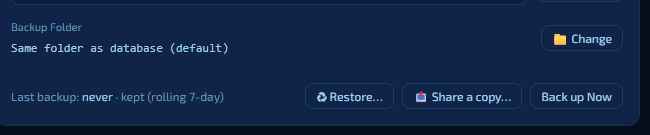

# 19. Backup and your data

Your tanks, tests, photos and settings are valuable — years of history, for some people. Aquatic Sentinel keeps them **on your own computer**, backs them up automatically, and makes it easy to take a copy elsewhere.

**In this chapter:** [Where your data lives](#where-your-data-lives) · [Automatic backups](#automatic-backups) · [Backing up now](#backing-up-now) · [Restoring](#restoring) · [Moving to a new computer](#moving-to-a-new-computer) · [Exporting parts of your data](#exporting-parts-of-your-data) · [What leaves your computer](#what-leaves-your-computer)

---

## Where your data lives

Everything is stored in **one database file**, `aquaticsentinel.db`, in the app's data folder — on Windows, `%APPDATA%\aquaticsentinel\`. There is no account and no cloud copy unless you make one.

**Settings → System → Database and Backup** shows where the database is and where backups go, and has an **Open Folder** button.

---

## Automatic backups

You don't have to remember. Aquatic Sentinel makes a **backup once a day** and keeps the **newest seven**, so you always have a week of history to go back to. Each backup is a timestamped copy of the whole database, named like `aquaticsentinel.backup-2026-10-10_09-30-00.db`, saved by default in the same folder as the database. Before copying, it checks the database is sound, so a damaged file never overwrites a good backup.

The line *"Last backup: … · kept (rolling 7-day)"* in Settings tells you when the last one ran.

**Change the folder** with the **Change** button — pick a different drive, a USB stick or a synced folder (desktop only, because it needs a native folder picker).

---

## Backing up now

Before a big change — importing a lot of data, trying something new — take a backup yourself:

- press **Back up Now** in **Settings → System → Database and Backup**, or
- press **Ctrl+Shift+B** from anywhere in the app.

It saves any pending changes first, so the backup holds what you have *right now* — not what the file looked like a minute ago.

**Share a copy…** sends a fresh copy of your data wherever you choose — Google Drive, email, any app — or saves it to the device's Downloads. It is the quickest way to get a copy off a phone ([chapter 17](17-android.md#protecting-your-data)).

> [!TIP]
> A backup that lives only on the computer it protects isn't much of a backup. Now and then, copy the newest file to a USB stick or a cloud drive.

---

## Restoring

1. Open **Settings → System → Database and Backup** and press **Restore…**.
2. Choose a backup from the list. Restore lists files named `aquaticsentinel.backup-…db`, with the date of each.
3. Press **♻ Restore Selected** and confirm.

> [!IMPORTANT]
> Restoring **replaces** all current data with the backup. Your current data is saved to a **new backup first**, so you can undo the restore by restoring *that* snapshot. Aquatic Sentinel restarts to finish (on Android it reloads in place).

### If Aquatic Sentinel won't start

Backups are ordinary copies of the database. In an emergency, close the app, rename a backup file to `aquaticsentinel.db` in the data folder (keeping the old file somewhere safe), and start it again.

---

## Moving to a new computer

1. On the old computer, press **Back up Now** and copy the newest backup file to a USB stick or cloud drive.
2. Install Aquatic Sentinel on the new computer.
3. Put the backup file in the new computer's backup folder **with its name unchanged** (`aquaticsentinel.backup-…db`) — or, if the new copy is reachable through your [remote-access](16-remote-access.md) address, open Settings on **another computer** and use **Upload a backup**, which names the file for you.
4. Press **Restore…** and choose it.

Your devices keep working if the new computer is on the same network; Tuya and other cloud accounts are entered again in Settings.

> [!NOTE]
> On **Android** the backup folder is the phone's own storage: plug the phone into a computer with a USB cable to copy backups off. A file manager on the phone can't open it, and **uninstalling the app deletes it** — copy off any backup you want to keep first.

---

## Exporting parts of your data

Some things have their own export for sharing or spreadsheets:

| What | Where |
|---|---|
| A tank's records | **My Tanks → tank → ⋯ More → Export** — CSV or JSON, for the last 7 days, 30 days or all time. |
| Your devices | **Devices → ⋯ More → Export all devices** (and **Import devices**). |
| Automation rules and recipes | **Automations → Export All** (and **Import**). |
| Power history | **Power → Export CSV**. |
| A tank's health snapshot | **Health → Share** — Copy snapshot or Download .txt. |
| A species care sheet | **Encyclopedia →** a species **→ Print / Save as PDF**. |

To keep the database a sensible size, **Power → Clear power history** and **Automations → Clear Log** remove old readings and log entries you no longer need.

---

## What leaves your computer

Aquatic Sentinel is local-first. Nothing is uploaded unless you switch on something that needs the internet:

- **AI features** send your question and the tank context you select to the provider **you** chose — and only when you use an AI feature.
- **Tuya, Kasa, Govee, Sentia and Hydros cloud control** talk to those companies' services, with the accounts you entered.
- **Weather** asks OpenWeatherMap, with the key and location you gave.
- **Remote access** publishes the address you set up through Cloudflare.
- **Bug reports** send nothing by themselves — the report opens in *your* email app and you press Send.

---

← [18. Settings](18-settings.md) · [Manual home](README.md) · **Next:** [20. Troubleshooting](20-troubleshooting.md) →
