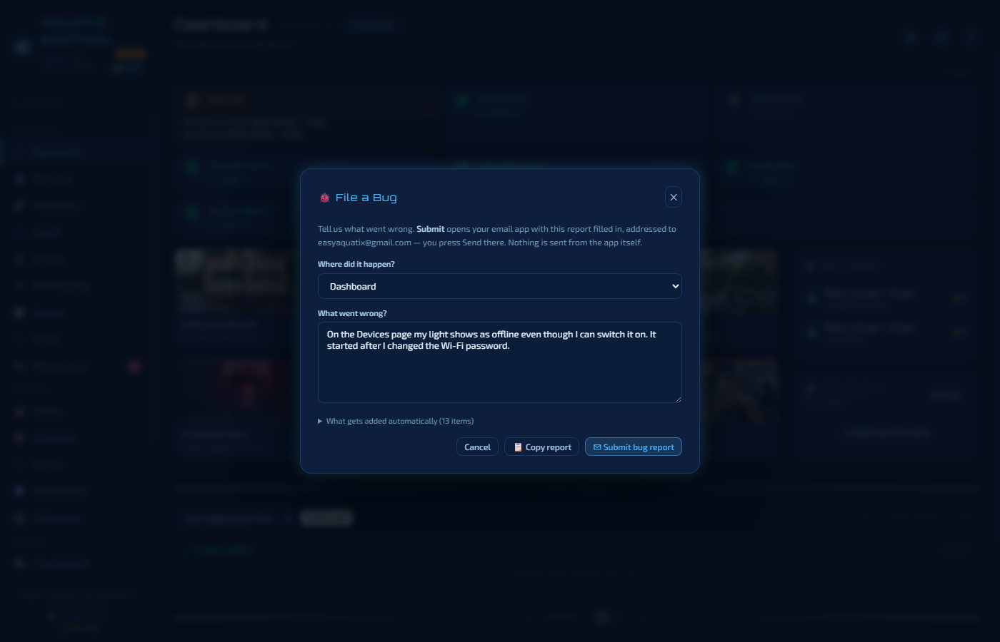

# 20. Troubleshooting and FAQ

Most problems have a short fix. This chapter is organised by what you're seeing; if yours isn't here, the last section shows how to report it in under a minute.

**In this chapter:** [Starting the app](#starting-the-app) · [Devices](#devices) · [Schedules and automations](#schedules-and-automations) · [Readings](#readings) · [AI](#ai) · [Phone and remote access](#phone-and-remote-access) · [Your data](#your-data) · [Reporting a bug](#reporting-a-bug) · [Questions people ask](#questions-people-ask)

---

## Starting the app

**Windows says "Windows protected your PC".**
The installer isn't code-signed yet, so SmartScreen asks first. Click **More info**, then **Run anyway**. The warning is about the missing signature, not about anything found in the file.

**On Linux, a dialog asks me to confirm the first run.**
Same reason — the AppImage isn't signed. Confirm once and it won't ask again. If it doesn't start at all, check that the file is marked executable.

**A message says Aquatic Sentinel can't start because a port is busy.**
This almost always means a second copy is already running — perhaps minimised, since the app starts with your computer. Find it in the taskbar (or Task Manager) and close it, then start again.

**It seems to be running an old version after an update.**
Quit it completely — including from the system tray — and start it again.

**The "update available" window.**
The prompt no longer freezes anything behind it, so you can leave it and decide when to restart.

---

## Devices

**A device shows offline.**
Work down this list:

1. **Is it really off?** Check its power and Wi-Fi.
2. **Local or cloud?** Devices in *Local* mode talk to the device directly; if that stops working, Aquatic Sentinel falls back to the manufacturer's cloud on its own, so a device is only shown offline if *neither* route answers.
3. **Did its address change?** If your router gave the device a new IP, the card finds it again by itself, even while you are looking at the page.
4. **Is it a battery sensor?** Sleeping sensors (many leak sensors and water-quality probes) wake only now and then and report through the cloud — a few minutes' delay is normal, and several types **can never** use local mode. See [Devices](09-devices.md#local-or-cloud).

**A banner says "Network issue detected — N devices went offline simultaneously".**
When two or more devices drop at once, it's almost never the devices — check your router, your switch and your internet. The banner clears by itself when they come back.

**Discover Devices returns nothing.**
Make sure your Smart Life account is linked to your Cloud Project at *iot.tuya.com → your project → Devices → Link Tuya App Account*, and that the **UID** you entered is the one from the developer platform, not your app username. See [Devices → Connecting Tuya](09-devices.md#connecting-tuya).

**A device "connects but doesn't work".**
That is almost always the wrong protocol version. In the device form, press **🔍 Diagnose** under *Advanced*: it tries every version against the device and picks the one that returns the most real data.

**A Kasa plug on firmware 1.1.1 won't connect.**
In the Kasa app, turn on **Me → Settings → Third-Party Compatibility**. It doesn't apply instantly — allow a few minutes. TP-Link warns that this setting can reopen older weaknesses, so anything on your home network can then switch the plug.

**I can't find the device on my network.**
Use **📡 Smart Network Scan** (it sweeps your network for Tuya devices; ones you've already added are greyed out) and **🔍 Identify**, which flashes the device so you know which one it is. These work from a browser on the same computer, but are blocked over remote access on purpose.

**Hydros.**
CoralVue Hydros support is still a **preview**, validated against a simulator but not yet on real hardware — treat it as experimental and tell us what you see.

---

## Schedules and automations

**A schedule or automation didn't run.**
They run **inside Aquatic Sentinel**, so the app must be running at the time:

- Check **Settings → System → Startup** — *Start with Windows* (or Linux) should be on, so the app is back after a reboot.
- On a **phone**, make sure battery optimisation is off for the app and the phone is plugged in ([chapter 17](17-android.md#setup-tips-keep-it-alive-overnight)).
- Check the **Settings → Automation → Enable Automation Engine** master switch is on.
- Open **Schedules → History** or the automation's own **History** to see whether it fired and what happened.
- A **locked outlet** ignores schedules, scenes and automations alike — see [Locking an outlet](09-devices.md#locking-an-outlet-in-place).
- An automation that depends on a sensor acts **only on fresh readings**. If the sensor went quiet, the rule pauses rather than acting on stale data, and the Dashboard says so.

---

## Readings

**A reading looks impossible.**
Every probe reading passes a check before it is stored. A value or a jump that can't be real — a temperature leaping from 78 to 153 °F — is **held back**: the last good value stays, automations won't act on the bad one, and you're alerted only if the fault lasts. A reading that could be a genuine emergency (a stuck heater, for instance) alerts you immediately and is never hidden.

**The Dashboard shows my manual test as blank.**
It shouldn't: every tile shows the latest value of *its own* parameter, with how long ago it was measured, even if a probe logged something newer. If you see otherwise, please [report it](#reporting-a-bug).

**My nitrate estimate is off.**
It's a rough cross-check from a conductivity ratio, not a measurement — see [Parameters → Nitrate estimate](04-parameters.md#nitrate-estimate). Test directly before acting on it.

---

## AI

**The assistant says there's no key, or can't connect.**
Open **Settings → AI Assistant** and run the **setup wizard**; it tests the key before saving it. The page also has **Test Connection**.

**"Overloaded" or "model not available".**
A free model is busy or has been retired. The app retries on another model by itself; if it keeps failing, pick a different model in Settings → AI Assistant — switching takes effect immediately.

**"Your balance is empty".**
That's your provider's account, not Aquatic Sentinel. Top up, or switch to a free provider such as Google Gemini.

**Price Scout finds nothing.**
Searching the web is only free with Gemini on an older Google account; see the note in [AI features](13-ai.md#providers).

---

## Phone and remote access

**My phone can't reach the app on my home Wi-Fi.**
Check the address (`http://<computer's address>:3480`) and that the computer's firewall allows the app on your private network.

**The remote link shows an Aquatic Sentinel page instead of the app.**
That's the "your computer is off" page — your computer is asleep, off, or the app is closed. Wake it, and the phone loads the app by itself.

**A paired phone stopped working.**
It may have been removed from **Settings → System → Who Can Connect**, or *Reset all remote access* was used. Pair it again with a new QR code.

**The camera won't start on my phone.**
Browsers only allow the camera on a secure connection: use `http://localhost:3480` on the phone itself, or the `https://` remote link — not `http://` with an IP number.

---

## Your data

**Where is my data?** On your computer — see [Backup and your data](19-backup-and-data.md).

**I lost something.** The app keeps seven daily backups. Open **Settings → System → Database and Backup → Restore…** and pick one.

**I changed computers.** Copy a backup across, or on the new computer use **Upload a backup** through your remote address, then **Restore**.

---

## Reporting a bug

This is a beta, and your reports are how it gets better. Reporting one takes a minute and **sends nothing by itself**.

1. In the left menu, under **Join Beta Discord**, click **File a Bug**. (On a phone, open the ☰ menu first.)
2. The page you were on is already chosen. **Say what went wrong** in your own words.
3. Press **Submit bug report**. You can read the whole report on screen before anything leaves your computer.
4. Your **email app opens** with the report written and addressed to us — press **Send**. No email app? Press **Copy report** and paste it into a message.

**What's in it:** your words, plus the basics that help us repeat the problem — the app version, your platform, the page you were on, your layout, language, and how many tanks and devices you have. **What's never in it:** your name, addresses, device IDs, API keys or log text.

More ways to get help:

- **The Beta Discord** — [discord.gg/AhDD86t4m2](https://discord.gg/AhDD86t4m2), also linked in the left menu. It's the place for questions, feature requests and showing off your tank.
- **Debug logging** — **Settings → System → Debug Logging → Write debug log to file** saves diagnostic output (with secrets masked) that you can send us.
- **Remote support (Windows)** — **Settings → System → Remote Support → Launch Quick Assist** lets someone from support see your screen; a code appears for you to share.

---

## Questions people ask

**Do I have to pay for the AI?** No. Aquatic Sentinel is free, the AI features are free on every plan, and Google Gemini gives you a free key. You can use a paid key if you prefer.

**Does it need to stay running?** Yes — schedules, automations, alarms and sensor polling all run inside the app, which is why it starts with your computer by default. An old phone left plugged in is an ideal always-on host.

**Can I use it on a Mac or iPhone?** As a browser client, yes, while a Windows, Linux or Android copy is running. See [chapter 16](16-remote-access.md).

**Does it work without the internet?** Yes for logging, charts, schedules, automations, scenes, timers and devices in local mode. You need the internet for the AI, weather, Tuya cloud devices and remote access.

**Where do I find the version number?** At the bottom of the left menu and on the Help & About page.

**How do I add an amphibian?** Choose the **Amphibians** filter on the Encyclopedia, then **+ Add Species**.

**How do I add a BLE device like the C600?** **Devices → + Add Device**, pick the BLE type, press **👁 Find Device** and choose yours from the list.

---

← [19. Backup and your data](19-backup-and-data.md) · [Manual home](README.md) · **Next:** [21. Reference](21-reference.md) →
